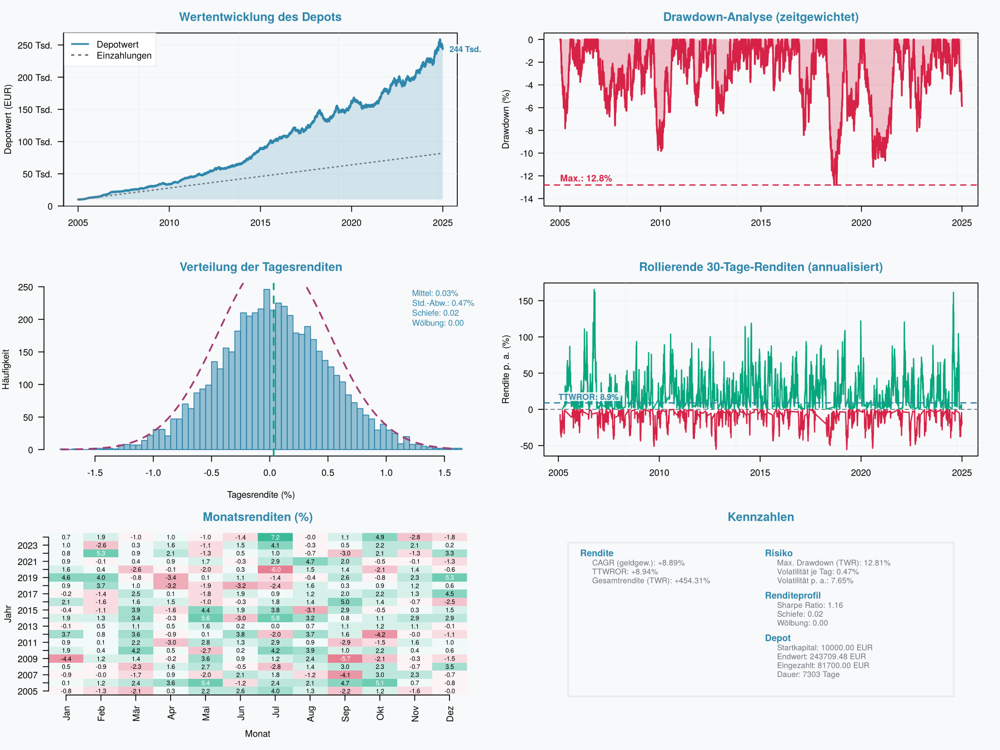

<p align="center">
  
</p>

<h1 align="center">SimLev</h1>

<p align="center">
  <strong>Simulation und Backtesting für Basis-, Hebel- und Multi-Asset-Strategien für Exchange Traded Products</strong><br>
  für <a href="r/">R</a> · <a href="python/">Python</a> · <a href="julia/">Julia</a>
</p>

---

**SimLev** rechnet Anlagestrategien auf täglichen Kursreihen durch, von der
einfachen Mischung aus Aktien- und Anleihe-ETF über Sparpläne und
Rebalancing bis zu signalgesteuerten Strategien mit gehebelten Produkten.
Der Unterschied zu gängigen Backtest-Werkzeugen ist die **detaillierte
Abbildung des deutschen Steuerrechts**: Vorabpauschale, Teilfreistellung,
Sparer-Pauschbetrag, getrennte Verlusttöpfe nach § 20 und § 23 EStG,
Kirchensteuer, Einkommensteuertarif und Günstigerprüfung werden Tag für Tag
mitgeführt. Um die Engine `simulation()` herum stehen Datenaufbereitung,
Auswertung, Bootstrap-Studien, Abhängigkeiten, Optimierung, Parametersuche
mit Prüfung auf Überanpassung, Planung, Entnahmephase und taktische
Allokation.

SimLev gibt es für R, Python und Julia mit denselben Funktionen, Argumenten
und Ergebnissen. Keine der drei Sprachen ist die „eigentliche“ Fassung: Die
Rechenkerne – die Engine von `simulation()`, Zufall, Verteilungen, lineare
Algebra, Optimierer, Modelle, Bootstrap und Steuertarif – liegen als
**gemeinsamer C/C++-Code** in [`core/`](core/), und alle drei Pakete rufen
denselben Code auf. Die Sprachpakete bilden die Schnittstelle darum:
Eingabeprüfung, Datenaufbereitung, Ablauf der Auswertungen, Ergebnisobjekte,
Druck und Grafik. Deshalb rechnen alle drei **bitgleich** (siehe
[Bitgleichheit](#bitgleichheit)). SimLev enthält
keinen Code aus fremden Paketen; die Verfahren und ihre Quellen stehen in
[`LITERATUR.md`](LITERATUR.md).

| Fassung | Ordner | Benötigt |
|---|---|---|
| **R** | [`r/`](r/) | R ≥ 4.0, C- und C++-Compiler, keine externen Pakete |
| **Python** | [`python/`](python/) | Python ≥ 3.10, `numpy`, `pandas`, C- und C++-Compiler |
| **Julia** | [`julia/`](julia/) | Julia ≥ 1.10, C- und C++-Compiler, nur die Standardbibliothek |

## Installation

SimLev wird nur über GitHub verteilt und bei der Installation aus dem
Quellcode übersetzt.

**R** (unter Windows mit [Rtools](https://cran.r-project.org/bin/windows/Rtools/),
unter macOS mit den Xcode Command Line Tools):

<!-- beispiele: nicht ausführen -->
``` r
# install.packages("remotes")
remotes::install_github("chemicalstats/SimLev-Repos", subdir = "r")
```

**Python** (baut die C-Erweiterung `simlev._ext`; unter Linux z. B. mit
`build-essential` und `python3-dev`):

``` bash
pip install "simlev @ git+https://github.com/chemicalstats/SimLev-Repos#subdirectory=python"
```

**Julia** (`Pkg.add` übersetzt die Bibliothek (C++) mit `deps/build.jl`; einen anderen
Compiler wählt `ENV["SIMLEV_CXX"]`):

<!-- beispiele: nicht ausführen -->
``` julia
using Pkg
Pkg.add(url = "https://github.com/chemicalstats/SimLev-Repos", subdir = "julia")
```

Beim ersten `using SimLev` kompiliert Julia das Paket einmalig vor; das
dauert einige Minuten. Einzelheiten stehen in den READMEs der Sprachordner.

> [!CAUTION]
> **Haftungsausschluss.** SimLev ist ein privates Hobbyprojekt. Nichts in
> diesem Repository ist eine Anlage-, Steuer- oder Rechtsberatung, eine
> Empfehlung oder ein Angebot zum Kauf oder Verkauf von Finanzprodukten.
> Der Code kann Fehler enthalten; Ergebnisse, Steuerberechnungen und
> Beispiele sind ohne Gewähr und können unvollständig oder falsch sein.
> Die abgebildete Rechtslage kann veraltet sein oder auf den Einzelfall
> nicht zutreffen. Simulationen und Backtests beruhen auf Annahmen und
> vergangenen bzw. synthetischen Daten und sind keine Prognose. Prüfe jedes
> Ergebnis selbst, recherchiere eigenständig und ziehe für Entscheidungen
> eine Fachperson hinzu (z. B. Steuerberatung). Die Nutzung erfolgt auf
> eigenes Risiko; es gilt der Gewährleistungs- und Haftungsausschluss der
> Lizenz (GPL-3.0, Abschnitte 15 und 16).

## Fallstudie: vier Anlageklassen von der Ansparphase bis zur Entnahme

Ein deutscher Privatanleger legt 10.000 EUR an und spart 20 Jahre lang
300 EUR im Monat. Danach will er 15 Jahre lang Geld aus dem Depot entnehmen. Er
fragt sich, ob er neben **Aktien** und **Anleihen** auch **Rohstoffe** und
**Managed Futures** (Trendfolgefonds) beimischen soll. Die Fallstudie geht
dieser Frage mit SimLev nach und vergleicht dazu eine breite Mischung aus
allen vier Anlageklassen mit der klassischen Mischung 60/40 aus Aktien und
Anleihen.

Aus der Ausgangsfrage ergeben sich mehrere Teilfragen. Am Anfang steht das
Fundament: Was steckt in den Daten, und stimmen sie mit ihren Annahmen
überein? Welche Produkte stehen für die vier Anlageklassen, und wie werden
sie besteuert? Danach geht es um die Ansparphase selbst – wie sich beide
Mischungen über 20 Jahre mit Sparplan, Kosten, Rebalancing und Steuer
entwickeln, wie viel die Steuer dabei nimmt, warum die breite Mischung mehr
zahlt als die klassische, und worin sich beide im Detail unterscheiden.

Ein einzelner Backtest beweist wenig. Deshalb wird das Ergebnis anschließend
auf die Probe gestellt: Hängt es an der einen Kursgeschichte, oder trägt es
auch über viele neu gezogene Pfade und verschiedene Marktregime? Halten die
Diversifikationseffekte, wenn die Aktien stark fallen? Welche Gewichte
schlagen gängige Optimierer vor, hilft ein Trendfilter auf den Aktienanteil,
und wie stark hängt das Ergebnis an der Art des Rebalancings – ohne dabei
einer Überanpassung aufzusitzen?

Zum Schluss richtet sich der Blick nach vorn: Mit welcher Wahrscheinlichkeit
wachsen 10.000 EUR und 3.600 EUR im Jahr in 20 Jahren auf 250.000 EUR, und
welche Mischung führt am ehesten dorthin? Und trägt das so angesparte Depot
eine Entnahme von 4 % im Jahr über 15 Jahre, und was kostet sie an Steuern?
Jeder der folgenden Abschnitte zeigt dazu den Code, das Ergebnis und eine
Einordnung.

> **Synthetische Daten.** Die Kurse sind keine Marktdaten. Rendite,
> Volatilität und Korrelation der vier Reihen sind hypothetische Annahmen
> zur Konstruktion eines Beispieldatensatzes (Abschnitt „Die Daten“); ihre
> Größenordnungen gelten als allgemein bekannt, sie bilden aber keinen
> realen Markt ab. Der Rest ist Zufall: Die Reihen haben keine Krisen,
> keine Regime und keine dicken Ränder. Alle Zahlen hier zeigen, *wie*
> SimLev rechnet, nicht, was ein Anleger erwarten kann.

<!-- beispiele: gleiche Ausgaben -->
Der Code steht in R, Python und Julia, jeweils aufklappbar. Alle Blöcke
einer Sprache laufen nacheinander in einer Sitzung. Die Ausgaben sind
echte Ausgaben und in allen drei Sprachen gleich;
`tests/werkzeuge/doku/beispiele.py` prüft beides.

- [Die Daten](#die-daten)
- [Anlageklassen und ihre Besteuerung](#anlageklassen-und-ihre-besteuerung)
- [Ansparphase mit `simulation()`](#ansparphase-mit-simulation)
- [Was die Steuer kostet](#was-die-steuer-kostet)
- [Auswertung und Dashboard](#auswertung-und-dashboard)
- [Robustheit: Bootstrap-Studie und Regime](#robustheit-bootstrap-studie-und-regime)
- [Abhängigkeiten in der Krise](#abhängigkeiten-in-der-krise)
- [Optimierung](#optimierung)
- [Parametersuche, Überanpassung und Sensitivität](#parametersuche-überanpassung-und-sensitivität)
- [Planung: Wird das Ziel erreicht?](#planung-wird-das-ziel-erreicht)
- [Entnahmephase mit Steuer](#entnahmephase-mit-steuer)
- [Ausblick](#ausblick)

### Die Daten

Die Datei `anlageklassen.csv` liegt jedem Paket bei (R:
`inst/extdata/`, Python: `simlev/data/`, Julia: `data/`). Sie enthält
Kurse an allen Werktagen vom 3. Januar 2005 bis 31. Dezember 2024, je
Reihe mit Startwert 100. Erzeugt hat sie das Skript
[`r/inst/extdata/anlageklassen.R`](r/inst/extdata/anlageklassen.R): tägliche
Logrenditen aus einer Normalverteilung, deren Mittelwert,
Standardabweichung und Korrelation über die 20 Jahre genau den folgenden
Vorgaben entsprechen. Die Vorgaben sind runde, hypothetische Annahmen zur
Konstruktion eines Beispieldatensatzes; ihre Größenordnungen gelten als
allgemein bekannt, sie sind kein Abbild realer Märkte. Die Kurse gelten
vereinfachend als EUR-Kurse.

| Spalte | Anlageklasse | Rendite p. a. | Volatilität p. a. |
|---|---|---:|---:|
| `AKTIEN` | Aktien | 9 % | 16 % |
| `ANLEIHEN` | Anleihen | 5 % | 6 % |
| `ROHSTOFFE` | Rohstoffe | 7 % | 16 % |
| `MFUTURES` | Managed Futures (Trendfolge) | 8 % | 10 % |

Angenommene Korrelationen: Aktien–Anleihen 0,10, Aktien–Rohstoffe 0,05,
Aktien–Managed Futures 0,00, Anleihen–Rohstoffe −0,15,
Anleihen–Managed Futures −0,05, Rohstoffe–Managed Futures 0,10.

SimLev erwartet eine Tabelle mit einer Spalte `date` und je Asset einer
Spalte mit dem Kursniveau. `series_check()` prüft sie auf Lücken, Sprünge
und mögliche Splits; `result_analysis()` wertet Kursreihen wie
Simulationsergebnisse aus. `zeige()` ist eine kleine Hilfsfunktion, die
Zahlen in allen drei Sprachen gleich druckt.

<details>
<summary><b>R</b></summary>

```r
library(SimLev)

datei  <- system.file("extdata", "anlageklassen.csv", package = "SimLev")
data   <- read.csv(datei)
data$date <- as.Date(data$date)
assets <- c("AKTIEN", "ANLEIHEN", "ROHSTOFFE", "MFUTURES")
zeige  <- function(...) { x <- c(...); cat(sprintf("%-30s %12.2f\n", names(x), x), sep = "") }

series_check(data)
reihen <- lapply(setNames(assets, assets), function(a) data.frame(date = data$date, value = data[[a]]))
result_analysis(reihen)
```

```text
SimLev-Datenprüfung

    column      start        end    n missing jumps spikes splits stale_max
    AKTIEN 2005-01-03 2024-12-31 5217       0     0      0      0         1
  ANLEIHEN 2005-01-03 2024-12-31 5217       0     0      0      0         1
 ROHSTOFFE 2005-01-03 2024-12-31 5217       0     0      0      0         1
  MFUTURES 2005-01-03 2024-12-31 5217       0     0      0      0         2
 nonpositive
           0
           0
           0
           0

Keine Auffälligkeiten.

══════════════════════════════════════════════════════════════
                    SimLev Detailanalyse
══════════════════════════════════════════════════════════════
  Zeitraum: 2005-01-03 bis 2024-12-31 (20.0 Jahre)

                                  AKTIEN    ANLEIHEN   ROHSTOFFE    MFUTURES
  Gesamtrendite                 460.44 %    165.33 %    286.97 %    366.10 %
  CAGR (TWR)                      9.00 %      5.00 %      7.00 %      8.00 %
  MWRR (geldgewichtet)                 –           –           –           –
  Volatilität p. a.              16.01 %      6.00 %     16.01 %     10.01 %
  Sharpe                           0.619       0.843       0.503       0.820
  Sortino                          0.903       1.248       0.734       1.213
  Calmar                           0.272       0.311       0.258       0.272
  Max. Drawdown                  33.08 %     16.11 %     27.13 %     29.45 %
...
```

</details>

<details>
<summary><b>Python</b></summary>

```python
import os
import struct
import numpy as np
import pandas as pd
import simlev

datei = os.path.join(os.path.dirname(simlev.__file__), "data", "anlageklassen.csv")
data = pd.read_csv(datei, parse_dates=["date"])
assets = ["AKTIEN", "ANLEIHEN", "ROHSTOFFE", "MFUTURES"]
def zeige(**x):
    for k, v in x.items():
        print(f"{k:<30s} {v:12.2f}")

print(simlev.series_check(data))
reihen = {a: pd.DataFrame({"date": data["date"], "value": data[a]}) for a in assets}
print(simlev.result_analysis(reihen))
```

```text
SimLev-Datenprüfung

    column      start        end    n missing jumps spikes splits stale_max
    AKTIEN 2005-01-03 2024-12-31 5217       0     0      0      0         1
  ANLEIHEN 2005-01-03 2024-12-31 5217       0     0      0      0         1
 ROHSTOFFE 2005-01-03 2024-12-31 5217       0     0      0      0         1
  MFUTURES 2005-01-03 2024-12-31 5217       0     0      0      0         2
 nonpositive
           0
           0
           0
           0

Keine Auffälligkeiten.

══════════════════════════════════════════════════════════════
                    SimLev Detailanalyse
══════════════════════════════════════════════════════════════
  Zeitraum: 2005-01-03 bis 2024-12-31 (20.0 Jahre)

                                  AKTIEN    ANLEIHEN   ROHSTOFFE    MFUTURES
  Gesamtrendite                 460.44 %    165.33 %    286.97 %    366.10 %
  CAGR (TWR)                      9.00 %      5.00 %      7.00 %      8.00 %
  MWRR (geldgewichtet)                 –           –           –           –
  Volatilität p. a.              16.01 %      6.00 %     16.01 %     10.01 %
  Sharpe                           0.619       0.843       0.503       0.820
  Sortino                          0.903       1.248       0.734       1.213
  Calmar                           0.272       0.311       0.258       0.272
  Max. Drawdown                  33.08 %     16.11 %     27.13 %     29.45 %
...
```

</details>

<details>
<summary><b>Julia</b></summary>

```julia
using SimLev, Dates, Printf

datei  = joinpath(pkgdir(SimLev), "data", "anlageklassen.csv")
zeilen = split.(readlines(datei)[2:end], ',')
assets = ["AKTIEN", "ANLEIHEN", "ROHSTOFFE", "MFUTURES"]
data   = RFrame("date" => Date.(first.(zeilen)),
                (a => parse.(Float64, getindex.(zeilen, j + 1)) for (j, a) in enumerate(assets))...)
zeige(; x...) = foreach(((k, v),) -> @printf("%-30s %12.2f\n", k, v), pairs(x))

display(series_check(data))
reihen = RList((a => RFrame("date" => data["date"], "value" => data[a]) for a in assets)...)
display(result_analysis(reihen))
```

```text
SimLev-Datenprüfung

    column      start        end    n missing jumps spikes splits stale_max
    AKTIEN 2005-01-03 2024-12-31 5217       0     0      0      0         1
  ANLEIHEN 2005-01-03 2024-12-31 5217       0     0      0      0         1
 ROHSTOFFE 2005-01-03 2024-12-31 5217       0     0      0      0         1
  MFUTURES 2005-01-03 2024-12-31 5217       0     0      0      0         2
 nonpositive
           0
           0
           0
           0

Keine Auffälligkeiten.

══════════════════════════════════════════════════════════════
                    SimLev Detailanalyse
══════════════════════════════════════════════════════════════
  Zeitraum: 2005-01-03 bis 2024-12-31 (20.0 Jahre)

                                  AKTIEN    ANLEIHEN   ROHSTOFFE    MFUTURES
  Gesamtrendite                 460.44 %    165.33 %    286.97 %    366.10 %
  CAGR (TWR)                      9.00 %      5.00 %      7.00 %      8.00 %
  MWRR (geldgewichtet)                 –           –           –           –
  Volatilität p. a.              16.01 %      6.00 %     16.01 %     10.01 %
  Sharpe                           0.619       0.843       0.503       0.820
  Sortino                          0.903       1.248       0.734       1.213
  Calmar                           0.272       0.311       0.258       0.272
  Max. Drawdown                  33.08 %     16.11 %     27.13 %     29.45 %
...
```

</details>

**Einordnung:** Die Daten sind lückenlos, und CAGR sowie
Volatilität treffen die Vorgaben bis auf 0,01 Prozentpunkte. Ohne
risikolosen Zins haben die Anleihen mit 0,843 die höchste Sharpe Ratio,
knapp vor den Managed Futures (0,820), und den kleinsten Drawdown
(16,11 %). Den tiefsten Drawdown haben die Aktien (33,08 %); bei den
Managed Futures (29,45 %) ist er trotz kleinerer Volatilität tiefer als bei
den Rohstoffen (27,13 %). Anders als CAGR und Volatilität ist der Drawdown
nicht vorgegeben, er folgt aus dem Verlauf der einen gezogenen Reihe.

### Anlageklassen und ihre Besteuerung

`asset_config()` beschreibt ein Asset, `create_strategy()` fasst die
Assets zusammen. Die Assetklasse bestimmt das Steuerregime:

| Asset | Produkt | `asset_class` | Steuerregime | Teilfreistellung |
|---|---|---|---|---:|
| `AKTIEN` | Aktien-ETF | `"etf"` | Investmentfonds (InvStG): Vorabpauschale | 30 % |
| `ANLEIHEN` | Anleihe-ETF | `"etf"` | Investmentfonds (InvStG): Vorabpauschale | 0 % |
| `ROHSTOFFE` | Rohstoff-ETC ohne Lieferanspruch | `"etc"` | § 20 EStG: Steuer nur auf realisierte Gewinne | – |
| `MFUTURES` | Managed-Futures-Fonds | `"etf"` | Investmentfonds (InvStG): Vorabpauschale | 0 % |

Die Mischung legt 40 % in Aktien, 30 % in Anleihen und je 15 % in
Rohstoffe und Managed Futures; zum Vergleich dient die klassische
Mischung 60/40 aus Aktien und Anleihen. Die Gewichte sind eine Annahme für
die Fallstudie, ebenso die Spreads (`spread`, voller Geld-Brief-Abstand in
Prozent).

<details>
<summary><b>R</b></summary>

```r
mix <- create_strategy(
  AKTIEN    = asset_config("etf", share = 0.40, spread = 0.10, partial_exemption = 30),
  ANLEIHEN  = asset_config("etf", share = 0.30, spread = 0.10),
  ROHSTOFFE = asset_config("etc", share = 0.15, spread = 0.20),
  MFUTURES  = asset_config("etf", share = 0.15, spread = 0.30)
)
klassisch <- create_strategy(
  AKTIEN   = asset_config("etf", share = 0.60, spread = 0.10, partial_exemption = 30),
  ANLEIHEN = asset_config("etf", share = 0.40, spread = 0.10)
)
mix
```

```text
Anlagestrategie (4 Assets)
================================

AKTIEN:
  Klasse: etf | Anteil: 40% | Steuer: investment_fund
ANLEIHEN:
  Klasse: etf | Anteil: 30% | Steuer: investment_fund
ROHSTOFFE:
  Klasse: etc | Anteil: 15% | Steuer: capital_gains
MFUTURES:
  Klasse: etf | Anteil: 15% | Steuer: investment_fund
```

</details>

<details>
<summary><b>Python</b></summary>

```python
mix = simlev.create_strategy(
    AKTIEN=simlev.asset_config(asset_class="etf", share=0.40, spread=0.10, partial_exemption=30),
    ANLEIHEN=simlev.asset_config(asset_class="etf", share=0.30, spread=0.10),
    ROHSTOFFE=simlev.asset_config(asset_class="etc", share=0.15, spread=0.20),
    MFUTURES=simlev.asset_config(asset_class="etf", share=0.15, spread=0.30),
)
klassisch = simlev.create_strategy(
    AKTIEN=simlev.asset_config(asset_class="etf", share=0.60, spread=0.10, partial_exemption=30),
    ANLEIHEN=simlev.asset_config(asset_class="etf", share=0.40, spread=0.10),
)
print(mix)
```

```text
Anlagestrategie (4 Assets)
================================

AKTIEN:
  Klasse: etf | Anteil: 40% | Steuer: investment_fund
ANLEIHEN:
  Klasse: etf | Anteil: 30% | Steuer: investment_fund
ROHSTOFFE:
  Klasse: etc | Anteil: 15% | Steuer: capital_gains
MFUTURES:
  Klasse: etf | Anteil: 15% | Steuer: investment_fund
```

</details>

<details>
<summary><b>Julia</b></summary>

```julia
mix = create_strategy(
    AKTIEN    = asset_config("etf"; share = 0.40, spread = 0.10, partial_exemption = 30),
    ANLEIHEN  = asset_config("etf"; share = 0.30, spread = 0.10),
    ROHSTOFFE = asset_config("etc"; share = 0.15, spread = 0.20),
    MFUTURES  = asset_config("etf"; share = 0.15, spread = 0.30),
)
klassisch = create_strategy(
    AKTIEN   = asset_config("etf"; share = 0.60, spread = 0.10, partial_exemption = 30),
    ANLEIHEN = asset_config("etf"; share = 0.40, spread = 0.10),
)
display(mix)
```

```text
Anlagestrategie (4 Assets)
================================

AKTIEN:
  Klasse: etf | Anteil: 40% | Steuer: investment_fund
ANLEIHEN:
  Klasse: etf | Anteil: 30% | Steuer: investment_fund
ROHSTOFFE:
  Klasse: etc | Anteil: 15% | Steuer: capital_gains
MFUTURES:
  Klasse: etf | Anteil: 15% | Steuer: investment_fund
```

</details>

**Einordnung:** SimLev leitet das Steuerregime aus der
Assetklasse ab: Die drei Fonds laufen unter `investment_fund`, der
Rohstoff-ETC unter `capital_gains`. Ein ETC mit Lieferanspruch auf
physisches Gold (`deliverable = TRUE`) fiele unter § 23 EStG und wäre nach
einem Jahr steuerfrei; zu einem breiten Rohstoffindex passt das nicht.

### Ansparphase mit `simulation()`

`simulation()` nimmt die Bausteine als eigene Objekte: `sim_costs()` für
Ordergebühren (hier 1 EUR je Order, Sparplanraten ohne Gebühr),
`dca_plan()` für den Sparplan (300 EUR im Monat), `rebalance_plan()` für das
Umschichten (einmal im Jahr, aber nur bei mehr als 5 Prozentpunkten
Abweichung) und `tax_profile()` für die Steuer: Abgeltungsteuer mit
Solidaritätszuschlag (26,375 %), Sparer-Pauschbetrag 1.000 EUR und
Vorabpauschale mit einem angenommenen Basiszins von 2,5 % für alle Jahre.

<details>
<summary><b>R</b></summary>

```r
steuer <- tax_profile(base_rate = 2.5)
anspar <- function(strategie, tax = steuer, rebalance = rebalance_plan(1, unit = "year", thresh = 5)) {
  simulation(data, strategie, start_value = 10000,
             costs     = sim_costs(order_fee = 1, dca_fee = 0),
             dca       = dca_plan(300, 1, unit = "month"),
             rebalance = rebalance,
             tax       = tax)
}
res_mix <- anspar(mix)
res_kl  <- anspar(klassisch)
res_mix
```

```text
══════════════════════════════════════════════════════════════
                 SimLev Simulationsergebnisse
══════════════════════════════════════════════════════════════

  Wertentwicklung
  ─────────────────────
  CAGR:             +7.43% (geldgewichtet, XIRR)
  TTWROR:           +7.58% (zeitgewichtet)
  Endwert:          201375.05 EUR
  Eingezahlt:       81700.00 EUR (Start + Sparraten)

  Risiko (zeitgewichtet, ohne Einzahlungseffekte)
  ─────────────────────
  Max. Drawdown:    12.59%
  Mittl. Drawdown:  3.48%
  Ulcer Index:      0.0427
  Längster DD:      712 Tage
  Mittl. Erholung:  30 Tage

  Kennzahlen
  ─────────────────────
  Sharpe:           +1.016
  Sortino:          +1.519
  Calmar:           +0.602
  Omega:            +1.171
  Gain/Pain:        +0.171
  Serenity:         +14.076
  Martin Ratio:     +1.773
  (Calmar, Serenity, Martin mit TTWROR)

  Verteilung
  ─────────────────────
  Mittel je Tag:    +0.0291%
  Std.-Abw. je Tag: 0.4622%
  Schiefe:          0.023
  Wölbung:          -0.012

  Steuern
  ─────────────────────
  Gezahlte Steuern: 6716.09 EUR
  Verlustvortrag:   0.00 EUR (§ 20) / 0.00 EUR (§ 23)
  SPB genutzt:      13768.74 EUR (Ersparnis: 3631.51 EUR)

══════════════════════════════════════════════════════════════
```

</details>

<details>
<summary><b>Python</b></summary>

```python
steuer = simlev.tax_profile(base_rate=2.5)
def anspar(strategie, tax=steuer, rebalance=simlev.rebalance_plan(span=1, unit="year", thresh=5)):
    return simlev.simulation(data, strategie, start_value=10000,
                             costs=simlev.sim_costs(order_fee=1, dca_fee=0),
                             dca=simlev.dca_plan(300, 1, unit="month"),
                             rebalance=rebalance,
                             tax=tax)
res_mix = anspar(mix)
res_kl = anspar(klassisch)
print(res_mix)
```

```text
══════════════════════════════════════════════════════════════
                 SimLev Simulationsergebnisse
══════════════════════════════════════════════════════════════

  Wertentwicklung
  ─────────────────────
  CAGR:             +7.43% (geldgewichtet, XIRR)
  TTWROR:           +7.58% (zeitgewichtet)
  Endwert:          201375.05 EUR
  Eingezahlt:       81700.00 EUR (Start + Sparraten)

  Risiko (zeitgewichtet, ohne Einzahlungseffekte)
  ─────────────────────
  Max. Drawdown:    12.59%
  Mittl. Drawdown:  3.48%
  Ulcer Index:      0.0427
  Längster DD:      712 Tage
  Mittl. Erholung:  30 Tage

  Kennzahlen
  ─────────────────────
  Sharpe:           +1.016
  Sortino:          +1.519
  Calmar:           +0.602
  Omega:            +1.171
  Gain/Pain:        +0.171
  Serenity:         +14.076
  Martin Ratio:     +1.773
  (Calmar, Serenity, Martin mit TTWROR)

  Verteilung
  ─────────────────────
  Mittel je Tag:    +0.0291%
  Std.-Abw. je Tag: 0.4622%
  Schiefe:          0.023
  Wölbung:          -0.012

  Steuern
  ─────────────────────
  Gezahlte Steuern: 6716.09 EUR
  Verlustvortrag:   0.00 EUR (§ 20) / 0.00 EUR (§ 23)
  SPB genutzt:      13768.74 EUR (Ersparnis: 3631.51 EUR)

══════════════════════════════════════════════════════════════
```

</details>

<details>
<summary><b>Julia</b></summary>

```julia
steuer = tax_profile(; base_rate = 2.5)
anspar(strategie; tax = steuer, rebalance = rebalance_plan(1; unit = "year", thresh = 5)) =
    simulation(data, strategie; start_value = 10000,
               costs     = sim_costs(; order_fee = 1, dca_fee = 0),
               dca       = dca_plan(300, 1; unit = "month"),
               rebalance = rebalance,
               tax       = tax)
res_mix = anspar(mix)
res_kl  = anspar(klassisch)
display(res_mix)
```

```text
══════════════════════════════════════════════════════════════
                 SimLev Simulationsergebnisse
══════════════════════════════════════════════════════════════

  Wertentwicklung
  ─────────────────────
  CAGR:             +7.43% (geldgewichtet, XIRR)
  TTWROR:           +7.58% (zeitgewichtet)
  Endwert:          201375.05 EUR
  Eingezahlt:       81700.00 EUR (Start + Sparraten)

  Risiko (zeitgewichtet, ohne Einzahlungseffekte)
  ─────────────────────
  Max. Drawdown:    12.59%
  Mittl. Drawdown:  3.48%
  Ulcer Index:      0.0427
  Längster DD:      712 Tage
  Mittl. Erholung:  30 Tage

  Kennzahlen
  ─────────────────────
  Sharpe:           +1.016
  Sortino:          +1.519
  Calmar:           +0.602
  Omega:            +1.171
  Gain/Pain:        +0.171
  Serenity:         +14.076
  Martin Ratio:     +1.773
  (Calmar, Serenity, Martin mit TTWROR)

  Verteilung
  ─────────────────────
  Mittel je Tag:    +0.0291%
  Std.-Abw. je Tag: 0.4622%
  Schiefe:          0.023
  Wölbung:          -0.012

  Steuern
  ─────────────────────
  Gezahlte Steuern: 6716.09 EUR
  Verlustvortrag:   0.00 EUR (§ 20) / 0.00 EUR (§ 23)
  SPB genutzt:      13768.74 EUR (Ersparnis: 3631.51 EUR)

══════════════════════════════════════════════════════════════
```

</details>

**Einordnung:** Aus 81.700 EUR Einzahlungen werden 201.375 EUR,
eine geldgewichtete Rendite (XIRR) von 7,43 % p. a. Der größte Rückgang
des zeitgewichteten Wertindex beträgt 12,59 %. Bis zum Ende der
Ansparphase hat die Mischung 6.716 EUR Steuern gezahlt; der
Sparer-Pauschbetrag hat 13.769 EUR Erträge freigestellt und 3.632 EUR
Steuer gespart. Die Gewinne, die noch im Depot stecken, sind dabei noch
nicht versteuert.

### Was die Steuer kostet

Ein Lauf ohne Steuer (`tax = NULL`) zeigt den Unterschied, zwei Läufe
ohne Rebalancing (`rebalance = NULL`) die Rolle des Umschichtens. Mit
`liquidate = TRUE` würde SimLev am letzten Tag alles verkaufen und
versteuern; hier bleibt das Depot stehen, denn es geht in die
Entnahmephase (Abschnitt „Entnahmephase mit Steuer“) über, und zwar mit seinen offenen Lots.

<details>
<summary><b>R</b></summary>

```r
ohne <- anspar(mix, tax = NULL)
zeige(Endwert_ohne_Steuer      = tail(ohne$worth, 1),
      Endwert_mit_Steuer       = tail(res_mix$worth, 1),
      Steuern_Mischung         = res_mix$tax_report$total_taxes_paid,
      Steuern_60_40            = res_kl$tax_report$total_taxes_paid,
      Steuern_Mischung_ohne_Reb = anspar(mix, rebalance = NULL)$tax_report$total_taxes_paid,
      Steuern_60_40_ohne_Reb   = anspar(klassisch, rebalance = NULL)$tax_report$total_taxes_paid)
```

```text
Endwert_ohne_Steuer               210345.41
Endwert_mit_Steuer                201375.05
Steuern_Mischung                    6716.09
Steuern_60_40                       3237.10
Steuern_Mischung_ohne_Reb            935.39
Steuern_60_40_ohne_Reb              1200.41
```

</details>

<details>
<summary><b>Python</b></summary>

```python
ohne = anspar(mix, tax=None)
zeige(Endwert_ohne_Steuer=ohne.worth[-1],
      Endwert_mit_Steuer=res_mix.worth[-1],
      Steuern_Mischung=res_mix.tax_report["total_taxes_paid"],
      Steuern_60_40=res_kl.tax_report["total_taxes_paid"],
      Steuern_Mischung_ohne_Reb=anspar(mix, rebalance=None).tax_report["total_taxes_paid"],
      Steuern_60_40_ohne_Reb=anspar(klassisch, rebalance=None).tax_report["total_taxes_paid"])
```

```text
Endwert_ohne_Steuer               210345.41
Endwert_mit_Steuer                201375.05
Steuern_Mischung                    6716.09
Steuern_60_40                       3237.10
Steuern_Mischung_ohne_Reb            935.39
Steuern_60_40_ohne_Reb              1200.41
```

</details>

<details>
<summary><b>Julia</b></summary>

```julia
ohne = anspar(mix; tax = nothing)
zeige(Endwert_ohne_Steuer  = ohne.worth[end],
      Endwert_mit_Steuer   = res_mix.worth[end],
      Steuern_Mischung     = res_mix.tax_report.total_taxes_paid,
      Steuern_60_40        = res_kl.tax_report.total_taxes_paid,
      Steuern_Mischung_ohne_Reb = anspar(mix; rebalance = nothing).tax_report.total_taxes_paid,
      Steuern_60_40_ohne_Reb    = anspar(klassisch; rebalance = nothing).tax_report.total_taxes_paid)
```

```text
Endwert_ohne_Steuer               210345.41
Endwert_mit_Steuer                201375.05
Steuern_Mischung                    6716.09
Steuern_60_40                       3237.10
Steuern_Mischung_ohne_Reb            935.39
Steuern_60_40_ohne_Reb              1200.41
```

</details>

**Einordnung:** Ohne Steuer stünden am Ende 210.345 EUR im
Depot, 8.970 EUR mehr. Die Mischung zahlt mehr als doppelt so viel Steuer
wie 60/40 (6.716 gegen 3.237 EUR). Das liegt am Rebalancing: Ohne
Umschichten zahlt die Mischung sogar weniger als 60/40 (935 gegen
1.200 EUR). Rebalancing verkauft, was gestiegen ist, und realisiert damit
Gewinne; die des Rohstoff-ETC sind ohne Teilfreistellung voll
steuerpflichtig. Mit
`income = income_tariff()` und `guenstigerpruefung = TRUE` rechnet
`simulation()` die Veranlagung mit dem Einkommensteuertarif je Jahr
(`tax_report$tariff_years`); Abschnitt „Entnahmephase mit Steuer“ nutzt das für die
Entnahmephase.

### Auswertung und Dashboard

`result_analysis()` stellt Ergebnisse nebeneinander, mit einer Benchmark
auch Alpha, Beta und Capture-Werte; das Dashboard zeichnet `plot(res_mix)` (R),
`res_mix.plot()` (Python) bzw. `plot_dashboard(res_mix)` (Julia).

<details>
<summary><b>R</b></summary>

```r
da <- result_analysis(list(klassisch = res_kl, mix = res_mix), benchmark = "klassisch")
da
plot(res_mix)
```

```text
══════════════════════════════════════════════════════════════
                    SimLev Detailanalyse
══════════════════════════════════════════════════════════════
  Zeitraum: 2005-01-03 bis 2024-12-31 (20.0 Jahre)

                               klassisch         mix
  Gesamtrendite                 323.25 %    330.70 %
  CAGR (TWR)                      7.48 %      7.58 %
  MWRR (geldgewichtet)            6.72 %      7.43 %
  Volatilität p. a.              10.25 %      7.47 %
  Sharpe                           0.756       1.016
  Sortino                          1.112       1.519
  Calmar                           0.372       0.602
  Max. Drawdown                  20.10 %     12.59 %
...
  Steuern                          3 237       6 716

  Gegen Benchmark 'klassisch'
                                     mix
  Alpha p. a.                     2.44 %
  Beta                             0.664
  Korrelation                      0.912
  R²                               0.832
  Up-Capture                       0.748
  Down-Capture                     0.569
  Capture Spread                   0.179
  Aktive Rendite p. a.            0.09 %
  Tracking Error                  4.60 %
  Information Ratio               -0.035
  M² (Modigliani)                10.41 %
══════════════════════════════════════════════════════════════
```

</details>

<details>
<summary><b>Python</b></summary>

```python
da = simlev.result_analysis({"klassisch": res_kl, "mix": res_mix}, benchmark="klassisch")
print(da)
res_mix.plot()
```

```text
══════════════════════════════════════════════════════════════
                    SimLev Detailanalyse
══════════════════════════════════════════════════════════════
  Zeitraum: 2005-01-03 bis 2024-12-31 (20.0 Jahre)

                               klassisch         mix
  Gesamtrendite                 323.25 %    330.70 %
  CAGR (TWR)                      7.48 %      7.58 %
  MWRR (geldgewichtet)            6.72 %      7.43 %
  Volatilität p. a.              10.25 %      7.47 %
  Sharpe                           0.756       1.016
  Sortino                          1.112       1.519
  Calmar                           0.372       0.602
  Max. Drawdown                  20.10 %     12.59 %
...
  Steuern                          3 237       6 716

  Gegen Benchmark 'klassisch'
                                     mix
  Alpha p. a.                     2.44 %
  Beta                             0.664
  Korrelation                      0.912
  R²                               0.832
  Up-Capture                       0.748
  Down-Capture                     0.569
  Capture Spread                   0.179
  Aktive Rendite p. a.            0.09 %
  Tracking Error                  4.60 %
  Information Ratio               -0.035
  M² (Modigliani)                10.41 %
══════════════════════════════════════════════════════════════
```

</details>

<details>
<summary><b>Julia</b></summary>

```julia
da = result_analysis(RList("klassisch" => res_kl, "mix" => res_mix); benchmark = "klassisch")
display(da)
plot_dashboard(res_mix)
```

```text
══════════════════════════════════════════════════════════════
                    SimLev Detailanalyse
══════════════════════════════════════════════════════════════
  Zeitraum: 2005-01-03 bis 2024-12-31 (20.0 Jahre)

                               klassisch         mix
  Gesamtrendite                 323.25 %    330.70 %
  CAGR (TWR)                      7.48 %      7.58 %
  MWRR (geldgewichtet)            6.72 %      7.43 %
  Volatilität p. a.              10.25 %      7.47 %
  Sharpe                           0.756       1.016
  Sortino                          1.112       1.519
  Calmar                           0.372       0.602
  Max. Drawdown                  20.10 %     12.59 %
...
  Steuern                          3 237       6 716

  Gegen Benchmark 'klassisch'
                                     mix
  Alpha p. a.                     2.44 %
  Beta                             0.664
  Korrelation                      0.912
  R²                               0.832
  Up-Capture                       0.748
  Down-Capture                     0.569
  Capture Spread                   0.179
  Aktive Rendite p. a.            0.09 %
  Tracking Error                  4.60 %
  Information Ratio               -0.035
  M² (Modigliani)                10.41 %
══════════════════════════════════════════════════════════════
```

</details>

<p align="center">
  
</p>

**Einordnung:** Die Mischung schwankt weniger als 60/40
(Volatilität 7,47 % gegen 10,25 %, größter Rückgang 12,59 % gegen 20,10 %)
und hat die höhere Sharpe Ratio (1,016 gegen 0,756). Die zeitgewichtete
Rendite ist etwas höher (7,58 % gegen 7,48 % p. a.), die geldgewichtete
ebenfalls (7,43 % gegen 6,72 %). Gegenüber 60/40 fängt sie
57 % der Verluste, aber 75 % der Gewinne ein (Down- und Up-Capture); das
Beta liegt bei 0,66. Das Dashboard zeigt Depotwert und Einzahlungen,
Drawdowns, die Verteilung der Tagesrenditen, rollierende Renditen,
Monatsrenditen und die wichtigsten Kennzahlen.

### Robustheit: Bootstrap-Studie und Regime

`bootstrap_study()` zieht neue Pfade aus den Tagesrenditen (hier
stationärer Bootstrap mit mittlerer Blocklänge 250 Tage, 100 Pfade) und
rechnet beide Mischungen mit denselben Bausteinen auf denselben Pfaden.
`dates = data$date` gibt den Pfaden den Werktagskalender der Daten; ohne
ihn wären es aufeinanderfolgende Kalendertage, und die Jahresrenditen wären
zu hoch. `keep_returns = "year"` behält die Jahresrenditen für die
Entnahmephase. `bootstrap_probability()` zählt Pfade, die eine Bedingung
erfüllen.

<details>
<summary><b>R</b></summary>

```r
cfg <- bootstrap_config(setNames(assets, assets), input = "prices")
study <- bootstrap_study(data, cfg, "stationary", n = 100, params = list(L = 250),
  dates = data$date, strategies = list(klassisch = klassisch, mix = mix),
  sim_args = list(start_value = 10000, costs = sim_costs(order_fee = 1, dca_fee = 0),
                  dca = dca_plan(300, 1, unit = "month"),
                  rebalance = rebalance_plan(1, unit = "year", thresh = 5), tax = steuer),
  seed = 1, keep_returns = "year", progress = FALSE)
summary(study)
p <- bootstrap_probability(study, max_drawdown > 0.2)
zeige(P_Drawdown_ueber_20_klassisch = p$probability[1], P_Drawdown_ueber_20_mix = p$probability[2])
```

```text
══════════════════════════════════════════════════════════════
                 SimLev Bootstrap-Studie
══════════════════════════════════════════════════════════════
  Verfahren: stationary | Pfade: 100 | Pfadlänge: 5216 Tage

  cagr (mit Sparplan geldgewichtet, XIRR)
  Strategie          Mittel        q05       q25       q50       q75       q95
  klassisch           7.28%      3.98%     6.09%     7.02%     8.56%    10.89%
  mix                 7.50%      5.38%     6.63%     7.37%     8.29%    10.13%

  ttwror
  Strategie          Mittel        q05       q25       q50       q75       q95
  klassisch           7.30%      4.32%     6.03%     7.28%     8.22%    10.86%
  mix                 7.54%      5.18%     6.67%     7.45%     8.38%    10.58%

  max_drawdown
  Strategie          Mittel        q05       q25       q50       q75       q95
  klassisch          22.28%     15.40%    19.39%    20.66%    25.15%    31.53%
  mix                13.96%     10.47%    11.98%    13.25%    15.83%    18.72%

  sharpe
  Strategie          Mittel        q05       q25       q50       q75       q95
  klassisch           0.737      0.458     0.619     0.737     0.823     1.051
  mix                 1.002      0.722     0.898     1.007     1.103     1.371

...
  final_value
  Strategie          Mittel        q05       q25       q50       q75       q95
  klassisch          206786     130469    169627    191183    233484    318221
  mix                207569     155174    181776    199866    225262    287257
══════════════════════════════════════════════════════════════
P_Drawdown_ueber_20_klassisch          0.62
P_Drawdown_ueber_20_mix                0.03
```

</details>

<details>
<summary><b>Python</b></summary>

```python
cfg = simlev.bootstrap_config({a: a for a in assets}, input="prices")
study = simlev.bootstrap_study(data, cfg, "stationary", n=100, params={"L": 250},
    dates=data["date"], strategies={"klassisch": klassisch, "mix": mix},
    sim_args={"start_value": 10000, "costs": simlev.sim_costs(order_fee=1, dca_fee=0),
              "dca": simlev.dca_plan(300, 1, unit="month"),
              "rebalance": simlev.rebalance_plan(span=1, unit="year", thresh=5), "tax": steuer},
    seed=1, keep_returns="year", progress=False)
print(simlev.summary(study))
p = simlev.bootstrap_probability(study, "max_drawdown > 0.2")
zeige(P_Drawdown_ueber_20_klassisch=p["probability"][0], P_Drawdown_ueber_20_mix=p["probability"][1])
```

```text
══════════════════════════════════════════════════════════════
                 SimLev Bootstrap-Studie
══════════════════════════════════════════════════════════════
  Verfahren: stationary | Pfade: 100 | Pfadlänge: 5216 Tage

  cagr (mit Sparplan geldgewichtet, XIRR)
  Strategie          Mittel        q05       q25       q50       q75       q95
  klassisch           7.28%      3.98%     6.09%     7.02%     8.56%    10.89%
  mix                 7.50%      5.38%     6.63%     7.37%     8.29%    10.13%

  ttwror
  Strategie          Mittel        q05       q25       q50       q75       q95
  klassisch           7.30%      4.32%     6.03%     7.28%     8.22%    10.86%
  mix                 7.54%      5.18%     6.67%     7.45%     8.38%    10.58%

  max_drawdown
  Strategie          Mittel        q05       q25       q50       q75       q95
  klassisch          22.28%     15.40%    19.39%    20.66%    25.15%    31.53%
  mix                13.96%     10.47%    11.98%    13.25%    15.83%    18.72%

  sharpe
  Strategie          Mittel        q05       q25       q50       q75       q95
  klassisch           0.737      0.458     0.619     0.737     0.823     1.051
  mix                 1.002      0.722     0.898     1.007     1.103     1.371

...
  final_value
  Strategie          Mittel        q05       q25       q50       q75       q95
  klassisch          206786     130469    169627    191183    233484    318221
  mix                207569     155174    181776    199866    225262    287257
══════════════════════════════════════════════════════════════
P_Drawdown_ueber_20_klassisch          0.62
P_Drawdown_ueber_20_mix                0.03
```

</details>

<details>
<summary><b>Julia</b></summary>

```julia
cfg = bootstrap_config(RList((a => a for a in assets)...); input = "prices")
study = bootstrap_study(data, cfg, "stationary"; n = 100, params = (L = 250,),
    dates = data["date"], strategies = (klassisch = klassisch, mix = mix),
    sim_args = (start_value = 10000, costs = sim_costs(; order_fee = 1, dca_fee = 0),
                dca = dca_plan(300, 1; unit = "month"),
                rebalance = rebalance_plan(1; unit = "year", thresh = 5), tax = steuer),
    seed = 1, keep_returns = "year", progress = false)
display(r_summary(study))
p = bootstrap_probability(study, "max_drawdown > 0.2")
zeige(P_Drawdown_ueber_20_klassisch = p["probability"][1], P_Drawdown_ueber_20_mix = p["probability"][2])
```

```text
══════════════════════════════════════════════════════════════
                 SimLev Bootstrap-Studie
══════════════════════════════════════════════════════════════
  Verfahren: stationary | Pfade: 100 | Pfadlänge: 5216 Tage

  cagr (mit Sparplan geldgewichtet, XIRR)
  Strategie          Mittel        q05       q25       q50       q75       q95
  klassisch           7.28%      3.98%     6.09%     7.02%     8.56%    10.89%
  mix                 7.50%      5.38%     6.63%     7.37%     8.29%    10.13%

  ttwror
  Strategie          Mittel        q05       q25       q50       q75       q95
  klassisch           7.30%      4.32%     6.03%     7.28%     8.22%    10.86%
  mix                 7.54%      5.18%     6.67%     7.45%     8.38%    10.58%

  max_drawdown
  Strategie          Mittel        q05       q25       q50       q75       q95
  klassisch          22.28%     15.40%    19.39%    20.66%    25.15%    31.53%
  mix                13.96%     10.47%    11.98%    13.25%    15.83%    18.72%

  sharpe
  Strategie          Mittel        q05       q25       q50       q75       q95
  klassisch           0.737      0.458     0.619     0.737     0.823     1.051
  mix                 1.002      0.722     0.898     1.007     1.103     1.371

...
  final_value
  Strategie          Mittel        q05       q25       q50       q75       q95
  klassisch          206786     130469    169627    191183    233484    318221
  mix                207569     155174    181776    199866    225262    287257
══════════════════════════════════════════════════════════════
P_Drawdown_ueber_20_klassisch          0.62
P_Drawdown_ueber_20_mix                0.03
```

</details>

Über 100 Pfade bleibt das Bild aus Abschnitt „Ansparphase mit `simulation()`“
bestehen: Die Mischung hat in allen gezeigten Quantilen die höhere Sharpe
Ratio und den kleineren größten Rückgang (im 95-%-Quantil 18,72 % gegen
31,53 %). Einen Rückgang von mehr als 20 % erleben 62 % der Pfade von
60/40, aber nur 3 % der Pfade der Mischung. Auch bei der Rendite liegt die
Mischung im Median leicht vorn (XIRR 7,37 % gegen 7,02 %); 60/40 streut
breiter (5-%-Quantil 3,98 % gegen 5,38 %, 95-%-Quantil 10,89 % gegen
10,13 %). Der echte Lauf der Mischung (7,43 %) liegt zwischen Median und
75-%-Quantil.

Der Bootstrap setzt Blöcke der einen Geschichte neu zusammen; Zustände, die
in den Daten fehlen, erzeugt er nicht. Ob die Daten Regime enthalten, also
Phasen mit eigener Rendite und Volatilität, prüft `regime_hmm()` mit einem
Hidden-Markov-Modell auf den Wochenrenditen:

<details>
<summary><b>R</b></summary>

```r
regime_hmm(data, "AKTIEN")
```

```text
Hidden-Markov-Modell: 2 Zustände auf AKTIEN (week), 1043 Perioden, logL 2485.6, BIC -4922.6

  Z1: Anteil 3 %, erwartete Dauer 7.3 Perioden, Rendite -76.8 % p. a., Vola 9.6 %
  Z2: Anteil 97 %, erwartete Dauer 277.4 Perioden, Rendite 11.3 % p. a., Vola 16.2 %

Übergangsmatrix
      Z1    Z2
Z1 0.863 0.137
Z2 0.004 0.996

Aktueller Zustand (gefiltert): Z2 mit 98 %
```

</details>

<details>
<summary><b>Python</b></summary>

```python
print(simlev.regime_hmm(data, "AKTIEN"))
```

```text
Hidden-Markov-Modell: 2 Zustände auf AKTIEN (week), 1043 Perioden, logL 2485.6, BIC -4922.6

  Z1: Anteil 3 %, erwartete Dauer 7.3 Perioden, Rendite -76.8 % p. a., Vola 9.6 %
  Z2: Anteil 97 %, erwartete Dauer 277.4 Perioden, Rendite 11.3 % p. a., Vola 16.2 %

Übergangsmatrix
      Z1    Z2
Z1 0.863 0.137
Z2 0.004 0.996

Aktueller Zustand (gefiltert): Z2 mit 98 %
```

</details>

<details>
<summary><b>Julia</b></summary>

```julia
display(regime_hmm(data, "AKTIEN"))
```

```text
Hidden-Markov-Modell: 2 Zustände auf AKTIEN (week), 1043 Perioden, logL 2485.6, BIC -4922.6

  Z1: Anteil 3 %, erwartete Dauer 7.3 Perioden, Rendite -76.8 % p. a., Vola 9.6 %
  Z2: Anteil 97 %, erwartete Dauer 277.4 Perioden, Rendite 11.3 % p. a., Vola 16.2 %

Übergangsmatrix
      Z1    Z2
Z1 0.863 0.137
Z2 0.004 0.996

Aktueller Zustand (gefiltert): Z2 mit 98 %
```

</details>

**Einordnung:** Das Modell findet einen Zustand Z1 mit 3 % der
Wochen und einer Rendite von −76,8 % p. a. Die Daten haben aber nach
ihrer Konstruktion kein Regime: Z1 fasst nur rund 30 schwache Wochen
zusammen. Ein Modell mit zwei Zuständen liefert immer zwei Zustände; ob sie
mehr als Rauschen sind, ist eine eigene Frage, etwa nach ihrer Stabilität
über Teilperioden. Für Daten mit echten Regimen hat `bootstrap_study()`
die Verfahren `regime` und `ms_garch`.

### Abhängigkeiten in der Krise

`dependence_analysis()` misst auf Wochenrenditen die Korrelation, die
Tail-Abhängigkeit je Paar (empirisch und über angepasste Copulas) und eine
zeitvariable Korrelation (DCC).

<details>
<summary><b>R</b></summary>

```r
dependence_analysis(data, assets, B = 99, seed = 1)
```

```text
SimLev Abhängigkeitsanalyse: 1043 Perioden (week), 2005-01-14 bis 2024-12-31

Korrelation (Pearson unten links, Kendall oben rechts)
          AKTIEN ANLEIHEN ROHSTOFFE MFUTURES
AKTIEN     1.000    0.061     0.062   -0.016
ANLEIHEN   0.088    1.000    -0.078   -0.042
ROHSTOFFE  0.099   -0.136     1.000    0.050
MFUTURES  -0.024   -0.064     0.077    1.000

Tail-Abhängigkeit je Paar
                 Paar Kendall lamL 0.05 lamU 0.05 lamL 0.1 lamU 0.1     Copula
    AKTIEN ~ ANLEIHEN   0.061      0.10      0.08     0.12     0.09      frank
   AKTIEN ~ ROHSTOFFE   0.062      0.12      0.08     0.17     0.10    clayton
    AKTIEN ~ MFUTURES  -0.016      0.08      0.04     0.11     0.12 gumbel_270
 ANLEIHEN ~ ROHSTOFFE  -0.078      0.02      0.02     0.06     0.05   gaussian
  ANLEIHEN ~ MFUTURES  -0.042      0.04      0.04     0.07     0.12 clayton_90
 ROHSTOFFE ~ MFUTURES   0.050      0.10      0.06     0.12     0.15 gumbel_180
 Cop. lamL Cop. lamU     t: rho/nu
      0.00      0.00  0.09 / 189.0
      0.01      0.00  0.10 / 175.7
      0.00      0.00  -0.03 / 58.2
      0.00      0.00  -0.13 / 57.4
      0.00      0.00 -0.07 / 500.0
      0.06      0.00  0.08 / 500.0
  (Unabhängigkeit: lam(q) ~ q; Gauß-Abhängigkeit: lam -> 0 für kleine q)

DCC(1,1): a = 0.0018, b = 0.9757 (Persistenz 0.9775); Korrelation zuletzt: AKTIEN ~ ANLEIHEN 0.10, AKTIEN ~ ROHSTOFFE 0.11, AKTIEN ~ MFUTURES -0.02, ANLEIHEN ~ ROHSTOFFE -0.15, ANLEIHEN ~ MFUTURES -0.05, ROHSTOFFE ~ MFUTURES 0.07
```

</details>

<details>
<summary><b>Python</b></summary>

```python
print(simlev.dependence_analysis(data, assets, B=99, seed=1))
```

```text
SimLev Abhängigkeitsanalyse: 1043 Perioden (week), 2005-01-14 bis 2024-12-31

Korrelation (Pearson unten links, Kendall oben rechts)
          AKTIEN ANLEIHEN ROHSTOFFE MFUTURES
AKTIEN     1.000    0.061     0.062   -0.016
ANLEIHEN   0.088    1.000    -0.078   -0.042
ROHSTOFFE  0.099   -0.136     1.000    0.050
MFUTURES  -0.024   -0.064     0.077    1.000

Tail-Abhängigkeit je Paar
                 Paar Kendall lamL 0.05 lamU 0.05 lamL 0.1 lamU 0.1     Copula
    AKTIEN ~ ANLEIHEN   0.061      0.10      0.08     0.12     0.09      frank
   AKTIEN ~ ROHSTOFFE   0.062      0.12      0.08     0.17     0.10    clayton
    AKTIEN ~ MFUTURES  -0.016      0.08      0.04     0.11     0.12 gumbel_270
 ANLEIHEN ~ ROHSTOFFE  -0.078      0.02      0.02     0.06     0.05   gaussian
  ANLEIHEN ~ MFUTURES  -0.042      0.04      0.04     0.07     0.12 clayton_90
 ROHSTOFFE ~ MFUTURES   0.050      0.10      0.06     0.12     0.15 gumbel_180
 Cop. lamL Cop. lamU     t: rho/nu
      0.00      0.00  0.09 / 189.0
      0.01      0.00  0.10 / 175.7
      0.00      0.00  -0.03 / 58.2
      0.00      0.00  -0.13 / 57.4
      0.00      0.00 -0.07 / 500.0
      0.06      0.00  0.08 / 500.0
  (Unabhängigkeit: lam(q) ~ q; Gauß-Abhängigkeit: lam -> 0 für kleine q)

DCC(1,1): a = 0.0018, b = 0.9757 (Persistenz 0.9775); Korrelation zuletzt: AKTIEN ~ ANLEIHEN 0.10, AKTIEN ~ ROHSTOFFE 0.11, AKTIEN ~ MFUTURES -0.02, ANLEIHEN ~ ROHSTOFFE -0.15, ANLEIHEN ~ MFUTURES -0.05, ROHSTOFFE ~ MFUTURES 0.07
```

</details>

<details>
<summary><b>Julia</b></summary>

```julia
display(dependence_analysis(data, assets; B = 99, seed = 1))
```

```text
SimLev Abhängigkeitsanalyse: 1043 Perioden (week), 2005-01-14 bis 2024-12-31

Korrelation (Pearson unten links, Kendall oben rechts)
          AKTIEN ANLEIHEN ROHSTOFFE MFUTURES
AKTIEN     1.000    0.061     0.062   -0.016
ANLEIHEN   0.088    1.000    -0.078   -0.042
ROHSTOFFE  0.099   -0.136     1.000    0.050
MFUTURES  -0.024   -0.064     0.077    1.000

Tail-Abhängigkeit je Paar
                 Paar Kendall lamL 0.05 lamU 0.05 lamL 0.1 lamU 0.1     Copula
    AKTIEN ~ ANLEIHEN   0.061      0.10      0.08     0.12     0.09      frank
   AKTIEN ~ ROHSTOFFE   0.062      0.12      0.08     0.17     0.10    clayton
    AKTIEN ~ MFUTURES  -0.016      0.08      0.04     0.11     0.12 gumbel_270
 ANLEIHEN ~ ROHSTOFFE  -0.078      0.02      0.02     0.06     0.05   gaussian
  ANLEIHEN ~ MFUTURES  -0.042      0.04      0.04     0.07     0.12 clayton_90
 ROHSTOFFE ~ MFUTURES   0.050      0.10      0.06     0.12     0.15 gumbel_180
 Cop. lamL Cop. lamU     t: rho/nu
      0.00      0.00  0.09 / 189.0
      0.01      0.00  0.10 / 175.7
      0.00      0.00  -0.03 / 58.2
      0.00      0.00  -0.13 / 57.4
      0.00      0.00 -0.07 / 500.0
      0.06      0.00  0.08 / 500.0
  (Unabhängigkeit: lam(q) ~ q; Gauß-Abhängigkeit: lam -> 0 für kleine q)

DCC(1,1): a = 0.0018, b = 0.9757 (Persistenz 0.9775); Korrelation zuletzt: AKTIEN ~ ANLEIHEN 0.10, AKTIEN ~ ROHSTOFFE 0.11, AKTIEN ~ MFUTURES -0.02, ANLEIHEN ~ ROHSTOFFE -0.15, ANLEIHEN ~ MFUTURES -0.05, ROHSTOFFE ~ MFUTURES 0.07
```

</details>

**Einordnung:** Die Korrelationen der Wochenrenditen liegen nahe
an den Vorgaben. Für die Krise zählen die Ränder: Die
geschätzte Tail-Abhängigkeit der Copulas ist fast überall 0, die
t-Copula landet bei ν zwischen 57 und 500 und ist damit nahe an der
Gauß-Copula, und die DCC-Korrelation ist mit a = 0,0018 nahezu konstant.
Das entspricht der Konstruktion der Daten: Eine gemeinsame
Normalverteilung hat keine Randabhängigkeit, und die Korrelation ist fest.
Die Diversifikation hält hier also auch in schlechten Wochen; das ist eine
Eigenschaft der synthetischen Daten, keine Aussage über Märkte. Mit echten
Kursen ist genau diese Analyse der Prüfstein, ob eine Beimischung in der
Krise hilft.

### Optimierung

`portfolio_optimize()` schätzt Gewichte aus Wochenrenditen. Zuerst die
Mischung mit der höchsten Sharpe Ratio:

<details>
<summary><b>R</b></summary>

```r
portfolio_optimize(data, assets = assets, method = "max_sharpe")
```

```text
SimLev-Optimierung: max_sharpe (1043 Perioden, week, Kovarianz sample)

    Anlage Gewicht Risikoanteil
    AKTIEN  10.3 %       15.0 %
  ANLEIHEN  51.8 %       38.8 %
 ROHSTOFFE  10.8 %       13.2 %
  MFUTURES  27.1 %       33.0 %

Erwartete Rendite 6.71 % p. a. (historisch), Volatilität 4.78 %, Sharpe 1.405
CVaR(0.05) 1.21 % je Periode, CDaR(0.05) 4.32 % (kumuliert)
Diversifikationsverhältnis 1.96, effektive Anzahl: Gewichte 2.7, Risiko 3.3
```

</details>

<details>
<summary><b>Python</b></summary>

```python
print(simlev.portfolio_optimize(data, assets=assets, method="max_sharpe"))
```

```text
SimLev-Optimierung: max_sharpe (1043 Perioden, week, Kovarianz sample)

    Anlage Gewicht Risikoanteil
    AKTIEN  10.3 %       15.0 %
  ANLEIHEN  51.8 %       38.8 %
 ROHSTOFFE  10.8 %       13.2 %
  MFUTURES  27.1 %       33.0 %

Erwartete Rendite 6.71 % p. a. (historisch), Volatilität 4.78 %, Sharpe 1.405
CVaR(0.05) 1.21 % je Periode, CDaR(0.05) 4.32 % (kumuliert)
Diversifikationsverhältnis 1.96, effektive Anzahl: Gewichte 2.7, Risiko 3.3
```

</details>

<details>
<summary><b>Julia</b></summary>

```julia
display(portfolio_optimize(data; assets = assets, method = "max_sharpe"))
```

```text
SimLev-Optimierung: max_sharpe (1043 Perioden, week, Kovarianz sample)

    Anlage Gewicht Risikoanteil
    AKTIEN  10.3 %       15.0 %
  ANLEIHEN  51.8 %       38.8 %
 ROHSTOFFE  10.8 %       13.2 %
  MFUTURES  27.1 %       33.0 %

Erwartete Rendite 6.71 % p. a. (historisch), Volatilität 4.78 %, Sharpe 1.405
CVaR(0.05) 1.21 % je Periode, CDaR(0.05) 4.32 % (kumuliert)
Diversifikationsverhältnis 1.96, effektive Anzahl: Gewichte 2.7, Risiko 3.3
```

</details>

Der Optimierer legt 51,8 % in Anleihen und 27,1 % in Managed Futures,
Aktien und Rohstoffe erhalten je rund 10 %. Er übernimmt die Kennzahlen
der Daten als Erwartung, und dort haben Anleihen und Managed Futures die
höchsten Sharpe Ratios (Abschnitt „Die Daten“). Die
Risikoparität dagegen verlangt von jeder Anlageklasse denselben Beitrag
zum Risiko und braucht keine Renditeschätzung:

<details>
<summary><b>R</b></summary>

```r
portfolio_optimize(data, assets = assets, method = "risk_parity")
```

```text
SimLev-Optimierung: risk_parity (1043 Perioden, week, Kovarianz sample)

    Anlage Gewicht Risikoanteil
    AKTIEN  14.5 %       25.0 %
  ANLEIHEN  45.1 %       25.0 %
 ROHSTOFFE  15.6 %       25.0 %
  MFUTURES  24.9 %       25.0 %

Erwartete Rendite 6.99 % p. a. (historisch), Volatilität 5.11 %, Sharpe 1.368
CVaR(0.05) 1.31 % je Periode, CDaR(0.05) 4.84 % (kumuliert)
Diversifikationsverhältnis 1.99, effektive Anzahl: Gewichte 3.2, Risiko 4.0
```

</details>

<details>
<summary><b>Python</b></summary>

```python
print(simlev.portfolio_optimize(data, assets=assets, method="risk_parity"))
```

```text
SimLev-Optimierung: risk_parity (1043 Perioden, week, Kovarianz sample)

    Anlage Gewicht Risikoanteil
    AKTIEN  14.5 %       25.0 %
  ANLEIHEN  45.1 %       25.0 %
 ROHSTOFFE  15.6 %       25.0 %
  MFUTURES  24.9 %       25.0 %

Erwartete Rendite 6.99 % p. a. (historisch), Volatilität 5.11 %, Sharpe 1.368
CVaR(0.05) 1.31 % je Periode, CDaR(0.05) 4.84 % (kumuliert)
Diversifikationsverhältnis 1.99, effektive Anzahl: Gewichte 3.2, Risiko 4.0
```

</details>

<details>
<summary><b>Julia</b></summary>

```julia
display(portfolio_optimize(data; assets = assets, method = "risk_parity"))
```

```text
SimLev-Optimierung: risk_parity (1043 Perioden, week, Kovarianz sample)

    Anlage Gewicht Risikoanteil
    AKTIEN  14.5 %       25.0 %
  ANLEIHEN  45.1 %       25.0 %
 ROHSTOFFE  15.6 %       25.0 %
  MFUTURES  24.9 %       25.0 %

Erwartete Rendite 6.99 % p. a. (historisch), Volatilität 5.11 %, Sharpe 1.368
CVaR(0.05) 1.31 % je Periode, CDaR(0.05) 4.84 % (kumuliert)
Diversifikationsverhältnis 1.99, effektive Anzahl: Gewichte 3.2, Risiko 4.0
```

</details>

**Einordnung:** Auch die Risikoparität legt den größten Teil in
Anleihen (45,1 %), weil sie am wenigsten schwanken; jede Anlageklasse
trägt 25 % zum Risiko bei. Aktien erhalten mit 14,5 % das kleinste
Gewicht, knapp vor den Rohstoffen (15,6 %). Wer andere Erwartungen hat als
die Kennzahlen der Daten, gibt sie vor (`mu` in
`portfolio_optimize()`) oder nutzt Szenarien
(`scenario_entropy_pooling()`); `portfolio_frontier()` zeigt die ganze
Effizienzkurve.

### Parametersuche, Überanpassung und Sensitivität

`param_search()` rechnet eine Strategie für jeden Punkt eines
Parameterraums, hier einen Aktien-ETF, der über dem gleitenden
Durchschnitt von `n` Tagen gehalten und darunter verkauft wird
(`signal_sma()`). `sharpe_deflated()` korrigiert die beste Sharpe Ratio um
die Zahl der Versuche, `overfit_pbo()` schätzt die Wahrscheinlichkeit, dass
die Auswahl des besten Punkts überangepasst ist.

<details>
<summary><b>R</b></summary>

```r
trend <- create_strategy(AKTIEN = asset_config("etf", trading = "signal", spread = 0.10,
  partial_exemption = 30, signal_buy = "buy", signal_sell = "sell"))
ps <- param_search(data,
  builder = function(p) list(strategy = trend, signal = function(df) signal_sma(df$AKTIEN, p$n)),
  space = param_space(n = c(20, 50, 100, 150, 200, 250, 300)),
  sim_args = list(tax = steuer), objective = "sharpe")
ps
sharpe_deflated(ps)
overfit_pbo(ps)
halten <- simulation(data, create_strategy(AKTIEN = asset_config("etf", spread = 0.10, partial_exemption = 30)),
                     tax = steuer)
zeige(Sharpe_Halten = halten$statistics$sharpe, CAGR_Halten_Prozent = 100 * halten$cagr)
```

```text
...
Zielgröße: sharpe

 id   n   cagr max_drawdown sharpe ulcer_index trades plateau
  2  50 7.22 %      25.11 %  0.623       0.100 18.157   0.455
  3 100 5.07 %      29.66 %  0.452       0.131 13.105   0.454
  7 300 4.50 %      29.92 %  0.397       0.163  7.453   0.384
  6 250 4.07 %      31.21 %  0.371       0.169  7.853   0.372
  5 200 3.75 %      29.17 %  0.347       0.156  8.854   0.334
  1  20 2.87 %      36.76 %  0.289       0.150 32.713   0.456
  4 150 2.88 %      31.17 %  0.285       0.180 12.655   0.362
cagr: mit Sparplan geldgewichtet (XIRR), sonst CAGR des Depotwerts

Bester Punkt:   #2 (n = 50), sharpe = 0.623
Bestes Plateau: #1 (n = 20), sharpe = 0.289, Nachbarschaft = 0.456
Deflated Sharpe Ratio
  Punkt #2, 1044 Beobachtungen (week)
  Sharpe Ratio (p. a.):                 0.619
  Versuche: 7 nominal, 2.1 effektiv (mittlere Korrelation 0.82), verwendet 2.1
  Erwartetes Maximum ohne Können (p. a.):  0.065
  PSR (SR > 0):                         99.7 %
  DSR (SR > erwartetes Maximum):        99.4 %
  Lesart: DSR über 95 % = Ergebnis hält der Mehrfachtest-Korrektur stand.
Probability of Backtest Overfitting (PBO, CSCV)
  7 Punkte, 1040 Beobachtungen (week), S = 16 Blöcke, 12870 Aufteilungen, Kennzahl sharpe
  PBO:                              5.0 %
  Median-Logit lambda:              1.95
  Leistungsabfall (Steigung OOS~IS): -1.01
  OOS-Verlustwahrscheinlichkeit:    1.2 %
  Gewählter Punkt OOS vor Median:   95.0 %
  Lesart: PBO nahe 0 = Auswahl trägt, um 57 % = Zufall (ungerade Punktezahl: (N + 1) / (2N)), darüber = Auswahl schadet.
Sharpe_Halten                          0.62
CAGR_Halten_Prozent                    9.00
```

</details>

<details>
<summary><b>Python</b></summary>

```python
trend = simlev.create_strategy(AKTIEN=simlev.asset_config(asset_class="etf", trading="signal", spread=0.10,
    partial_exemption=30, signal_buy="buy", signal_sell="sell"))
ps = simlev.param_search(data,
    builder=lambda p: {"strategy": trend, "signal": lambda df: simlev.signal_sma(df["AKTIEN"], n=p["n"])},
    space=simlev.param_space(n=[20, 50, 100, 150, 200, 250, 300]),
    sim_args={"tax": steuer}, objective="sharpe")
print(ps)
print(simlev.sharpe_deflated(ps))
print(simlev.overfit_pbo(ps))
halten = simlev.simulation(data, simlev.create_strategy(AKTIEN=simlev.asset_config(asset_class="etf", spread=0.10,
                           partial_exemption=30)), tax=steuer)
zeige(Sharpe_Halten=halten.statistics["sharpe"], CAGR_Halten_Prozent=100 * halten.cagr)
```

```text
...
Zielgröße: sharpe

 id   n   cagr max_drawdown sharpe ulcer_index trades plateau
  2  50 7.22 %      25.11 %  0.623       0.100 18.157   0.455
  3 100 5.07 %      29.66 %  0.452       0.131 13.105   0.454
  7 300 4.50 %      29.92 %  0.397       0.163  7.453   0.384
  6 250 4.07 %      31.21 %  0.371       0.169  7.853   0.372
  5 200 3.75 %      29.17 %  0.347       0.156  8.854   0.334
  1  20 2.87 %      36.76 %  0.289       0.150 32.713   0.456
  4 150 2.88 %      31.17 %  0.285       0.180 12.655   0.362
cagr: mit Sparplan geldgewichtet (XIRR), sonst CAGR des Depotwerts

Bester Punkt:   #2 (n = 50), sharpe = 0.623
Bestes Plateau: #1 (n = 20), sharpe = 0.289, Nachbarschaft = 0.456
Deflated Sharpe Ratio
  Punkt #2, 1044 Beobachtungen (week)
  Sharpe Ratio (p. a.):                 0.619
  Versuche: 7 nominal, 2.1 effektiv (mittlere Korrelation 0.82), verwendet 2.1
  Erwartetes Maximum ohne Können (p. a.):  0.065
  PSR (SR > 0):                         99.7 %
  DSR (SR > erwartetes Maximum):        99.4 %
  Lesart: DSR über 95 % = Ergebnis hält der Mehrfachtest-Korrektur stand.
Probability of Backtest Overfitting (PBO, CSCV)
  7 Punkte, 1040 Beobachtungen (week), S = 16 Blöcke, 12870 Aufteilungen, Kennzahl sharpe
  PBO:                              5.0 %
  Median-Logit lambda:              1.95
  Leistungsabfall (Steigung OOS~IS): -1.01
  OOS-Verlustwahrscheinlichkeit:    1.2 %
  Gewählter Punkt OOS vor Median:   95.0 %
  Lesart: PBO nahe 0 = Auswahl trägt, um 57 % = Zufall (ungerade Punktezahl: (N + 1) / (2N)), darüber = Auswahl schadet.
Sharpe_Halten                          0.62
CAGR_Halten_Prozent                    9.00
```

</details>

<details>
<summary><b>Julia</b></summary>

```julia
trend = create_strategy(AKTIEN = asset_config("etf", "signal"; spread = 0.10,
    partial_exemption = 30, signal_buy = "buy", signal_sell = "sell"))
ps = param_search(data;
    builder = p -> (strategy = trend, signal = df -> signal_sma(df["AKTIEN"], p["n"])),
    space = param_space(n = [20, 50, 100, 150, 200, 250, 300]),
    sim_args = (tax = steuer,), objective = "sharpe")
display(ps)
display(sharpe_deflated(ps))
display(overfit_pbo(ps))
halten = simulation(data, create_strategy(AKTIEN = asset_config("etf"; spread = 0.10, partial_exemption = 30));
                    tax = steuer)
zeige(Sharpe_Halten = halten.statistics["sharpe"], CAGR_Halten_Prozent = 100 * halten.cagr)
```

```text
...
Zielgröße: sharpe

 id   n   cagr max_drawdown sharpe ulcer_index trades plateau
  2  50 7.22 %      25.11 %  0.623       0.100 18.157   0.455
  3 100 5.07 %      29.66 %  0.452       0.131 13.105   0.454
  7 300 4.50 %      29.92 %  0.397       0.163  7.453   0.384
  6 250 4.07 %      31.21 %  0.371       0.169  7.853   0.372
  5 200 3.75 %      29.17 %  0.347       0.156  8.854   0.334
  1  20 2.87 %      36.76 %  0.289       0.150 32.713   0.456
  4 150 2.88 %      31.17 %  0.285       0.180 12.655   0.362
cagr: mit Sparplan geldgewichtet (XIRR), sonst CAGR des Depotwerts

Bester Punkt:   #2 (n = 50), sharpe = 0.623
Bestes Plateau: #1 (n = 20), sharpe = 0.289, Nachbarschaft = 0.456
Deflated Sharpe Ratio
  Punkt #2, 1044 Beobachtungen (week)
  Sharpe Ratio (p. a.):                 0.619
  Versuche: 7 nominal, 2.1 effektiv (mittlere Korrelation 0.82), verwendet 2.1
  Erwartetes Maximum ohne Können (p. a.):  0.065
  PSR (SR > 0):                         99.7 %
  DSR (SR > erwartetes Maximum):        99.4 %
  Lesart: DSR über 95 % = Ergebnis hält der Mehrfachtest-Korrektur stand.
Probability of Backtest Overfitting (PBO, CSCV)
  7 Punkte, 1040 Beobachtungen (week), S = 16 Blöcke, 12870 Aufteilungen, Kennzahl sharpe
  PBO:                              5.0 %
  Median-Logit lambda:              1.95
  Leistungsabfall (Steigung OOS~IS): -1.01
  OOS-Verlustwahrscheinlichkeit:    1.2 %
  Gewählter Punkt OOS vor Median:   95.0 %
  Lesart: PBO nahe 0 = Auswahl trägt, um 57 % = Zufall (ungerade Punktezahl: (N + 1) / (2N)), darüber = Auswahl schadet.
Sharpe_Halten                          0.62
CAGR_Halten_Prozent                    9.00
```

</details>

Der beste Filter (n = 50) erreicht eine Sharpe
Ratio von 0,623, das reine Halten des Aktien-ETF unter denselben
Bedingungen 0,62, bei einer CAGR von 9,00 % statt 7,22 %. Bei der Sharpe
Ratio liegt der Filter also gleichauf, bei der Rendite klar hinter dem
Halten. Das passt zu den Daten: Sie enthalten keinen
Trend, den ein Filter ausnutzen könnte. Die beiden Prüfungen auf
Überanpassung schlagen trotzdem nicht an, und das ist kein Widerspruch.
Die Deflated Sharpe Ratio prüft, ob die beste Sharpe Ratio über dem
Wert liegt, den sieben Versuche ohne jedes Können erwarten ließen (0,065
p. a.); mit 0,619 tut sie das klar (DSR 99,4 %). Die PBO von 5,0 % sagt,
dass die im Ausschnitt beste Variante meist auch außerhalb davon vorn
liegt. Beide Prüfungen vergleichen gegen null bzw. die geprüften Varianten
untereinander; den Vergleich mit dem Halten muss man selbst anstellen.

Die zweite Stellschraube ist das Rebalancing. `sensitivity_rebalancing()`
rechnet die Mischung (hier nur mit 10.000 EUR Einmalanlage) für mehrere
Rhythmen mit und ohne Toleranzband von 5 Prozentpunkten:

<details>
<summary><b>R</b></summary>

```r
sensitivity_rebalancing(data, mix,
  frequencies = list(monat = c("month", 1), quartal = c("quarter", 1), jahr = c("year", 1)),
  bands = c(NA, 5), sim_args = list(start_value = 10000, tax = steuer))
```

```text
Toleranzbänder: absolut (Prozentpunkte)
 frequency offset band   cagr max_drawdown sharpe ulcer_index  taxes trades
     monat     NA    - 7.52 %      13.47 %  1.012       0.045 2261.8   48.9
     monat     NA    5 7.66 %      12.92 %  1.018       0.044  669.2    2.2
   quartal     NA    - 7.71 %      13.01 %  1.034       0.044 1912.3   16.9
   quartal     NA    5 7.72 %      12.78 %  1.020       0.045  778.5    2.2
      jahr     NA    - 7.79 %      12.58 %  1.042       0.044  480.9    4.9
      jahr     NA    5 7.72 %      12.34 %  1.035       0.042  689.6    1.6
      none     NA    - 7.59 %      17.97 %  0.866       0.061    0.0    0.3
cagr: mit Sparplan geldgewichtet (XIRR), sonst CAGR des Depotwerts
```

</details>

<details>
<summary><b>Python</b></summary>

```python
print(simlev.sensitivity_rebalancing(data, mix,
    frequencies={"monat": ["month", 1], "quartal": ["quarter", 1], "jahr": ["year", 1]},
    bands=[np.nan, 5], sim_args={"start_value": 10000, "tax": steuer}))
```

```text
Toleranzbänder: absolut (Prozentpunkte)
 frequency offset band   cagr max_drawdown sharpe ulcer_index  taxes trades
     monat     NA    - 7.52 %      13.47 %  1.012       0.045 2261.8   48.9
     monat     NA    5 7.66 %      12.92 %  1.018       0.044  669.2    2.2
   quartal     NA    - 7.71 %      13.01 %  1.034       0.044 1912.3   16.9
   quartal     NA    5 7.72 %      12.78 %  1.020       0.045  778.5    2.2
      jahr     NA    - 7.79 %      12.58 %  1.042       0.044  480.9    4.9
      jahr     NA    5 7.72 %      12.34 %  1.035       0.042  689.6    1.6
      none     NA    - 7.59 %      17.97 %  0.866       0.061    0.0    0.3
cagr: mit Sparplan geldgewichtet (XIRR), sonst CAGR des Depotwerts
```

</details>

<details>
<summary><b>Julia</b></summary>

```julia
display(sensitivity_rebalancing(data, mix;
    frequencies = RList("monat" => ("month", 1), "quartal" => ("quarter", 1), "jahr" => ("year", 1)),
    bands = [missing, 5], sim_args = (start_value = 10000, tax = steuer)))
```

```text
Toleranzbänder: absolut (Prozentpunkte)
 frequency offset band   cagr max_drawdown sharpe ulcer_index  taxes trades
     monat     NA    - 7.52 %      13.47 %  1.012       0.045 2261.8   48.9
     monat     NA    5 7.66 %      12.92 %  1.018       0.044  669.2    2.2
   quartal     NA    - 7.71 %      13.01 %  1.034       0.044 1912.3   16.9
   quartal     NA    5 7.72 %      12.78 %  1.020       0.045  778.5    2.2
      jahr     NA    - 7.79 %      12.58 %  1.042       0.044  480.9    4.9
      jahr     NA    5 7.72 %      12.34 %  1.035       0.042  689.6    1.6
      none     NA    - 7.59 %      17.97 %  0.866       0.061    0.0    0.3
cagr: mit Sparplan geldgewichtet (XIRR), sonst CAGR des Depotwerts
```

</details>

**Einordnung:** Ohne Rebalancing (`none`) fällt die Sharpe Ratio auf
0,866, und der größte Rückgang steigt auf 17,97 %. Häufiges Umschichten
hält das Risiko klein, kostet aber Steuern: monatlich ohne Band
2.262 EUR. Die Sharpe Ratio liegt bei allen Rhythmen mit Rebalancing
zwischen 1,012 und 1,042. Monatlich und vierteljährlich senkt das
Toleranzband die Zahl der Umschichtungen und die Steuer deutlich (auf
669 bzw. 779 EUR), bei kaum veränderten Kennzahlen; jährlich senkt es die
Zahl der Umschichtungen (1,6 gegen 4,9), die Steuer aber steigt (690 gegen
481 EUR). Das jährliche Rebalancing mit Band aus Abschnitt „Ansparphase
mit `simulation()`“ hat den kleinsten größten Rückgang (12,34 %) und die
wenigsten Umschichtungen, aber weder die höchste Sharpe Ratio noch die
niedrigste Steuer.

### Planung: Wird das Ziel erreicht?

`portfolio_returns()` bildet die Jahresrenditen fester Mischungen aus den
Daten, `planning_goal()` sucht darauf die beste Mischung für das Ziel, auch
mit Wechsel von Jahr zu Jahr (dynamische Programmierung nach Das u. a.
2020). Die Rechnung ist vor Steuern und Kosten.

<details>
<summary><b>R</b></summary>

```r
kandidaten <- list(klassisch = c(AKTIEN = 0.6, ANLEIHEN = 0.4),
                   mix       = c(AKTIEN = 0.4, ANLEIHEN = 0.3, ROHSTOFFE = 0.15, MFUTURES = 0.15),
                   aktien    = c(AKTIEN = 1))
planning_goal(portfolio_returns(data, kandidaten), start_value = 10000, goal = 250000,
              horizon = 20, contributions = 3600, seed = 1)
```

```text
Zielplanung: Ziel 250 000 in 20 Perioden, Start 10 000, Zahlungen 3 600 je Periode
Zielwahrscheinlichkeit dynamisch: 60.9 % (Vorwärtssimulation, SE 0.7 Prozentpunkte; DP-Wert 62.1 %)
Bester fester Kandidat: aktien mit 55.8 %

klassisch       mix    aktien
     33.9      36.9      55.8

Wahl im ersten Schritt: aktien
```

</details>

<details>
<summary><b>Python</b></summary>

```python
kandidaten = {"klassisch": {"AKTIEN": 0.6, "ANLEIHEN": 0.4},
              "mix": {"AKTIEN": 0.4, "ANLEIHEN": 0.3, "ROHSTOFFE": 0.15, "MFUTURES": 0.15},
              "aktien": {"AKTIEN": 1}}
print(simlev.planning_goal(simlev.portfolio_returns(data, kandidaten), start_value=10000, goal=250000,
                           horizon=20, contributions=3600, seed=1))
```

```text
Zielplanung: Ziel 250 000 in 20 Perioden, Start 10 000, Zahlungen 3 600 je Periode
Zielwahrscheinlichkeit dynamisch: 60.9 % (Vorwärtssimulation, SE 0.7 Prozentpunkte; DP-Wert 62.1 %)
Bester fester Kandidat: aktien mit 55.8 %

klassisch       mix    aktien
     33.9      36.9      55.8

Wahl im ersten Schritt: aktien
```

</details>

<details>
<summary><b>Julia</b></summary>

```julia
kandidaten = RList("klassisch" => (AKTIEN = 0.6, ANLEIHEN = 0.4),
                   "mix"       => (AKTIEN = 0.4, ANLEIHEN = 0.3, ROHSTOFFE = 0.15, MFUTURES = 0.15),
                   "aktien"    => (AKTIEN = 1,))
display(planning_goal(portfolio_returns(data, kandidaten), 10000, 250000, 20;
                      contributions = 3600, seed = 1))
```

```text
Zielplanung: Ziel 250 000 in 20 Perioden, Start 10 000, Zahlungen 3 600 je Periode
Zielwahrscheinlichkeit dynamisch: 60.9 % (Vorwärtssimulation, SE 0.7 Prozentpunkte; DP-Wert 62.1 %)
Bester fester Kandidat: aktien mit 55.8 %

klassisch       mix    aktien
     33.9      36.9      55.8

Wahl im ersten Schritt: aktien
```

</details>

**Einordnung:** Mit fester Mischung erreichen 60/40 und die
Mischung das Ziel in 33,9 % bzw. 36,9 % der Fälle, reine Aktien in
55,8 %. Für ein hohes Ziel zählt die Rendite mehr als die Schwankung. Wer
die Mischung jedes Jahr nach dem erreichten Vermögen neu wählt, kommt auf
60,9 % und beginnt mit Aktien. Die Rechnung kennt nur die Jahresrenditen
der Daten, keine Steuern und keine Kosten; der echte Lauf der Mischung
endete in Abschnitt „Ansparphase mit `simulation()`“ nach Steuern bei 201.375 EUR.

### Entnahmephase mit Steuer

`withdrawal_simulation()` rechnet auf den Jahresrenditen der
Bootstrap-Pfade aus Abschnitt „Robustheit: Bootstrap-Studie und Regime“ (Strategie `mix`). Als Startvermögen dient
das Ergebnis der Ansparphase: SimLev übernimmt Depotwert und
Anschaffungskosten der offenen Lots und verkauft nach FIFO. Die
Entnahmephase führt das Depot vereinfacht als einen Bestand:
Teilfreistellung (hier das Mittel 0,4 × 30 % = 12 %), Vorabpauschale und
Verkaufskosten gelten für alles, Ordergebühren entfallen; SimLev weist
darauf mit Warnungen hin. Die Regel `"constant"` entnimmt im ersten
Jahr 4 % und danach denselben realen Betrag (Inflation hier 2 % p. a.).
Der Vergleich mit Günstigerprüfung nimmt ein zu versteuerndes Einkommen
von 15.000 EUR im Jahr an, etwa aus einer Rente.

<details>
<summary><b>R</b></summary>

```r
entnahme <- function(tax) {
  withdrawal_simulation(study, withdrawal_rule("constant", rate = 4), strategy = "mix",
                        years = 15, inflation = 2, start_value = res_mix,
                        partial_exemption = 12, sale_cost = 0.15, base_rate = 2.5, tax = tax)
}
wd <- entnahme(tax_profile())
wd
wd_gp <- entnahme(tax_profile(guenstigerpruefung = TRUE, income = income_tariff(15000)))
wd_gp
```

```text
══════════════════════════════════════════════════════════════
                 SimLev Entnahme-Simulation
══════════════════════════════════════════════════════════════

  Regel:            Konstante reale Entnahme (Bengen/Trinity)
  Pfade:            100 Pfade über 15 Jahre, Startvermögen 201375
  Steuern:          deutsche Privatperson (vereinfacht)

  Erfolgsquote:     100.0 % (Depot reicht für alle geplanten Entnahmen)
  Kapitalerhalt:    11.0 % (reales Endvermögen >= Start)
  SWR (5-%-Quantil PWR): 6.92 % der Startsumme

  real, in Startkaufkraft            q05       q25       q50       q75       q95
  Endvermögen                      78194    112625    136476    162412    225257
  Entnahme Jahr 1                   8055      8055      8055      8055      8055
  Konsum Jahr 1                     8055      8055      8055      8055      8055
  Konsum Jahr 10                    8055      8055      8055      8055      8055
  Konsum Jahr 20                       –         –         –         –         –
  Konsum Jahr 30                       –         –         –         –         –
  Konsum Durchschnitt               8055      8055      8055      8055      8055
  Konsum Minimum                    8055      8055      8055      8055      8055
  Sicherheitsäquiv. (g=2)           8055      8055      8055      8055      8055
  Max. Konsumrückgang              0.00%     0.00%     0.00%     0.00%     0.00%
  PWR                              6.92%     7.72%     8.36%     8.99%    10.09%
  Steuern gesamt                   18965     22627     24471     27049     31854

══════════════════════════════════════════════════════════════
...
  Kapitalerhalt:    12.0 % (reales Endvermögen >= Start)
...
  Steuern gesamt                   16406     19820     21531     23996     28659
...
```

</details>

<details>
<summary><b>Python</b></summary>

```python
def entnahme(tax):
    return simlev.withdrawal_simulation(study, rule=simlev.withdrawal_rule(type="constant", rate=4), strategy="mix",
                                        years=15, inflation=2, start_value=res_mix,
                                        partial_exemption=12, sale_cost=0.15, base_rate=2.5, tax=tax)
wd = entnahme(simlev.tax_profile())
print(wd)
wd_gp = entnahme(simlev.tax_profile(guenstigerpruefung=True, income=simlev.income_tariff(15000)))
print(wd_gp)
```

```text
══════════════════════════════════════════════════════════════
                 SimLev Entnahme-Simulation
══════════════════════════════════════════════════════════════

  Regel:            Konstante reale Entnahme (Bengen/Trinity)
  Pfade:            100 Pfade über 15 Jahre, Startvermögen 201375
  Steuern:          deutsche Privatperson (vereinfacht)

  Erfolgsquote:     100.0 % (Depot reicht für alle geplanten Entnahmen)
  Kapitalerhalt:    11.0 % (reales Endvermögen >= Start)
  SWR (5-%-Quantil PWR): 6.92 % der Startsumme

  real, in Startkaufkraft            q05       q25       q50       q75       q95
  Endvermögen                      78194    112625    136476    162412    225257
  Entnahme Jahr 1                   8055      8055      8055      8055      8055
  Konsum Jahr 1                     8055      8055      8055      8055      8055
  Konsum Jahr 10                    8055      8055      8055      8055      8055
  Konsum Jahr 20                       –         –         –         –         –
  Konsum Jahr 30                       –         –         –         –         –
  Konsum Durchschnitt               8055      8055      8055      8055      8055
  Konsum Minimum                    8055      8055      8055      8055      8055
  Sicherheitsäquiv. (g=2)           8055      8055      8055      8055      8055
  Max. Konsumrückgang              0.00%     0.00%     0.00%     0.00%     0.00%
  PWR                              6.92%     7.72%     8.36%     8.99%    10.09%
  Steuern gesamt                   18965     22627     24471     27049     31854

══════════════════════════════════════════════════════════════
...
  Kapitalerhalt:    12.0 % (reales Endvermögen >= Start)
...
  Steuern gesamt                   16406     19820     21531     23996     28659
...
```

</details>

<details>
<summary><b>Julia</b></summary>

```julia
entnahme(tax) = withdrawal_simulation(study, withdrawal_rule("constant"; rate = 4); strategy = "mix",
    years = 15, inflation = 2, start_value = res_mix,
    partial_exemption = 12, sale_cost = 0.15, base_rate = 2.5, tax = tax)
wd = entnahme(tax_profile())
display(wd)
wd_gp = entnahme(tax_profile(; guenstigerpruefung = true, income = income_tariff(15000)))
display(wd_gp)
```

```text
══════════════════════════════════════════════════════════════
                 SimLev Entnahme-Simulation
══════════════════════════════════════════════════════════════

  Regel:            Konstante reale Entnahme (Bengen/Trinity)
  Pfade:            100 Pfade über 15 Jahre, Startvermögen 201375
  Steuern:          deutsche Privatperson (vereinfacht)

  Erfolgsquote:     100.0 % (Depot reicht für alle geplanten Entnahmen)
  Kapitalerhalt:    11.0 % (reales Endvermögen >= Start)
  SWR (5-%-Quantil PWR): 6.92 % der Startsumme

  real, in Startkaufkraft            q05       q25       q50       q75       q95
  Endvermögen                      78194    112625    136476    162412    225257
  Entnahme Jahr 1                   8055      8055      8055      8055      8055
  Konsum Jahr 1                     8055      8055      8055      8055      8055
  Konsum Jahr 10                    8055      8055      8055      8055      8055
  Konsum Jahr 20                       –         –         –         –         –
  Konsum Jahr 30                       –         –         –         –         –
  Konsum Durchschnitt               8055      8055      8055      8055      8055
  Konsum Minimum                    8055      8055      8055      8055      8055
  Sicherheitsäquiv. (g=2)           8055      8055      8055      8055      8055
  Max. Konsumrückgang              0.00%     0.00%     0.00%     0.00%     0.00%
  PWR                              6.92%     7.72%     8.36%     8.99%    10.09%
  Steuern gesamt                   18965     22627     24471     27049     31854

══════════════════════════════════════════════════════════════
...
  Kapitalerhalt:    12.0 % (reales Endvermögen >= Start)
...
  Steuern gesamt                   16406     19820     21531     23996     28659
...
```

</details>

**Einordnung:** Die Entnahme von 8.055 EUR im Jahr (4 % von
201.375 EUR) gelingt auf allen 100 Pfaden; nach 15 Jahren liegt das reale
Vermögen im Median bei 136.476 EUR, und 11 % der Pfade haben ihr
Startvermögen real erhalten. Die höchste Anfangsrate, die auf 95 % der
Pfade bis zum vollständigen Verzehr getragen hätte (SWR), liegt bei
6,92 %. An Steuern fallen im Median
24.471 EUR an (real). Mit Günstigerprüfung und 15.000 EUR übrigem zu
versteuernden Einkommen sind es 21.531 EUR, weil der persönliche Tarif
dann unter der Abgeltungsteuer liegt. `withdrawal_rule()` kennt 14 Regeln, `withdrawal_max_rate()` sucht die
höchste Anfangsrate für eine Ziel-Erfolgsquote.

### Ausblick

Einige Teile von SimLev passen nicht in diesen Strang
und stehen in den Tutorials
([R](r/vignettes/getting-started.Rmd), [Python](python/examples/tutorial.md),
[Julia](julia/examples/tutorial.md)) und den Hilfeseiten:

- **Taktische Allokation** (`tactical_rotation()`,
  `tactical_target_volatility()`, `tactical_simulation()`): Die
  synthetischen Reihen haben weder Trend noch wechselnde Volatilität;
  taktische Regeln hätten hier nichts zu finden.
- **Fonds-Wrapper** (`wrapper_config()`, `wrapper_nav()`): eine innere
  Strategie mit Verwaltungs- und Performancegebühr als ein Asset, etwa ein
  Mischfonds statt der vier Einzelpositionen.
- **Hebelprodukte**: `series_leverage()`, `split_rule()`,
  `sensitivity_leverage()` und die Rückrechnung von Produkten mit
  `backcast_fit()` und `backcast()`.
- **Steuerdetails**: Kirchensteuer, Verlustvortrag, § 23 EStG mit
  Haltefrist (z. B. Gold-ETC mit Lieferanspruch) und `harvest_rule()`.
- **Datenaufbereitung**: `series_align()`, `series_splice()`,
  `series_convert_currency()`, `series_deflate()` und Indizes wie
  `index_bond()` und `index_total_return()`.
- **Szenarien und Tail-Risiko**: `scenario_entropy_pooling()`,
  `scenario_crisis()`, `scenario_copula()`, `copula_fit()`, `tail_covar()`.
- **Statistische Prüfungen**: `sharpe_test()`, `sharpe_haircut()`,
  `overfit_reality_check()`, `overfit_walk_forward()`,
  `portfolio_cpcv()`.
- **Sparplan oder Einmalanlage**: `planning_lumpsum_vs_dca()`.

## Bitgleichheit

Für dieselben Eingaben liefern R, Python und Julia dieselben
IEEE-754-Gleitkommazahlen ohne Toleranz, dazu dieselben Druckausgaben,
Warnungen und Fehlermeldungen; `NA` und `NaN` werden unterschieden, ebenso
das Vorzeichen der Null. Die Fallstudie zeigt das an ihren Ausgaben; der
folgende Block druckt zusätzlich das Bitmuster einiger Ergebnisse, das in
allen drei Sprachen gleich ist:

<details>
<summary><b>R</b></summary>

```r
bits <- function(x) paste(rev(as.character(writeBin(x, raw(), endian = "little"))), collapse = "")
cat(bits(tail(res_mix$worth, 1)), bits(res_mix$tax_report$total_taxes_paid),
    bits(wd$paths$taxes[1]), sep = "\n")
```

```text
410894f85cbc3c16
40ba3c17d02c18e3
40d98a89aa06b34a
```

</details>

<details>
<summary><b>Python</b></summary>

```python
bits = lambda x: struct.pack(">d", x).hex()
print(bits(res_mix.worth[-1]), bits(res_mix.tax_report["total_taxes_paid"]),
      bits(wd.paths["taxes"][0]), sep="\n")
```

```text
410894f85cbc3c16
40ba3c17d02c18e3
40d98a89aa06b34a
```

</details>

<details>
<summary><b>Julia</b></summary>

```julia
bits(x) = string(reinterpret(UInt64, Float64(x)); base = 16, pad = 16)
println(bits(res_mix.worth[end]), "\n", bits(res_mix.tax_report.total_taxes_paid), "\n",
        bits(wd.paths["taxes"][1]))
```

```text
410894f85cbc3c16
40ba3c17d02c18e3
40d98a89aa06b34a
```

</details>

Dafür sorgen:

- **Eine gemeinsame C/C++-Bibliothek** in [`core/`](core/) (Zufall,
  Verteilungen, lineare Algebra, Optimierer, Modelle, Bootstrap-Kerne und
  die Engine von `simulation()`), in allen Sprachen mit denselben
  Gleitkomma-Einstellungen übersetzt.
- **R-Grundfunktionen in Python und Julia** (Summen, Sortierung, Quantile,
  Datumsformate, Formatierung, Druck), nachgebildet bzw. gemeinsam in C
  (`core/slc_rbase*`); Herkunft in den `COPYRIGHTS`-Dateien der Pakete.
- **Ein eigener Zufallsgenerator** (xoshiro256**): `simlev_seed()` und
  `seed` steuern ihn in allen Sprachen, `set.seed()`, numpy oder Julias
  Zufall wirken nicht; Ergebnisse hängen nicht von `cores` ab.

Geprüft ist Linux auf x86-64 mit glibc (80-Bit-`long double`, glibc-libm,
System-ICU für die Sortierung von Zeichenketten); unter macOS und Windows
ist der Gleichlauf nicht zugesagt. Grafiken sind nicht bitgleich, die
dargestellten Daten schon. Die Gleichlaufprüfung
`tests/werkzeuge/gleichlauf/run.py` vergleicht die drei Sprachen Bit für Bit
anhand gemeinsamer Referenzfälle ([`tests/README.md`](tests/README.md)).

## Dokumentation

| Was | Wo |
|---|---|
| Tutorial R (Daten, Strategie, `simulation()` mit Kosten, Sparplan, Rebalancing, Splits, Steuer und Wrapper, Auswertung, Bootstrap, Entnahme, Optimierung und Forschung, Grafik) | Vignette [`r/vignettes/getting-started.Rmd`](r/vignettes/getting-started.Rmd), im Paket `vignette("getting-started", package = "SimLev")` |
| Tutorial Python, dieselben Kapitel | [`python/examples/tutorial.md`](python/examples/tutorial.md) |
| Tutorial Julia, dieselben Kapitel | [`julia/examples/tutorial.md`](julia/examples/tutorial.md) |
| Funktionsreferenz | R: Hilfeseiten (`?simulation`, Übersicht und Glossar in `?SimLev`); Python: Docstrings (`help(simlev.simulation)`); Julia: Docstrings (`?simulation`) |
| Schreibweisen je Sprache | [`r/README.md`](r/README.md), [`python/README.md`](python/README.md), [`julia/README.md`](julia/README.md) |
| Zuordnung der Funktionen und Dateien R / Python / Julia | [`STRUKTUR.md`](STRUKTUR.md) |
| Quellen der Verfahren | [`LITERATUR.md`](LITERATUR.md) |
| Änderungen je Version | [`r/NEWS.md`](r/NEWS.md), [`python/NEWS.md`](python/NEWS.md), [`julia/NEWS.md`](julia/NEWS.md) |
| Weiterentwicklung | [`r/DEVELOPING.md`](r/DEVELOPING.md), [`python/DEVELOPING.md`](python/DEVELOPING.md), [`julia/DEVELOPING.md`](julia/DEVELOPING.md), [`core/README.md`](core/README.md) |

Alle Beispiele der Tutorials und READMEs führt
`tests/werkzeuge/doku/beispiele.py` in den drei Sprachen aus und vergleicht
die gezeigten Ausgaben.

## Grenzen und Hinweise

- **Keine Steuer- oder Anlageberatung.** Nicht jeder Einzelfall ist
  abgebildet (z. B. ausländische Quellensteuer). SimLev wendet die *heutige*
  Rechtslage auf die Vergangenheit an.
- **Hebel, Dividenden und Finanzierungskosten** müssen in den Kursreihen
  enthalten sein; SimLev berechnet sie nicht.
- **Ein Backtest ist keine Prognose.** Gegen Überanpassung helfen
  `overfit_pbo()`, `sharpe_deflated()` und `overfit_walk_forward()`.

## Aufbau des Repositorys

```
SimLev-Repos/
├── README.md, LICENSE.md
├── STRUKTUR.md     Zuordnung R / Python / Julia (erzeugt aus tests/schnittstelle)
├── LITERATUR.md    Quellen der Verfahren
├── assets/         Logo-Varianten (simlev-blue.png, simlev-green.png)
├── core/           C-Bibliothek und gemeinsame C++-Kerne; Kopien in r/src,
│                   python/src/core und julia/deps/core (core/sync.py)
├── r/              R-Paket mit Vignette (r/vignettes), Beispieldaten (r/inst/extdata)
│                   und Abbildungen (r/man/figures)
├── python/         Python-Paket, Tutorial und Beispiele (python/examples)
├── julia/          Julia-Paket, Tutorial und Beispiele (julia/examples)
└── tests/          Tests nach Zweck (Katalog tests/README.md); die Pakete brauchen sie nicht
```

Jede Fassung ist ein eigenständiges Paket mit eigener Versionsnummer
(`r/DESCRIPTION`, `python/pyproject.toml`, `julia/Project.toml`).

## Hilfe und Mitwirken

Fragen, Fehlerberichte und Vorschläge sind als
[Issue](https://github.com/chemicalstats/SimLev-Repos/issues) willkommen,
mit Sprachfassung und kleinem reproduzierbarem Beispiel. Änderungen an der
Rechenlogik gehören in alle drei Fassungen und müssen die
Gleichlaufprüfung bitgleich bestehen.

## Lizenz

SimLev steht unter der **GNU General Public License, Version 3** (GPL-3).
Den vollständigen Lizenztext finden Sie in [LICENSE.md](LICENSE.md).

Sie dürfen SimLev frei nutzen, studieren, anpassen und weitergeben; wer es
weitergibt, auch verändert, muss das unter derselben Lizenz und mit dem
Quellcode tun (*Copyleft*). Die Software wird ohne jede Gewährleistung
bereitgestellt. Rechtlich maßgeblich ist allein der englische Lizenztext.

© 2026 ChemicalStats von der Mauerstrasse
