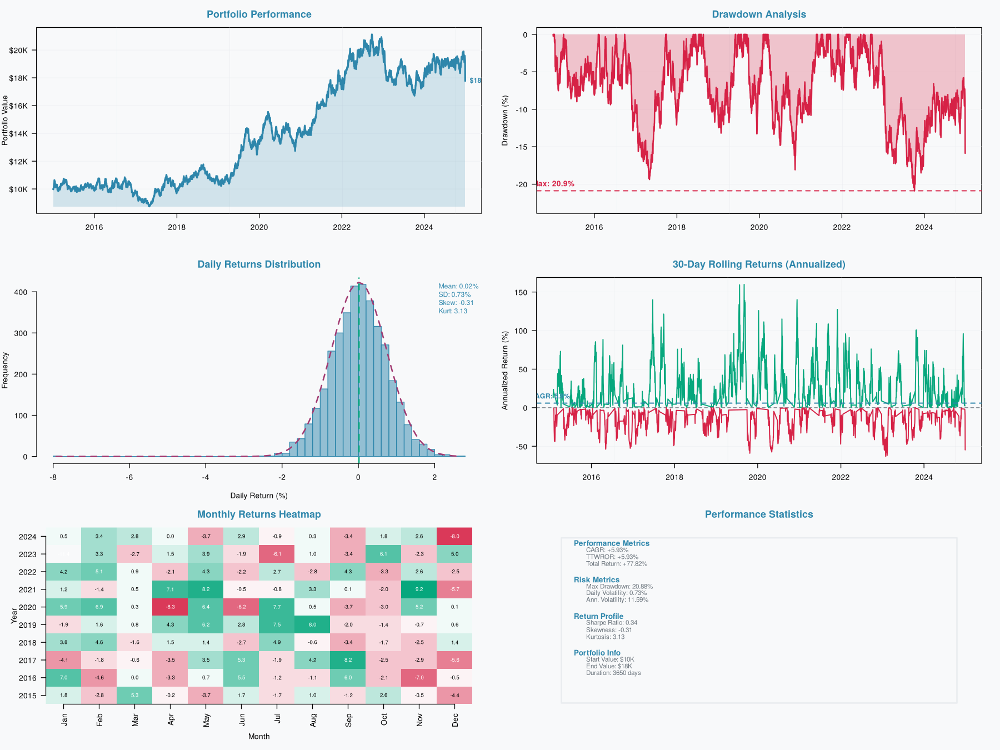
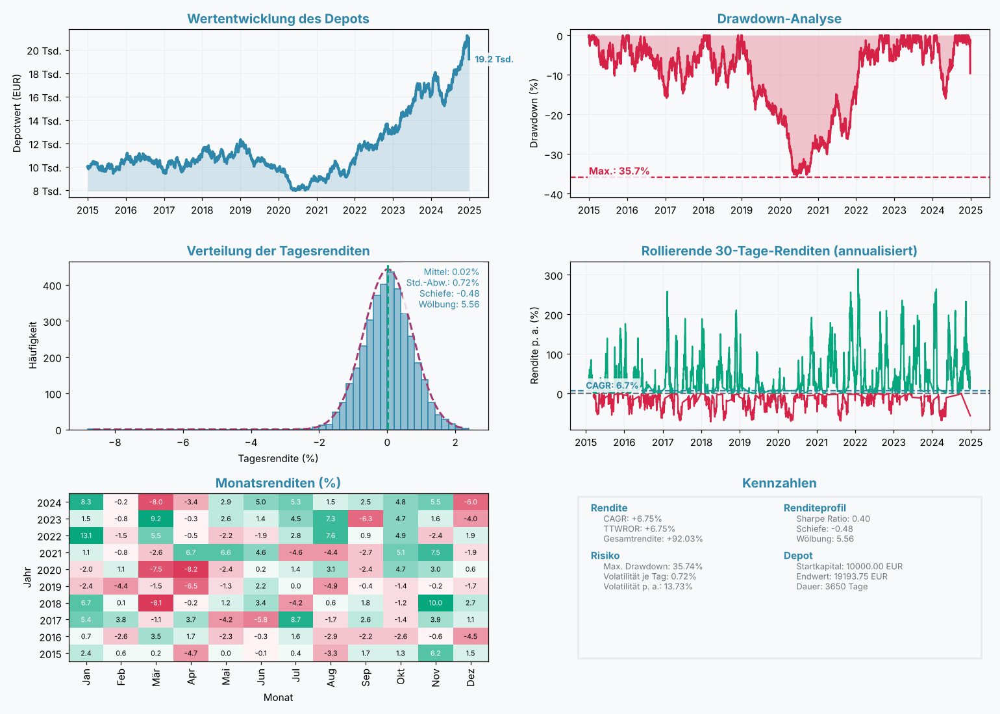
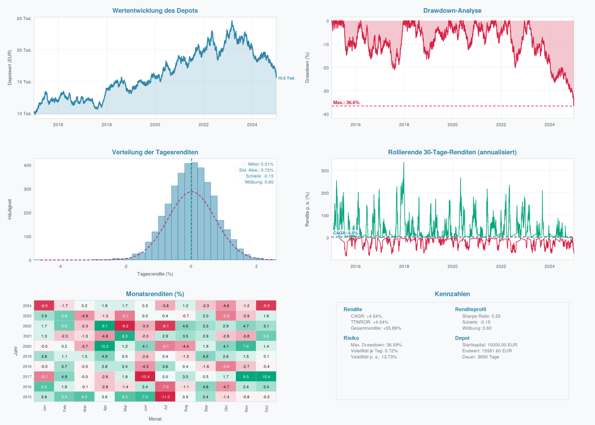

<p align="center">
  
</p>

<h1 align="center">SimLev</h1>

<p align="center">
  <strong>Simulation und Backtesting für Basis-, Hebel- und Multi-Asset-Strategien für Exchange Traded Products</strong><br>
  für <a href="r/">R</a> · <a href="python/">Python</a> · <a href="julia/">Julia</a>
</p>

<p align="center">
  <a href="https://github.com/chemicalstats/SimLev-Repos/actions/workflows/r.yml"></a>
  <a href="https://github.com/chemicalstats/SimLev-Repos/actions/workflows/python.yml"></a>
  <a href="https://github.com/chemicalstats/SimLev-Repos/actions/workflows/julia.yml"></a>
</p>

---

**SimLev** rechnet Anlagestrategien auf täglichen Preisreihen durch: von der
einfachen 70/30-Mischung aus Aktien- und Anleihe-ETF über Sparpläne und
Rebalancing bis zu signalgesteuerten Strategien mit gehebelten Produkten.
Der Unterschied zu gängigen Backtest-Werkzeugen ist die **detaillierte
Abbildung des deutschen Steuerrechts**. Vorabpauschale, Teilfreistellung,
Sparer-Pauschbetrag, getrennte Verlusttöpfe nach § 20 und § 23 EStG und die
Günstigerprüfung werden Tag für Tag mitgeführt. Ein Backtest zeigt so nicht
nur das Ergebnis *vor* Steuern, sondern auch, was einem deutschen
Privatanleger am Ende tatsächlich geblieben wäre.

SimLev gibt es in drei Sprachen. Das R-Paket ist die Referenz; die Python-
und die Julia-Fassung laufen eigenständig ohne R und rechnen **bitgleich**
zu ihm: Jeder Tageswert, jede Kennzahl, jeder Steuerbetrag und auch die
Textausgabe stimmen exakt überein.

| Fassung | Ordner | Benötigt | Besonderheit |
|---|---|---|---|
| **R** | [`r/`](r/) | R ≥ 4.0, C++-Compiler (Rcpp) | Referenzimplementierung |
| **Python** | [`python/`](python/) | Python ≥ 3.9, `numpy`, `pandas` | reines Python, kein Compiler nötig |
| **Julia** | [`julia/`](julia/) | Julia ≥ 1.10, keine externen Pakete | bitgleich auf allen Plattformen, 10- bis 35-mal so schnell wie R |

> **Sprachspezifische Beispiele sind aufklappbar.** Klicken Sie in den
> Abschnitten unten auf **R**, **Python** oder **Julia**, um den Code für
> Ihre Sprache zu sehen. Alles andere gilt für alle drei Fassungen.

## Inhalt

- [Auf einen Blick](#auf-einen-blick)
- [Installation](#installation)
- [Schnellstart](#schnellstart)
- [Grundkonzepte](#grundkonzepte)
  - [Eingabedaten](#eingabedaten)
  - [Die Prozent-Konvention](#die-prozent-konvention)
  - [Assets und Strategien](#assets-und-strategien)
  - [Buy-and-Hold und Signalstrategien](#buy-and-hold-und-signalstrategien)
  - [Sparpläne (DCA)](#sparpläne-dca)
  - [Rebalancing](#rebalancing)
  - [Besteuerung](#besteuerung)
  - [Splits bei gehebelten Produkten](#splits-bei-gehebelten-produkten)
- [Erweiterungen im R-Paket](#erweiterungen-im-r-paket)
  - [Backcast von Produkten](#backcast-von-produkten)
  - [Bootstrap-Studien](#bootstrap-studien)
  - [Entnahmephase](#entnahmephase)
  - [Vertiefte Analyse und Sensitivitäten](#vertiefte-analyse-und-sensitivitäten)
  - [Parametersuche und Überanpassung](#parametersuche-und-überanpassung)
  - [Daten und Portfolios aufbereiten](#daten-und-portfolios-aufbereiten)
  - [Abhängigkeiten, Tail-Risiko und Drittvariablen](#abhängigkeiten-tail-risiko-und-drittvariablen)
  - [Taktische Allokation](#taktische-allokation)
  - [Optimierung und Risikozerlegung](#optimierung-und-risikozerlegung)
  - [Anleihen, Geldmarkt und Währungssicherung](#anleihen-geldmarkt-und-währungssicherung)
- [Ergebnisse auswerten](#ergebnisse-auswerten)
- [Unterschiede zwischen den Sprachen](#unterschiede-zwischen-den-sprachen)
- [Bitgleichheit zum R-Paket](#bitgleichheit-zum-r-paket)
- [Geschwindigkeit](#geschwindigkeit)
- [Wie die Engine arbeitet](#wie-die-engine-arbeitet)
- [Grenzen und wichtige Hinweise](#grenzen-und-wichtige-hinweise)
- [Aufbau des Repositorys und Entwicklung](#aufbau-des-repositorys-und-entwicklung)
- [Hilfe und Mitwirken](#hilfe-und-mitwirken)
- [Lizenz](#lizenz)

## Auf einen Blick

| Bereich | Was SimLev kann |
|---|---|
| **Handelslogik** | Buy-and-Hold, signalgesteuerte Ein- und Ausstiege, gestaffelte Asset-Starts, Bruchstücke oder ganze Anteile |
| **Kapitalflüsse** | Einmalanlage, Sparpläne (monatlich, quartalsweise, jährlich), wahlweise mit Mini-Rebalancing über die Sparrate |
| **Rebalancing** | Kalenderbasiert, mit Toleranzschwelle oder ereignisbasiert (Hebel- und Volatilitäts-Trigger) |
| **Kosten** | Bid-Ask-Spread je Asset, optional laufende Fondskosten und Performancegebühr |
| **Steuern** | InvStG-Fondsbesteuerung, Abgeltungsteuer nach § 20 EStG, private Veräußerungsgeschäfte nach § 23 EStG |
| **Kennzahlen** | CAGR, TTWROR, Volatilität, Sharpe, Sortino, Calmar, Omega, Ulcer Index, Drawdown-Dauer u. v. m. |
| **Visualisierung** | Statisches Dashboard (R: Base-Grafik, Python: matplotlib, Julia: SVG) und interaktives, offline lauffähiges HTML-Dashboard |
| **Backcast** *(nur R)* | Rückrechnung von ETF/ETP-Historien aus Basisindex, TER-Reihe, Hebel und Tagesgeld; Fit der Abweichung mit Out-of-Sample-Test |
| **Bootstrap** *(nur R)* | 14 Verfahren (Block, stationär, Regime, EVT, (GJR-)GARCH, MS-GARCH …), Hebelprodukte, Strategie-Studien über Hunderttausende Pfade |
| **Entnahmephase** *(nur R)* | 14 Entnahmeregeln (4-%-Regel, Vanguard, Guyton-Klinger …) auf Kohorten, Bootstrap-Pfaden oder gespeicherten Simulationsergebnissen, mit vereinfachter deutscher Steuer |
| **Analyse** *(nur R)* | `deep_analysis()`: Alpha, Beta, Capture, Tracking Error, Information Ratio, M², VaR/CVaR, MWRR, Rendite- und Monatstabellen, Drawdown-Tabelle, rollierende Kennzahlen; Sensitivitäten für Rebalancing, Lump Sum vs. DCA und Hebel |
| **Parametersuche** *(nur R)* | Raster, Zufallssuche und Latin Hypercube über Strategie-, Signal- und Simulationsparameter; Plateau-Auswahl, Probability of Backtest Overfitting, Deflated Sharpe Ratio, Walk-Forward, Prüfung der besten Punkte auf Bootstrap-Pfaden |
| **Datenaufbereitung** *(nur R)* | Quellen zusammenführen, Prüfbericht (Lücken, Spikes, Splits), Makroreihen mit Veröffentlichungsverzug, Währung, Total Return, reale Werte, Verkettung, Portfolio-Vorlagen |
| **Abhängigkeiten** *(nur R)* | Rang- und Tail-Abhängigkeit, Copulas (Gauß, t, Clayton, Gumbel, Frank), DCC, Korrelation je Regime von Inflation, Zinsen oder Spreads mit Block-Bootstrap, Quantilsregression, CoVaR |
| **Taktische Allokation** *(nur R)* | Regeln mit Rückfall-Portfolio, Momentum-Rotation, Dual Momentum, Canary-Schutz, Zielvolatilität, Glidepath, Kern-Satellit; Ausführung mit Steuern und Kosten über die Engine |
| **Optimierung** *(nur R)* | Minimum-Varianz, maximale Sharpe Ratio, maximale Diversifikation, Risikoparität mit Budgets, HRP, minimaler CVaR; Grenzen, Ledoit-Wolf, Resampling, Effizienzgrenze, rollierende Optimierung, Risikobeiträge |
| **Synthetische Reihen** *(nur R)* | Anleihe-Index aus Renditen (konstante Laufzeit), Geldmarkt-Index aus Tagesgeld, währungsgesicherte Reihen |
| **Geschwindigkeit** | 30 Jahre Tagesdaten mit drei Assets, Sparplan, Rebalancing und Steuern in 0,02 s (Julia) bis 0,23 s (R) |

## Installation

<details>
<summary><b>R</b></summary>

SimLev enthält C++-Code und wird aus dem Quellcode kompiliert. Neben
**R ≥ 4.0** brauchen Sie einen funktionierenden Compiler:

| Betriebssystem | Was Sie benötigen |
|---|---|
| Windows | [Rtools](https://cran.r-project.org/bin/windows/Rtools/) in der zu Ihrer R-Version passenden Ausgabe |
| macOS | Xcode Command Line Tools (`xcode-select --install` im Terminal) |
| Linux | `build-essential` bzw. `gcc`/`g++` und die R-Entwicklungspakete (z. B. `r-base-dev`) |

Ob alles bereit ist, prüft `pkgbuild::check_build_tools()`.

``` r
# install.packages("remotes")
remotes::install_github("chemicalstats/SimLev-Repos", subdir = "r")
```

Aus einem lokalen Quellarchiv:

``` r
install.packages("SimLev_0.2.0.tar.gz", repos = NULL, type = "source")
```

Optionale Pakete: `plotly` (interaktives Dashboard über plotly; ohne plotly
schreibt SimLev ein eigenes, abhängigkeitsfreies HTML), `TTR` (technische
Indikatoren für Signalstrategien), `testthat` (Tests), `knitr` und
`rmarkdown` (Vignette).

</details>

<details>
<summary><b>Python</b></summary>

SimLev ist reines Python ab Version 3.9. Ein Compiler wird nicht benötigt.

``` bash
pip install "simlev @ git+https://github.com/chemicalstats/SimLev-Repos#subdirectory=python"
pip install "simlev[plot] @ git+https://github.com/chemicalstats/SimLev-Repos#subdirectory=python"   # mit matplotlib
```

Aus einem lokalen Klon:

``` bash
cd python
pip install .                 # nur die Engine (numpy, pandas)
pip install ".[plot]"         # zusätzlich matplotlib für das Dashboard
pip install ".[all]"          # zusätzlich plotly für interaktive plotly-Figuren
```

| Paket | Wofür | Pflicht? |
|---|---|---|
| `numpy`, `pandas` | Rechenkern und Datenaufnahme | ja |
| `matplotlib` | Statisches Dashboard (`result.plot()`, `export_dashboard`) | optional |
| `plotly` | Interaktives Dashboard als plotly-Figur | optional |
| `pytest` | Test-Suite | optional |

</details>

<details>
<summary><b>Julia</b></summary>

Benötigt wird **Julia ab Version 1.10**. Weitere Pakete sind nicht nötig.

``` julia
using Pkg
Pkg.add(url = "https://github.com/chemicalstats/SimLev-Repos", subdir = "julia")
# oder aus einem lokalen Klon:
# Pkg.develop(path = "pfad/zu/SimLev-Repos/julia")
```

Beim ersten `using SimLev` kompiliert Julia das Paket einmalig vor (etwa
20–30 Sekunden). Danach lädt es in Sekundenbruchteilen, und schon der erste
Aufruf von `simulation()` ist schnell.

</details>

## Schnellstart

Das Beispiel simuliert zehn Jahre einer 70/30-Mischung aus einem Aktien-ETF
(`WORLD`) und einem Anleihe-ETF (`BONDS`): 10.000 EUR Einmalanlage,
jährliches Rebalancing, deutsche Privatbesteuerung und Verkauf aller
Positionen am Ende. Die Preise sind synthetisch, damit das Beispiel ohne
externe Daten läuft. In der Praxis setzen Sie hier Ihre eigenen Kursreihen
ein.

<details>
<summary><b>R</b></summary>

``` r
library(SimLev)

# 1. Preisdaten: eine Datumsspalte plus eine Preisspalte je Asset
set.seed(42)
n <- 365 * 10
data <- data.frame(
  date  = seq.Date(as.Date("2015-01-01"), by = "day", length.out = n),
  WORLD = 100 * cumprod(1 + rnorm(n, 4e-4, 0.010)),
  BONDS =  50 * cumprod(1 + rnorm(n, 1e-4, 0.003))
)

# 2. Strategie: Gewichte, Kosten und Teilfreistellung
#    (30 % für Aktien-ETFs, 0 % für Renten-ETFs)
strategy <- create_strategy(
  WORLD = asset_config("etf", action_type = "bnh",
                       asset_share = 0.7, asset_spread = 0.1, asset_bonus = 30),
  BONDS = asset_config("etf", action_type = "bnh",
                       asset_share = 0.3, asset_spread = 0.1, asset_bonus = 0)
)

# 3. Simulation
result <- simulation(
  data, strategy,
  start_value  = 10000,
  balance_mode = TRUE, balance_span = 1, balance_unit = "year",
  tax_mode     = "person", tax_rate = 26.375,
  liquidate    = TRUE,
  risk_free    = 2
)

print(result)
plot(result)
```

```
  Performance
  ─────────────────────
  CAGR:             +5.93%
  TTWROR:           +5.93%
  Final Value:      17772.63 EUR

  Risk
  ─────────────────────
  Max Drawdown:     20.88%
  Longest DD:       826 Tage
  ...
  Steuern
  ─────────────────────
  Gezahlte Steuern: 1354.28 EUR
  SPB genutzt:      1700.74 EUR (Ersparnis: 448.57 EUR)
```

Aus 10.000 EUR wurden nach zehn Jahren, allen Spreads und allen Steuern
17.772,63 EUR, also 5,93 % pro Jahr. Ohne Steuern (`tax_mode = "none"`) wären
es 19.127,20 EUR (6,71 % p. a.) gewesen.

<p align="center">
  
</p>

</details>

<details>
<summary><b>Python</b></summary>

Das vollständige Skript liegt unter
[`python/examples/schnellstart.py`](python/examples/schnellstart.py).

``` python
import numpy as np
import pandas as pd
import simlev

# 1. Preisdaten: eine Datumsspalte plus eine Preisspalte je Asset
rng = np.random.default_rng(42)
n = 365 * 10
data = pd.DataFrame({
    "date":  pd.date_range("2015-01-01", periods=n, freq="D"),
    "WORLD": 100 * np.cumprod(1 + rng.normal(4e-4, 0.010, n)),
    "BONDS":  50 * np.cumprod(1 + rng.normal(1e-4, 0.003, n)),
})

# 2. Strategie: Gewichte, Kosten und Teilfreistellung
strategy = simlev.create_strategy(
    WORLD=simlev.asset_config("etf", action_type="bnh", asset_share=0.7, asset_spread=0.1, asset_bonus=30),
    BONDS=simlev.asset_config("etf", action_type="bnh", asset_share=0.3, asset_spread=0.1, asset_bonus=0),
)

# 3. Simulation
result = simlev.simulation(
    data, strategy,
    start_value=10000,
    balance_mode=True, balance_span=1, balance_unit="year",
    tax_mode="person", tax_rate=26.375,
    liquidate=True,
    risk_free=2,
)

print(result)
result.plot()
```

```
  Performance
  ─────────────────────
  CAGR:             +6.75%
  TTWROR:           +6.75%
  Final Value:      19195.90 EUR

  Risk
  ─────────────────────
  Max Drawdown:     35.75%
  Longest DD:       1317 Tage
  ...
  Steuern
  ─────────────────────
  Gezahlte Steuern: 1813.50 EUR
  SPB genutzt:      1337.11 EUR (Ersparnis: 352.66 EUR)
```

Aus 10.000 EUR wurden 19.195,90 EUR, also 6,75 % pro Jahr. Ohne Steuern
(`tax_mode="none"`) wären es 21.009,66 EUR (7,72 % p. a.) gewesen.

<p align="center">
  
</p>

</details>

<details>
<summary><b>Julia</b></summary>

Das vollständige Skript liegt unter
[`julia/examples/schnellstart.jl`](julia/examples/schnellstart.jl).

``` julia
using SimLev, Dates, Random

# 1. Preisdaten: eine Datumsspalte plus eine Preisspalte je Asset
rng = MersenneTwister(42)
n = 365 * 10
data = (date  = collect(Date(2015, 1, 1):Day(1):Date(2015, 1, 1) + Day(n - 1)),
        WORLD = 100 .* cumprod(1 .+ 4e-4 .+ 0.010 .* randn(rng, n)),
        BONDS =  50 .* cumprod(1 .+ 1e-4 .+ 0.003 .* randn(rng, n)))

# 2. Strategie: Gewichte, Kosten und Teilfreistellung
strategy = create_strategy(
    WORLD = asset_config("etf", "bnh"; asset_share = 0.7, asset_spread = 0.1, asset_bonus = 30),
    BONDS = asset_config("etf", "bnh"; asset_share = 0.3, asset_spread = 0.1, asset_bonus = 0),
)

# 3. Simulation
result = simulation(data, strategy;
    start_value = 10000,
    balance_mode = true, balance_span = 1, balance_unit = "year",
    tax_mode = "person", tax_rate = 26.375,
    liquidate = true,
    risk_free = 2)

plot_dashboard(result)
```

```
  Performance
  ─────────────────────
  CAGR:             +4.53%
  TTWROR:           +4.53%
  Final Value:      15558.32 EUR

  Risk
  ─────────────────────
  Max Drawdown:     36.57%
  Longest DD:       666 Tage
  ...
  Steuern
  ─────────────────────
  Gezahlte Steuern: 744.73 EUR
  SPB genutzt:      2044.75 EUR (Ersparnis: 539.30 EUR)
```

Aus 10.000 EUR wurden 15.558,32 EUR, also 4,53 % pro Jahr. Ohne Steuern
(`tax_mode = "none"`) wären es 16.303,40 EUR (5,02 % p. a.) gewesen.

<p align="center">
  
</p>

</details>

**Warum unterscheiden sich die Zahlen?** Jede Sprache erzeugt die
synthetischen Kurse mit ihrem eigenen Zufallsgenerator, die Preisreihen sind
also verschieden. Mit identischen Eingabedaten liefern alle drei Fassungen
exakt dasselbe Ergebnis (siehe [Bitgleichheit](#bitgleichheit-zum-r-paket)).

**So lesen Sie das Ergebnis:** *Final Value* ist der Depotwert nach allen
Spreads und Steuern, *CAGR* die jährliche Wachstumsrate. *Max Drawdown* ist
der schlimmste zwischenzeitliche Verlust vom letzten Höchststand, *Longest
DD* die längste Durststrecke bis zum nächsten Höchststand. *SPB genutzt*
zeigt, wie viel Sparer-Pauschbetrag angerechnet wurde und wie viel Steuer
das gespart hat.

Der Knick am letzten Tag im Dashboard ist kein Kurseinbruch. Es ist die
Steuer, die mit `liquidate` beim Verkauf aller Positionen fällig wird. Die
Option ist sinnvoll, wenn Sie wissen wollen, was nach Auflösung des Depots
*netto* übrig bleibt. Ohne sie zeigt der Endwert den Depotwert inklusive
noch nicht versteuerter Gewinne.

## Grundkonzepte

### Eingabedaten

SimLev ist eine reine Backtest-Engine. Sie verarbeitet jede Preisreihe genau
so, wie sie übergeben wird. **Hebel, Dividenden und Finanzierungskosten
werden nicht intern berechnet**, sondern müssen in der Preisreihe bereits
enthalten sein. Für einen gehebelten ETF übergeben Sie also die tatsächliche
(oder selbst nachgebildete) Kursreihe des gehebelten Produkts, für
thesaurierende ETFs einfach den Kurs.

Erwartet wird eine Tabelle mit

- einer Spalte **`date`**,
- **je einer Preisspalte pro Asset**, deren Name exakt dem Asset-Namen in
  der Strategie entspricht,
- optional weiteren Spalten: Kauf- und Verkaufssignale (logisch), ein
  täglicher Basiszins für die Vorabpauschale, ein risikoloser Zins oder eine
  Trigger-Spalte für ereignisbasiertes Rebalancing.

| | R | Python | Julia |
|---|---|---|---|
| Tabelle | `data.frame` | `pandas.DataFrame` oder `dict` aus Spalten | NamedTuple von Vektoren, `Dict`, `DataFrame` oder jede Tabelle mit `propertynames`/`getproperty` |
| `date` | `Date` oder Text `"JJJJ-MM-TT"` | `datetime64`, `datetime.date` oder Text | `Date`, `DateTime`, Text oder Tage seit 1970-01-01 |
| Fehlende Werte | `NA` | `NaN` | `missing` |

**Fehlende Kalendertage** wie Wochenenden und Feiertage füllt SimLev
automatisch mit dem letzten bekannten Kurs auf (*Last Observation Carried
Forward*, LOCF). Diese Tage werden im Ergebnis unter `filled` markiert und
aus allen renditebasierten Kennzahlen (Volatilität, Sharpe, Sortino,
Schiefe, Kurtosis) herausgerechnet. Künstliche Null-Rendite-Tage verzerren
die Statistik so nicht. Fällt ein geplantes Ereignis (Sparrate,
Rebalancing, Liquidation) auf einen aufgefüllten Tag, wird es auf den
nächsten echten Handelstag verschoben. Würde es dadurch in den Folgemonat
rutschen, wird es auf den vorherigen Handelstag vorgezogen.

### Die Prozent-Konvention

Alle Raten und Schwellen werden **in Prozent** angegeben, nicht als
Dezimalzahl. Das ist die häufigste Fehlerquelle beim Einstieg:

| Argument | Beispiel | Bedeutung |
|---|---|---|
| `tax_rate` | `26.375` | 25 % Abgeltungsteuer + 5,5 % Solidaritätszuschlag darauf |
| `asset_spread` | `0.1` | 0,1 % voller Bid-Ask-Spread (je Kauf/Verkauf die Hälfte) |
| `asset_bonus` | `30` | 30 % Teilfreistellung |
| `balance_thresh` | `5` | Rebalancing erst ab 5 % Gewichtsabweichung |
| `base_rate` | `2.55` | 2,55 % Basiszins für die Vorabpauschale |
| `risk_free` | `2` | 2 % risikoloser Zins p. a. |
| `marginal_tax_rate` | `42` | 42 % persönlicher Grenzsteuersatz |

Einzige Ausnahme sind die Zielgewichte `asset_share`. Jedes liegt zwischen
0 (ausschließlich) und 1, und zusammen müssen sie sich auf 1 summieren.
Sonst bricht `simulation()` mit einer Fehlermeldung ab.

### Assets und Strategien

Jedes Asset wird mit `asset_config()` beschrieben. Mehrere Assets fasst
`create_strategy()` zu einer Strategie zusammen. Beide Funktionen prüfen
ihre Eingaben sofort. Tippfehler oder unzulässige Werte fallen so auf,
bevor eine Simulation startet.

<details>
<summary><b>R</b></summary>

``` r
strategy <- create_strategy(
  WORLD = asset_config("etf", action_type = "bnh", asset_share = 0.6,
                       asset_spread = 0.10, asset_bonus = 30),
  EM    = asset_config("etf", action_type = "bnh", asset_share = 0.2,
                       asset_spread = 0.20, asset_bonus = 30),
  GOLD  = asset_config("etc", action_type = "bnh", asset_share = 0.2,
                       deliverable = TRUE)
)

validate_strategy(strategy, data)   # prüft zusätzlich, ob alle Spalten in data existieren
```

</details>

<details>
<summary><b>Python</b></summary>

``` python
strategy = simlev.create_strategy(
    WORLD=simlev.asset_config("etf", action_type="bnh", asset_share=0.6, asset_spread=0.10, asset_bonus=30),
    EM=simlev.asset_config("etf", action_type="bnh", asset_share=0.2, asset_spread=0.20, asset_bonus=30),
    GOLD=simlev.asset_config("etc", action_type="bnh", asset_share=0.2, deliverable=True),
)

simlev.validate_strategy(strategy, data)   # prüft zusätzlich, ob alle Spalten in data existieren
```

</details>

<details>
<summary><b>Julia</b></summary>

Die ersten fünf Argumente von `asset_config` (`asset_class`, `action_type`,
`asset_share`, `asset_spread`, `asset_bonus`) dürfen wie in R positionell
oder als Schlüsselwort übergeben werden.

``` julia
strategy = create_strategy(
    WORLD = asset_config("etf", "bnh", 0.6, 0.10, 30),
    EM    = asset_config("etf", "bnh", 0.2, 0.20, 30),
    GOLD  = asset_config("etc"; asset_share = 0.2, deliverable = true),
)

validate_strategy(strategy, data)   # prüft zusätzlich, ob alle Spalten in data existieren
```

</details>

Die **Assetklasse** bestimmt automatisch, nach welchen Regeln ein Asset
besteuert wird. Wollen Sie davon abweichen, setzen Sie `tax_regime`
explizit.

| `asset_class` | `deliverable` | Abgeleitetes Steuerregime | Typisches Beispiel |
|---|---|---|---|
| `"etf"` | – | `investment_fund` (InvStG: Teilfreistellung, Vorabpauschale) | Aktien- oder Renten-ETF |
| `"etn"`, `"etc"` | nein | `capital_gains` (§ 20 EStG, Abgeltungsteuer) | ETC ohne Lieferanspruch |
| `"etn"`, `"etc"` | ja | `private_sale` (§ 23 EStG, steuerfrei nach einem Jahr) | Physisch hinterlegtes Gold mit Lieferanspruch |
| `"certificate"` | – | `capital_gains` | Zertifikat, Hebelprodukt als Schuldverschreibung |

Bestehende Strategien verändern Sie mit `add_asset()`, `update_asset()` und
`remove_asset()`, die jeweils eine neue Strategie zurückgeben. Ältere,
als einfache Listen definierte Strategien wandelt `migrate_strategy()` in
das aktuelle Format um; `simulation()` akzeptiert sie auch direkt.

### Buy-and-Hold und Signalstrategien

Mit `action_type = "bnh"` wird ein Asset am ersten Tag gekauft und
gehalten. Käufe und Verkäufe entstehen danach nur noch durch Sparraten,
Rebalancing oder Liquidation.

Mit `action_type = "signal"` steigt das Asset ein und aus, wann immer Ihre
Signalspalten es vorgeben. Die Signale berechnen Sie vorab selbst; SimLev
macht keine Annahmen über Ihre Handelsregel. Ein klassisches Beispiel ist
der Kreuzungspunkt zweier gleitender Durchschnitte:

<details>
<summary><b>R</b></summary>

``` r
data$sma50  <- TTR::SMA(data$WORLD, n = 50)
data$sma200 <- TTR::SMA(data$WORLD, n = 200)
data$buy    <- data$sma50 > data$sma200
data$sell   <- data$sma50 < data$sma200

strategy <- create_strategy(
  WORLD = asset_config("etf", action_type = "signal",
                       asset_share = 1, asset_spread = 0.1, asset_bonus = 30,
                       signal_buy = "buy", signal_sell = "sell")
)
```

</details>

<details>
<summary><b>Python</b></summary>

``` python
sma50 = data["WORLD"].rolling(50).mean()
sma200 = data["WORLD"].rolling(200).mean()
data["buy"] = (sma50 > sma200).fillna(False)
data["sell"] = (sma50 < sma200).fillna(False)

strategy = simlev.create_strategy(
    WORLD=simlev.asset_config("etf", action_type="signal", asset_share=1, asset_spread=0.1, asset_bonus=30,
                              signal_buy="buy", signal_sell="sell"),
)
```

</details>

<details>
<summary><b>Julia</b></summary>

``` julia
sma(x, k) = [i < k ? NaN : sum(@view x[i-k+1:i]) / k for i in eachindex(x)]
s50, s200 = sma(data.WORLD, 50), sma(data.WORLD, 200)
data = merge(data, (buy = s50 .> s200, sell = s50 .< s200))     # NaN-Vergleiche ergeben false

strategy = create_strategy(
    WORLD = asset_config("etf", "signal", 1, 0.1, 30; signal_buy = "buy", signal_sell = "sell"))
```

</details>

Solange ein Signal-Asset nicht investiert ist, hält es sein Zielgewicht als
eigene Cash-Reserve. Beim Rebalancing wird diese Reserve wie eine Position
behandelt. Das Portfolio bleibt also auch dann im gewünschten Verhältnis,
wenn ein Teil gerade „an der Seitenlinie“ steht.

### Sparpläne (DCA)

Ein Sparplan (*Dollar-Cost Averaging*) investiert regelmäßig einen festen
Betrag zusätzlich zum Startkapital. Im Beispiel sind es 250 EUR pro Monat:

<details>
<summary><b>R</b></summary>

``` r
result_dca <- simulation(
  data, strategy,
  start_value = 10000,
  dca_mode = TRUE, dca_value = 250, dca_span = 1, dca_unit = "month",
  balance_dca = TRUE,       # Sparrate füllt zuerst untergewichtete Assets auf
  balance_mode = TRUE, balance_span = 1, balance_unit = "year",
  tax_mode = "person", tax_rate = 26.375,
  liquidate = TRUE
)
```

</details>

<details>
<summary><b>Python</b></summary>

``` python
result_dca = simlev.simulation(
    data, strategy,
    start_value=10000,
    dca_mode=True, dca_value=250, dca_span=1, dca_unit="month",
    balance_dca=True,       # Sparrate füllt zuerst untergewichtete Assets auf
    balance_mode=True, balance_span=1, balance_unit="year",
    tax_mode="person", tax_rate=26.375,
    liquidate=True,
)
```

</details>

<details>
<summary><b>Julia</b></summary>

``` julia
result_dca = simulation(data, strategy;
    start_value = 10000,
    dca_mode = true, dca_value = 250, dca_span = 1, dca_unit = "month",
    balance_dca = true,                       # Sparrate füllt zuerst untergewichtete Assets auf
    balance_mode = true, balance_span = 1, balance_unit = "year",
    tax_mode = "person", tax_rate = 26.375,
    liquidate = true)
```

</details>

Ohne `balance_dca` (Standard) wird jede Rate fest nach den Zielgewichten
aufgeteilt. Mit `balance_dca` wirkt sie wie ein kleines Rebalancing: Sie
fließt zuerst in die Assets, die gerade unter ihrem Zielgewicht liegen. Das
spart Verkäufe und damit Steuern, weil das Depot über frisches Geld statt
über Umschichtungen ins Gleichgewicht kommt.

**Wichtig bei Sparplänen: CAGR und TTWROR unterscheiden sich.** Die CAGR
bezieht sich auf das Depotwachstum *einschließlich* der Einzahlungen. Die
TTWROR (*True Time-Weighted Rate of Return*) rechnet die Einzahlungen heraus
und misst nur, wie gut das investierte Geld gearbeitet hat. Mit den Daten
und der 70/30-Strategie aus dem Python-Schnellstart steigt der Depotwert in
zehn Jahren auf rund 70.450 EUR, eine CAGR von 21,3 %. Die TTWROR liegt
dagegen bei 6,6 %. Sie ist die Zahl, die Sie mit anderen Strategien oder
mit einem Index vergleichen sollten.

### Rebalancing

Durch unterschiedliche Kursentwicklungen driften die Gewichte im Lauf der
Zeit auseinander. SimLev bietet drei Wege, sie wieder anzugleichen:
**kalenderbasiert** in festen Abständen, **mit Toleranzschwelle** an den
Kalenderterminen, aber nur wenn sich der Aufwand lohnt, und
**ereignisbasiert**, wenn eine von Ihnen definierte Bedingung eintritt.

<details>
<summary><b>R</b></summary>

``` r
# kalenderbasiert
simulation(data, strategy, balance_mode = TRUE, balance_span = 1, balance_unit = "quarter")

# mit Toleranzschwelle: nur handeln, wenn ein Gewicht > 5 % abweicht
simulation(data, strategy, balance_mode = TRUE, balance_span = 1, balance_unit = "year",
           balance_thresh = 5)

# relatives Band (nur R): Ziel 40 % darf zwischen 30 % und 50 % liegen
simulation(data, strategy, balance_mode = TRUE, balance_span = 1, balance_unit = "month",
           balance_thresh = 25, balance_thresh_type = "relative")

# ereignisbasiert; data$sigma_ewma enthält eine selbst berechnete Volatilitätsschätzung
data <- compute_rebal_trigger(data, type = "vol_band", threshold = 20, vol_col = "sigma_ewma")
simulation(data, strategy, event_col = "rebal_trigger",
           event_mode = "replace")   # oder "additional" zum Kalender
```

Kommentierte Vorlagen für eigene Trigger-Regeln finden Sie in
[`r/R/rebal_trigger_cookbook.R`](r/R/rebal_trigger_cookbook.R).

</details>

<details>
<summary><b>Python</b></summary>

``` python
# kalenderbasiert
simlev.simulation(data, strategy, balance_mode=True, balance_span=1, balance_unit="quarter")

# mit Toleranzschwelle: nur handeln, wenn ein Gewicht > 5 % abweicht
simlev.simulation(data, strategy, balance_mode=True, balance_span=1, balance_unit="year",
                  balance_thresh=5)

# ereignisbasiert; data["sigma_ewma"] enthält eine selbst berechnete Volatilitätsschätzung
data = simlev.compute_rebal_trigger(data, type="vol_band", threshold=20, vol_col="sigma_ewma")
simlev.simulation(data, strategy, event_col="rebal_trigger",
                  event_mode="replace")   # oder "additional" zum Kalender
```

</details>

<details>
<summary><b>Julia</b></summary>

``` julia
# kalenderbasiert
simulation(data, strategy; balance_mode = true, balance_span = 1, balance_unit = "quarter")

# mit Toleranzschwelle: nur handeln, wenn ein Gewicht > 5 % abweicht
simulation(data, strategy; balance_mode = true, balance_unit = "year", balance_thresh = 5)

# ereignisbasiert; data.sigma_ewma enthält eine selbst berechnete Volatilitätsschätzung
data = compute_rebal_trigger(data, "vol_band"; threshold = 20, vol_col = "sigma_ewma")
simulation(data, strategy; event_col = "rebal_trigger",
           event_mode = "replace")   # oder "additional" zum Kalender
```

</details>

`compute_rebal_trigger()` erzeugt eine logische Spalte, die Sie über
`event_col` an die Simulation übergeben. Gerade bei gehebelten Strategien
ist das oft sinnvoller als ein fester Kalender, etwa wenn sich der
gewünschte Hebel oder die Marktvolatilität spürbar verändert hat.

| Trigger-Typ | Löst aus, wenn ... |
|---|---|
| `"abs_leverage"` | der Ziel-Hebel absolut um mehr als die Schwelle vom zuletzt umgesetzten Hebel abweicht (`threshold = 10` ⇒ 0,10 Hebelpunkte) |
| `"rel_leverage"` | der Ziel-Hebel relativ um mehr als die Schwelle abweicht (`10` ⇒ 10 %) |
| `"vol_band"` | die Volatilität relativ zum Wert beim letzten Rebalancing um mehr als die Schwelle abweicht |
| `"combined"` | mindestens einer von mehreren Sub-Triggern auslöst (ODER-Verknüpfung) |

Verglichen wird immer mit dem Stand beim *letzten tatsächlichen*
Rebalancing, nicht mit dem Vortag. So lösen auch viele kleine Bewegungen
aus, die sich aufsummieren. Optional legt `event_weight` die Zielgewichte
an Event-Tagen aus Datenspalten fest.

### Besteuerung

Über `tax_mode` wählen Sie eines von drei Modellen:

| `tax_mode` | Bedeutung |
|---|---|
| `"none"` | Keine Steuern, also die reine Brutto-Performance |
| `"person"` | Besteuerung eines deutschen Privatanlegers mit vollständiger FIFO-Lotverwaltung |
| `"funds"` | Vereinfachte Fondshülle: laufende Kosten (`funds_fee`, wie eine TER) und eine Performancegebühr mit High-Watermark (`bonus_fee`) |

Im Modus `"person"` bildet SimLev unter anderem folgende Regeln ab:

- **Teilfreistellung** (§ 20 InvStG): Bei Aktien-ETFs bleiben 30 %, bei
  Mischfonds 15 % der Erträge steuerfrei. Den Satz geben Sie je Asset über
  `asset_bonus` an.
- **Vorabpauschale** (§ 18 InvStG): Für thesaurierende Fonds wird jährlich
  ein fiktiver Mindestertrag besteuert. Er beträgt 70 % des Basiszinses auf
  den Wert zu Jahresbeginn, höchstens aber den tatsächlichen Wertzuwachs.
  Bei Kauf im Lauf des Jahres wird pro Monat anteilig gerechnet. Der
  Basiszins kommt fest aus `base_rate` oder, mit `base_rate_flex`, täglich
  aus einer Datenspalte (`base_rate_data`). Festgesetzt wird zum 31.12.,
  abgebucht am ersten Handelstag des Folgejahres. Reicht das Cash nicht,
  werden Anteile verkauft. Bereits versteuerte Vorabpauschalen mindern
  später den Veräußerungsgewinn (§ 19 InvStG).
- **Sparer-Pauschbetrag**: Jährlich bleiben 1.000 EUR Kapitalerträge
  steuerfrei, einstellbar über `sparer_pauschbetrag` (für Ehepaare z. B.
  `2000`).
- **Verlustverrechnung**: Verluste werden mit Gewinnen desselben Topfes
  verrechnet und bei Bedarf vorgetragen. Der allgemeine Topf nach § 20 EStG
  und der Topf für private Veräußerungsgeschäfte nach § 23 EStG bleiben
  strikt getrennt. Übersteigen spätere Verluste im selben Jahr bereits
  versteuerte Gewinne, wird die Steuer zum Jahreswechsel erstattet, wie bei
  der unterjährigen Verlustverrechnung einer Bank.
- **Private Veräußerungsgeschäfte** (§ 23 EStG): Für Assets mit
  Lieferanspruch (z. B. physisches Gold) sind Gewinne nach einem Jahr
  Haltedauer steuerfrei. Innerhalb der Frist gelten der persönliche
  Steuersatz (`marginal_tax_rate`) und eine Freigrenze von 1.000 EUR
  (`private_sale_threshold`). Wird sie überschritten, ist der *gesamte*
  Gewinn steuerpflichtig.
- **Günstigerprüfung** (§ 32d Abs. 6 EStG): Mit `use_guenstigerpruefung`
  wird der persönliche Steuersatz angewendet, wenn er unter der
  Abgeltungsteuer liegt.

**Modellphilosophie:** SimLev projiziert die *heutige* Rechtslage in die
Vergangenheit, also aktuellen Pauschbetrag, aktuelle
Teilfreistellungssätze und aktuelle Freigrenzen. Ein Backtest beantwortet
damit die Frage *„Wie hätte meine Strategie abgeschnitten, wenn ich damals
zu den heutigen Konditionen investiert hätte?“*. Er berechnet nicht, welche
Steuer damals tatsächlich angefallen wäre. So bleiben Zeiträume vor und
nach Steuerreformen direkt vergleichbar.

### Splits bei gehebelten Produkten

Manche Hebelprodukte führen Splits oder Zusammenlegungen durch, wenn ihr
Kurs eine bestimmte Grenze über- oder unterschreitet. Mit `split_mode` und
`split_thresh` (untere und obere Grenze, in R als `c(20, 400)`, in Python
als `(20, 400)`, in Julia als `[20, 400]`) bildet SimLev das nach: Über der
oberen Grenze wird gesplittet, unter der unteren zusammengelegt. Übergeben
Sie dafür die Kursreihe *ohne* Split-Bereinigung. Für die Besteuerung
ändert sich nichts. Die Anschaffungskosten aller FIFO-Lots werden im
Split-Verhältnis angepasst, Kaufdaten und damit Haltedauern bleiben
erhalten.

## Erweiterungen im R-Paket

Die folgenden Funktionen gibt es bisher nur im R-Paket. Sie rechnen um die
Engine herum und verändern `simulation()` nicht; die Golden-Master-Fälle
bleiben bitgleich. Ausführliche Beispiele, die die Projektskripte
nachbilden, stehen in
[`r/inst/examples/backcast_bootstrap_withdrawal_examples.md`](r/inst/examples/backcast_bootstrap_withdrawal_examples.md).

### Backcast von Produkten

`backcast_fit()` passt ein Rückrechnungsmodell auf dem Zeitraum an, in dem
Produkt und Basisindex beide vorliegen; `backcast()` verlängert das Produkt
damit in die Vergangenheit und verkettet renditebasiert mit den echten
Kursen. Das Strukturmodell folgt der Methodik der MSCI Daily Leveraged/Short
Indizes plus Fondskosten:

```
r_t = beta·L·x_t + (1 − L)·Zins_t·T/360 − TER_t·T/365 − Spread·m(L)·T/360 − Drag·T/365
```

Gefittet werden wahlweise `drag` (Restabweichung p. a.), `spread` und
`beta`. Das Ziel ist die kumulierte Pfadabweichung (`"level"`), die tägliche
bzw. mehrtägige Renditeabweichung (`"return"`) oder beides (`"hybrid"`).
Die TER kann sich zu Stichtagen ändern, der Zins ist eine Datenspalte.
Ausgegeben werden Tracking Error, Tracking Difference, Korrelation und ein
Out-of-Sample-Test in Backcast-Richtung.

``` r
fit <- backcast_fit(data, product = "etf", index = "index_nr_eur",
                    ter = c("2010-02-24" = 0.35, "2023-10-10" = 0.50),
                    leverage = 2, rate = "estr")
bc  <- backcast(fit)          # date, value, return, model, product, source
```

### Bootstrap-Studien

`bootstrap_config()` beschreibt Indizes, daraus abgeleitete Hebelprodukte
und Zusatzreihen (Zins, Inflation), die aus derselben historischen Zeile
mitgezogen werden. `bootstrap()` erzeugt Pfade; `bootstrap_study()` erzeugt
Pfade, berechnet Signale, simuliert alle Strategien mit `simulation()` auf
denselben Pfaden und behält nur die Kennzahlen. Das läuft parallel und lässt
sich nach einem Abbruch fortsetzen; jeder Pfad hat einen eigenen
Zufallsstrom und ist unabhängig von der Kernzahl reproduzierbar.
`summary()` zeigt Verteilungen und den gepaarten Vergleich mit einem
Benchmark, `bootstrap_probability()` beliebige (gemeinsame)
Wahrscheinlichkeiten.

``` r
cfg <- bootstrap_config(c(us = "us_ret", eu = "eu_ret"), regime_index = "us",
                        aux = c(rate = "eu_rate"),
                        letfs = list(list(base = "eu", leverage = 2, finance = "rate", expense = 0.5)))
study <- bootstrap_study(hist, cfg, "stationary", n = 10000, params = list(L = 250),
                         strategies = list(bnh = strategy_bnh, sma = list(strategy = strategy_sma, signal = sma_signal)),
                         benchmark = "bnh", burn_in = 730, cores = 8, seed = 42,
                         keep_returns = "year")
summary(study)
```

Verfahren: `raw`, `block`, `circular`, `stationary`, `wild`, `regime`, `evt`,
`tails`, `reset`, `garch`, `gjr_garch`, `ms_garch`, `ms_ar_garch_m`,
`tvtp_ms_garch` (die MS-Verfahren benötigen das Paket `MSGARCH`), optional
mit ESS-gewichteter Gittersuche über Hyperparameter. `block_length()`
schätzt Blocklängen nach Politis & White (2004).

### Entnahmephase

Die Entnahmephase ist bewusst von `simulation()` getrennt. Sie rechnet auf
Periodenrenditen aus historischen Kohorten (`withdrawal_cohorts()`),
Bootstrap-Pfaden (`withdrawal_paths()`), einer Bootstrap-Studie mit
`keep_returns` oder einem **gespeicherten Ergebnis von `simulation()`**:

``` r
res <- simulation(data, strategy, start_value = 1e5)
saveRDS(res, "lauf.rds")

wd <- withdrawal_simulation(readRDS("lauf.rds"),
                            withdrawal_rule("guyton_klinger", rate = 5),
                            years = 30, inflation = 2, start_value = 1e6,
                            tax_mode = "person")
wd                       # Erfolgsquote, SWR/PWR, Konsum- und Vermögensquantile
plot(wd)
```

| Regel | Beschreibung |
|---|---|
| `constant` | 4-%-Regel (Bengen, Trinity): Anfangsrate, danach inflationsangepasst |
| `percent` | Fester Prozentsatz des aktuellen Depots |
| `vanguard` | Vanguard Dynamic Spending: Rate × Depot, real begrenzt auf +5 % / −2,5 % |
| `guyton_klinger` | Guyton-Klinger-Regeln: Inflationsstopp nach Verlustjahr, Kürzung/Erhöhung um 10 % an ±20-%-Leitplanken |
| `floor_ceiling` | Bengen 2001: Rate × Depot im Korridor −15 % / +20 % um die reale Erstentnahme |
| `clyatt` | 95-%-Regel: höchstens 5 % weniger als im Vorjahr |
| `ratchet` | Kitces: +10 %, wenn das reale Depot 150 % des Starts übersteigt |
| `endowment` | Yale/Tobin: Glättung zwischen Vorjahresentnahme und Rate × Depot |
| `one_over_n`, `vpw`, `abw` | Restlaufzeit-, Variable-Percentage- und Annuitäten-Entnahme |
| `cape` | Rate = a + b / CAPE |
| `sensible`, `hebeler` | Sensible Withdrawals, Hebeler Autopilot II |

Kennzahlen sind Erfolgs- und Kapitalerhaltquote, Perfect Withdrawal Rate
und sichere Entnahmerate, Konsumquantile, Sicherheitsäquivalent (CRRA) und
Steuern. `withdrawal_max_rate()` sucht die höchste Anfangsrate für eine
Ziel-Erfolgsquote. Die Besteuerung im schnellen Kern ist vereinfacht: ein
thesaurierender Fondsbestand mit Teilfreistellung, Verlusttopf,
Sparer-Pauschbetrag und Vorabpauschale.

### Vertiefte Analyse und Sensitivitäten

`deep_analysis()` wertet gespeicherte Ergebnisse von `simulation()` (einzeln
oder als benannte Liste) oder beliebige Kursreihen nachträglich aus, im
Umfang von Portfolio-Backtestern wie testfol.io. Grundlage ist der
zeitgewichtete Wertindex, Sparpläne verzerren die Renditen also nicht.

``` r
da <- deep_analysis(list(Aktien = res_a, Mischung = res_b), benchmark = "Aktien", risk_free = 2)
da                    # Kennzahlen und Benchmark-Block
summary(da)           # zusätzlich Jahresrenditen und größte Drawdowns
plot(da)              # Wachstum, Drawdowns, rollierende CAGR, Jahresrenditen
plot(da, "monthly")   # Monatsrenditen als Heatmap
```

| Bereich | Kennzahlen |
|---|---|
| Rendite | Gesamtrendite, CAGR (TWR), MWRR (interner Zinsfuß), beste/schlechteste Tage, Monate, Jahre, positive Monate |
| Risiko | Volatilität, Sharpe, Sortino, Calmar, max./mittlerer Drawdown, Ulcer Index, UPI, längster Drawdown, Recovery Factor, VaR und CVaR (Tag und Monat, 1/5/10 %) |
| Benchmark | Alpha, Beta, Korrelation (gesamt, auf, ab), R², Up-/Down-Capture, Capture Spread, aktive Rendite, Tracking Error, Information Ratio, M², Treynor |
| Tabellen | Jahres- und Monatsrenditen, Saisonalität, größte Drawdowns mit Dauer und Erholung, rollierende CAGR, Volatilität, Sharpe, Drawdown und Beta, Korrelationsmatrizen |

Für Parameterstudien rufen `sensitivity_grid()` (beliebige
`simulation()`-Argumente im Raster), `rebalancing_sensitivity()` (Frequenz,
Versatz, absolute oder relative Bänder), `lumpsum_vs_dca()` (Einmalanlage
gegen gestreckten Einstieg über rollierende Starts, mit Gewinnquote, MLSA und
MLSD) und `leverage_sensitivity()` (Kennzahlen über den Hebel, optimaler
Hebel) die Engine wiederholt auf, wahlweise parallel. `leveraged_series()`
erzeugt eine täglich zurückgesetzte Hebelreihe aus einem Index (Hebel, TER,
Zins, Spread).

### Parametersuche und Überanpassung

`param_search()` wertet eine Strategie über einen Parameterraum aus: volles
Raster, Zufallssuche oder Latin Hypercube. Die Strategie beschreibt eine
`builder`-Funktion, die aus einem Parametersatz dieselbe Spezifikation
liefert wie ein Element von `bootstrap_study()`. Signal-Bausteine
(`signal_sma()`, `signal_ema()`, `signal_crossover()`, `signal_momentum()`,
`signal_drawdown()`, `signal_volatility()`, `signal_combine()`) erzeugen
Kauf- und Verkaufsspalten mit Parametern und optionaler Hysterese.

``` r
st <- create_strategy(LETF = asset_config("etf", "signal", signal_buy = "buy", signal_sell = "sell"))
ps <- param_search(data,
  builder = function(p) list(strategy = st, signal = function(df) signal_sma(df$INDEX, p$n, p$band)),
  space = param_space(n = param_range(50, 400, n = 8, integer = TRUE, log = TRUE), band = c(0, 1, 2, 3)),
  burn_in = 400, objective = "sharpe", cores = 4)
summary(ps)           # beste Punkte und bestes Plateau
plot(ps)              # Heatmap der Zielgröße
pbo(ps)               # Probability of Backtest Overfitting (CSCV)
deflated_sharpe(ps)   # Sharpe Ratio nach Mehrfachtest-Korrektur
walk_forward(ps, train = 5, test = 1)
param_bootstrap(ps, hist, cfg, top = 5, method = "stationary", n = 500)
```

Eine einzelne Spitze im Raster ist oft Zufall. `plateau()` bewertet jeden
Punkt mit seinen Nachbarn; `pbo()` misst über alle Aufteilungen der Historie
in zwei Hälften, wie oft der In-Sample-beste Punkt Out-of-Sample unter dem
Median landet (Bailey, Borwein, López de Prado & Zhu 2017);
`deflated_sharpe()` vergleicht die beste Sharpe Ratio mit dem Maximum, das
man aus gleich vielen wertlosen Versuchen erwarten würde, mit einer
effektiven Versuchsanzahl aus der mittleren Korrelation der Punkte (Bailey &
López de Prado 2014); `walk_forward()` wählt in rollierenden
Trainingsfenstern und verkettet die folgenden Testfenster.

### Daten und Portfolios aufbereiten

``` r
dat <- align_series(us = msci_usd, fx = eurusd, fund = etf_kurse)    # Kalendertage, LOCF
check_series(dat)                                                    # Lücken, Spikes, Splits, stehende Kurse
dat <- convert_currency(dat, "us", "fx")                             # USD-Index in EUR
dat <- align_macro(dat, hvpi, "inflation", lag = 45, transform = "yoy")   # erst ab Veröffentlichung
dat <- align_macro(dat, zinskurve, "spread", lag = 1)
lang <- splice_series(fund = etf_kurse, backcast = bc_df, proxy = msci_usd)
portfolio_template("permanent", map = c(stocks = "world", long_bonds = "bund_lang",
                                        cash = "geldmarkt", gold = "gold_eur"))
```

`align_series()` legt Quellen mit unterschiedlichen Börsenkalendern auf
einen gemeinsamen Kalender, `check_series()` meldet Auffälligkeiten,
`align_macro()` ordnet Monats- oder Quartalswerte erst ab dem Tag ihrer
Veröffentlichung zu (sonst stecken Zukunftsinformationen in Signalen und
bedingten Analysen), `total_return_index()` und `deflate()` rechnen Kurs- in
Total-Return- bzw. reale Reihen um, `splice_series()` verkettet Reihen
renditebasiert mit Vorrang der ersten, `strategy_from_weights()` und
`portfolio_template()` bauen Strategien aus Gewichten bzw. bekannten
Allokationen (60/40, Permanent, All Weather, Golden Butterfly, Three Fund,
HFEA, Aktien/Gold).

### Abhängigkeiten, Tail-Risiko und Drittvariablen

`dependence_analysis()` untersucht die Abhängigkeit zwischen Anlagen über die
Korrelation hinaus und fragt mit `conditions`, wie sie vom Zustand einer
Drittvariable abhängt, die der Nutzer übergibt, etwa Inflation, Leitzins oder
Zinsspread. Der Zustand geht verzögert ein: Die Rendite einer Woche gehört
zum Zustand, der am Ende der Vorwoche bekannt war.

``` r
dep <- dependence_analysis(dat, c("aktien", "anleihen", "gold"),
                           conditions = c("inflation", "spread"),
                           breaks = list(inflation = c(-Inf, 2, 4, Inf)), B = 999)
dep                  # Korrelationen, Tail-Koeffizienten, beste Copula, DCC, Regime-Vergleich
plot(dep, "conditional", pair = "aktien ~ anleihen", condition = "inflation")
tail_regression(dat, "aktien", c("inflation", "spread"))   # Quantile der Rendite
covar_analysis(dat, system = "portfolio", assets = c("aktien", "anleihen"), state = "spread")
validate_dependence(bootstrap(hist, cfg, "stationary", n = 200), hist)
stress <- regime_subset(hist, "inflation >= 4", min_run = 60)   # Stress-Bootstrap
```

| Baustein | Inhalt |
|---|---|
| `tail_dependence()` | empirische Koeffizienten λ unten/oben je Quantil, Exceedance-Korrelationen (Longin & Solnik 2001) |
| `fit_copula()` | Gauß, t, Clayton, Gumbel, Frank, rotierte Varianten für negative Abhängigkeit; Pseudo-ML, AIC, implizite Tail-Abhängigkeit |
| `dcc_fit()` | DCC(1,1) nach Engle (2002), Filter in C++ |
| bedingte Analyse | Kennzahlen je Regime, Differenz oberstes minus unterstes Regime mit stationärem Block-Bootstrap (Intervall, p-Wert) |
| `quantile_reg()`, `tail_regression()` | lineare Quantilsregression (MM-Algorithmus), Effekt der Drittvariablen je Quantil mit Block-Bootstrap-Fehlern |
| `covar_analysis()` | CoVaR und ΔCoVaR nach Adrian & Brunnermeier (2016), optional zeitvariabel über Zustandsvariablen |
| `validate_dependence()` | erhalten Bootstrap-Pfade Korrelation und Tail-Abhängigkeit der Historie? |
| `regime_subset()` | Zeilen eines Regimes als Grundlage für Stress-Bootstraps |

Alle Verfahren sind ohne Zusatzpakete umgesetzt.

### Taktische Allokation

Taktische Strategien wechseln zwischen Zielportfolios. Gewichts-Erzeuger
liefern dafür eine Reihe von Zielgewichten (`SimLevWeights`), die
`tactical_simulation()` mit der normalen Engine ausführt, also mit Steuern,
Spreads, Sparplänen und Toleranzbändern. Intern nutzt sie das
Ereignis-Rebalancing von `simulation()` (`event_col`, `event_weight`); die
Engine selbst bleibt unverändert.

``` r
# Regeln: erste zutreffende gewinnt, sonst Rückfall
w1 <- tactical_rules(dat, list(
  list(when = signal_sma(dat$aktien, 200, band = 2), weights = c(aktien = 1)),
  list(when = "inflation < 3", weights = c(anleihen = 1))), default = c(geldmarkt = 1))
# Momentum-Rotation mit absolutem Filter und Canary-Schutz
w2 <- tactical_rotation(dat, c("usa", "europa", "em"), top = 2, safe = c("anleihen", "geldmarkt"),
                        canary = c("em", "anleihen"), type = "13612w")
# Zielvolatilität, Glidepath und Kern-Satellit
w3 <- target_volatility(dat, c(aktien = 0.7, anleihen = 0.3), safe = "geldmarkt", target = 10)
w4 <- glidepath(dat, from = c(aktien = 0.9, anleihen = 0.1), to = c(aktien = 0.4, anleihen = 0.6))
w5 <- blend_weights(kern = w4, satellit = w2, shares = c(0.8, 0.2))
res <- tactical_simulation(dat, w5, rebalance = "month", tolerance = 5, lag = 1,
                           asset_args = list(asset_bonus = c(usa = 30, europa = 30, em = 30)),
                           tax_mode = "person", dca_mode = TRUE, dca_value = 500, dca_span = 1)
```

`lag = 1` handelt ein Signal vom Schlusskurs eines Tages am nächsten Tag;
`lag = 0` entspricht der Konvention vieler Online-Backtester.

### Optimierung und Risikozerlegung

``` r
portfolio_optimize(dat, c("aktien", "anleihen", "gold"), method = "risk_parity")
portfolio_optimize(dat, assets, method = "max_sharpe", upper = 0.6, cov = "ledoit_wolf", resample = 200)
plot(efficient_frontier(dat, assets))
risk_contributions(dat, c(aktien = 0.6, anleihen = 0.3, gold = 0.1), measure = "cvar")
w <- rolling_optimization(dat, assets, "min_variance", window = 3, every = "quarter")
tactical_simulation(dat, w, rebalance = "quarter")      # Optimierung ausserhalb der Stichprobe
```

Verfahren: Minimum-Varianz, Mean-Variance, maximale Sharpe Ratio, maximale
Diversifikation (Choueifaty & Coignard 2008), Risikoparität mit
Risikobudgets (Spinu 2013), Hierarchical Risk Parity (López de Prado 2016),
minimaler CVaR (Rockafellar & Uryasev 2000), inverse Volatilität und
Gleichgewichtung; Grenzen je Anlage, Ledoit-Wolf-Schrumpfung und
Michaud-Resampling über Block-Bootstrap-Stichproben. Die Löser sind ohne
Zusatzpakete geschrieben (projizierter Gradient mit Beschleunigung,
gedämpftes Newton-Verfahren) und gegen geschlossene Lösungen getestet.
`risk_contributions()` zerlegt Volatilität oder CVaR additiv auf die
Anlagen.

### Anleihen, Geldmarkt und Währungssicherung

``` r
dat$bund10 <- bond_index_from_yields(dat, "rendite_10j", maturity = 10, coupon_frequency = 1)
dat$geldmarkt <- money_market_index(dat, "ester", spread = 0.1)
dat$sp500_eur_h <- currency_hedged_index(dat, "sp500_usd", domestic_rate = "ester", foreign_rate = "sofr")
```

`bond_index_from_yields()` bildet einen Total-Return-Index konstanter
Laufzeit aus einer Renditereihe (Kupon plus Neubewertung, wahlweise über
Duration und Konvexität; Swinkels 2019). `money_market_index()` verzinst
Act/360, `currency_hedged_index()` addiert die Zinsdifferenz einer
rollierenden Devisentermin-Absicherung.

## Ergebnisse auswerten

`simulation()` liefert ein `SimLevResult`. Seine Bestandteile heißen in
allen drei Sprachen gleich:

| Bestandteil | Inhalt |
|---|---|
| `dates`, `filled` | Simulationstage und Markierung der per LOCF aufgefüllten Tage |
| `worth` | Täglicher Gesamtwert des Depots in EUR |
| `drawdowns` | Täglicher Abstand zum bisherigen Höchststand |
| `cagr`, `ttwror` | Jährliche Wachstumsrate und zeitgewichtete Rendite |
| `statistics` | Alle Risiko- und Renditekennzahlen |
| `report` | Je Asset tägliche Werte: `worth`, `money`, `flows`, `total`, `share` |
| `tax_report` | Gezahlte Steuern, Verlustvorträge, genutzter Pauschbetrag und dessen Steuerersparnis |
| `buys`, `sells` | Durchschnittliche Anzahl Käufe und Verkäufe pro Jahr je Asset |
| `trades` | *Nur Python und Julia:* alle Lots, Verkäufe, Vorabpauschalen und Gebühren je Asset |

<details>
<summary><b>R</b></summary>

``` r
result$worth
result$statistics$sharpe
result$report$WORLD$total

plot(result)                                   # alle Standard-Panels
plot(result, style = "compact")                # 2×2: Performance, Drawdown, Verteilung, Kennzahlen
plot(result, style = "custom", panels = c("performance", "drawdown", "monthly"))
plot(result, compare = result_ohne_steuer)     # zwei Strategien nebeneinander

export_dashboard(result, "backtest.pdf", width = 16, height = 10)
plot_interactive(result, file = "backtest.html")
```

</details>

<details>
<summary><b>Python</b></summary>

``` python
result.worth                         # numpy-Array
result.statistics["sharpe"]
result.report["WORLD"]["total"]

# Tagesverlauf als Tabelle
df = pd.DataFrame({"worth": result.worth, "drawdown": result.drawdowns}, index=result.dates)

fig = result.plot()                                    # alle Standard-Panels (matplotlib-Figure)
result.plot(style="compact")
result.plot(style="custom", panels=["performance", "drawdown", "monthly"])
result.plot(compare=result_ohne_steuer)
result.plot(currency="€")

simlev.export_dashboard(result, "backtest.pdf", width=16, height=10)
simlev.plot_interactive(result, file="backtest.html")   # engine="plotly" für eine plotly-Figur
```

</details>

<details>
<summary><b>Julia</b></summary>

``` julia
result.worth
result.statistics.sharpe
result.report["WORLD"].total

plot_dashboard(result)                                    # SVG, in Jupyter, Pluto und VS Code direkt sichtbar
plot_dashboard(result; style = "compact")
plot_dashboard(result; style = "custom", panels = ["performance", "drawdown", "monthly"])
plot_dashboard(result; compare = result_ohne_steuer)
plot_dashboard(result; currency = "€", file = "backtest.svg")

export_dashboard(result, "backtest.svg"; width = 16, height = 10)   # auch .html; .pdf/.png über rsvg-convert
plot_interactive(result; file = "backtest.html")
```

</details>

Verfügbare Panels sind `"performance"`, `"drawdown"`, `"distribution"`,
`"rolling"`, `"monthly"`, `"stats"`, `"correlation"` und `"comparison"`.
Über `colors` passen Sie das Farbschema an ein Corporate Design an.

`plot_interactive()` erzeugt ein HTML-Dashboard mit Tooltips, einem
synchronen Fadenkreuz über alle Panels und ein- und ausblendbaren Serien.
Ohne plotly schreibt SimLev eine vollständig eigenständige HTML-Datei, die
offline in jedem Browser funktioniert und sich problemlos per E-Mail
verschicken lässt.

## Unterschiede zwischen den Sprachen

Funktionsnamen und Argumente sind in allen drei Fassungen identisch. Wer
SimLev aus R kennt, muss nur wenige Schreibweisen umstellen:

| R | Python | Julia |
|---|---|---|
| `NULL` | `None` | `nothing` |
| `TRUE` / `FALSE` | `True` / `False` | `true` / `false` |
| `NA` | `NaN` | `missing` (in Daten) bzw. `NA` |
| `c(20, 400)` | `(20, 400)` oder `[20, 400]` | `[20, 400]` |
| `list(A = "w1")` | `{"A": "w1"}` | `(A = "w1",)` |
| `data.frame(...)` | `pandas.DataFrame(...)` | NamedTuple oder `DataFrame(...)` |
| `simulation(data, s, start_value = 1e4)` | `simlev.simulation(data, s, start_value=1e4)` | `simulation(data, s; start_value = 1e4)` |
| `result$worth` | `result.worth` | `result.worth` |
| `result$statistics$sharpe` | `result.statistics["sharpe"]` | `result.statistics.sharpe` |
| `result$report$WORLD$total` | `result.report["WORLD"]["total"]` | `result.report["WORLD"].total` |
| `print(result)`, `summary(result)` | `print(result)`, `result.summary()` | `display(result)`, `summary(result)` |
| `plot(result)` | `result.plot()` | `plot_dashboard(result)` |

Bewusste Abweichungen der Ports vom R-Paket betreffen nur Komfort,
Darstellung und fehlerhafte Eingaben, nie Rechenergebnisse gültiger
Eingaben:

- Die **Kopfzeile des interaktiven Dashboards** zeigt in R wegen eines
  Fehlers „CAGR NA% · Sharpe NA“. Python und Julia zeigen dort die echten
  Werte; der Rest der HTML-Datei ist zeichengleich zur R-Ausgabe.
- `export_html_dashboard()` ist im R-Paket ein Platzhalter. In Python und
  Julia schreibt die Funktion das interaktive Dashboard.
- **Doppelte Datumswerte** führen in Julia zu einer Fehlermeldung. R rechnet
  hier stillschweigend mit einem verschobenen Kalender weiter.
- Das **statische Dashboard** zeichnet jede Sprache mit eigenen Mitteln
  (R: Base-Grafik, Python: matplotlib, Julia: SVG). Panels, Beschriftungen
  und Kennzahlen entsprechen dem R-Paket.

- **Backcast, Bootstrap und Entnahmephase** (`backcast_fit()`,
  `bootstrap()`, `bootstrap_study()`, `withdrawal_simulation()` u. a.) gibt
  es bisher nur im R-Paket, ebenso `deep_analysis()`, die
  Sensitivitätsfunktionen, relative Rebalancing-Bänder
  (`balance_thresh_type = "relative"`), Parametersuche mit
  Überanpassungs-Prüfung, Datenaufbereitung, Abhängigkeitsanalyse,
  taktische Allokation, Optimierung und synthetische Anleihereihen.

Aus dem R-Paket übernommene Eigenheiten:

- Das Statistik-Panel des Dashboards zeigt eine vereinfachte „Sharpe
  Ratio“ `(CAGR − 2 %) / (σ · √252)`. Sie weicht deshalb von
  `statistics$sharpe` ab. Maßgeblich ist der Wert in `statistics`.
- Das Argument `spread` von `simulation()` hat keine Wirkung. Spreads
  werden je Asset über `asset_spread` gesetzt.

Weitere sprachspezifische Hinweise stehen in den READMEs der Unterordner
[`r/`](r/README.md), [`python/`](python/README.md) und
[`julia/`](julia/README.md).

## Bitgleichheit zum R-Paket

„Bitgleich“ heißt: Für dieselben Eingaben liefern Python und Julia dieselben
IEEE-754-Gleitkommazahlen wie R, ohne jede Toleranz. Das betrifft alle
Tageswerte, alle Kennzahlen, alle Steuerwerte, die Ausgabe von
`print(result)` und die Detailprotokolle von `details = TRUE`.

Dafür bilden die Ports nicht nur die Logik, sondern auch die
**Rechenweise** von R exakt nach:

- **80-Bit-`long double`.** R summiert bei `sum()`, `mean()`, `var()`,
  `cumsum()`, `prod()` und `rowSums()` intern mit dem 80-Bit-Format der
  x87-FPU. Python nutzt dafür `numpy.longdouble` in derselben Reihenfolge.
  Julia kennt diesen Typ nicht und enthält deshalb einen eigenen Typ `F80`,
  der die x87-Arithmetik einschließlich Rundung, Über- und Unterlauf und
  NaN-Regeln in Software bitgenau nachbildet.
- **Potenzen** folgen R's Sonderregeln (`x^2` als `x*x`, sonst `pow()` der
  C-Bibliothek). Kalender, `round()`, `format()`, `sprintf()` und Modulo
  verhalten sich wie in R.
- Die **C++-Kerne** des R-Pakets (FIFO, Steuern, Markt-Updates) sind Zeile
  für Zeile übertragen.

**So wurde es geprüft:** [`golden/golden_cases.R`](golden/golden_cases.R)
und [`golden/stress_cases.R`](golden/stress_cases.R) erzeugen Szenarien,
rechnen sie mit dem R-Paket und speichern Eingaben und Ergebnisse binär
exakt. Die Vergleichswerkzeuge der Ports rechnen dieselben Szenarien nach
und vergleichen jeden Wert Bit für Bit.

| Satz | Python | Julia |
|---|---|---|
| Gezielte Fälle für jeden Steuer- und Sonderpfad (Vorabpauschale mit Zwangsverkauf, 29.-Februar-Lots nach § 23, Splits, LOCF-Lücken, Event-Rebalancing, Günstigerprüfung u. a.) plus Zufallsfälle | 658, alle bitgleich | 706, alle bitgleich |
| Stressfälle (30 Jahre, Totalverlust-Hebel, mehrere Signal-Assets, konstante Preise, Schalttage, Extremwerte, Fehlerpfade) | – | 1.631, alle bitgleich bis auf eine bewusste Abweichung (doppelte Datumswerte) |

Ein Teil dieser Fälle liegt im Ordner [`golden/`](golden/) und wird bei
jeder Änderung automatisch geprüft: die 68 Fälle in `golden/cases/` von
Python und Julia, die 37 Stressfälle in `golden/extra/` zusätzlich von
Julia.

**Plattformen:** Die Referenz ist R unter Linux x86-64. Python ist dort
bitgleich, wo `numpy.longdouble` 80 Bit hat (Linux x86-64); auf Plattformen
mit 64-Bit-`long double` wie macOS auf Apple Silicon prüfen die Tests mit
einer Toleranz von 1e-9. Julia rechnet `F80` in Software und ist daher
plattformunabhängig bitgleich bis auf `pow()` aus der C-Bibliothek: Unter
macOS und Windows können davon abhängige Werte (Fondsgebühren, CAGR, einige
Kennzahlen) im letzten Bit abweichen.

## Geschwindigkeit

Gemessen auf derselben Maschine (Mittel aus fünf Läufen, Julia nach dem
Vorkompilieren):

| Szenario | R | Python | Julia |
|---|---|---|---|
| 30 Jahre, 3 Assets, Sparplan, jährliches Rebalancing, Steuern | 0,23 s | 0,077 s | **0,016 s** |
| 30 Jahre, Fondsmodus, Splits, ganze Anteile, Schwellen-Rebalancing | 0,13 s | 0,048 s | **0,021 s** |
| 3,5 Jahre, 3 Assets, zwei Signal-Assets, § 23, Sparplan | 0,071 s | 0,028 s | **0,002 s** |

Parameterstudien mit Hunderten von Läufen sind damit in allen drei
Fassungen problemlos möglich.

## Wie die Engine arbeitet

An den meisten Tagen passiert in einem Buy-and-Hold-Depot nichts außer
Kursbewegungen. SimLev nutzt das und unterscheidet zwei Pfade:

- Der **Slow Path** läuft nur an Tagen, an denen tatsächlich etwas
  geschieht: Sparrate, Rebalancing, Signal, Jahreswechsel mit
  Steuerabrechnung, Split oder Liquidation. Hier wird jedes Ereignis
  vollständig mit Lotverwaltung und Steuerlogik verarbeitet.
- Alle Tage dazwischen schreibt der **Fast Path** als zusammenhängenden
  Block fort: in R mit einem einzigen C++-Aufruf, in Python mit einer
  vektorisierten numpy-Operation, in Julia in einer einfachen Schleife.

## Grenzen und wichtige Hinweise

- **Keine Steuer- oder Anlageberatung.** SimLev ist ein Analysewerkzeug.
  Die Steuerlogik ist sorgfältig umgesetzt, bildet aber nicht jeden
  Einzelfall ab (z. B. Kirchensteuer, ausländische Quellensteuer,
  Ausschüttungen als eigene Zahlungsströme). Für verbindliche Aussagen
  wenden Sie sich an eine Steuerberaterin oder einen Steuerberater.
- **Die Qualität der Ergebnisse hängt von den Eingabedaten ab.** Achten Sie
  auf bereinigte Kursreihen (Ausschüttungen, Splits – außer Sie lassen
  Splits über `split_mode` simulieren) und darauf, dass Hebel- und
  Finanzierungskosten in der Reihe enthalten sind.
- **Ein Backtest ist keine Prognose.** Besonders bei vielen getesteten
  Parametervarianten besteht die Gefahr, eine Strategie an die
  Vergangenheit anzupassen (*Overfitting*).

## Aufbau des Repositorys und Entwicklung

```
SimLev-Repos/
├── README.md          diese Seite
├── LICENSE.md         GPL-3
├── r/                 R-Paket (DESCRIPTION, R/, src/, man/, tests/, vignettes/)
├── python/            Python-Paket (pyproject.toml, SimLev-Repos/, tests/, tools/, examples/)
├── julia/             Julia-Paket (Project.toml, src/, test/, tools/, examples/)
├── golden/            gemeinsame Referenzfälle aus R und ihre Generatoren
│   ├── cases/         68 Golden-Master-Fälle (Python und Julia)
│   ├── extra/         37 Stressfälle (Julia)
│   ├── golden_cases.R
│   └── stress_cases.R
├── docs/              Logo, Hex-Sticker, Dashboard-Abbildungen
└── .github/workflows/ CI für R, Python und Julia
```

Jede Fassung ist ein eigenständiges Paket mit eigener Versionsnummer.
Releases werden getrennt getaggt, etwa `r-v0.1.0`, `py-v0.1.0` und
`jl-v0.1.0`. Die CI startet nur die Sprache, deren Ordner sich geändert
hat; eine Änderung in `golden/` prüft beide Ports.

**Tests ausführen:**

<details>
<summary><b>R</b></summary>

``` r
devtools::test("r")
# oder vollständig:
rcmdcheck::rcmdcheck("r")
```

</details>

<details>
<summary><b>Python</b></summary>

``` bash
cd python
pip install ".[test]"
pytest                       # 124 Tests, davon 68 Bitgleichheits-Tests gegen R
```

</details>

<details>
<summary><b>Julia</b></summary>

``` bash
cd julia
julia --project -e 'using Pkg; Pkg.test()'                     # Bitgleichheits-Tests gegen golden/cases und golden/extra
julia --project tools/compare_golden.jl ../golden/cases        # Golden-Master-Abgleich mit Ausgabe
```

</details>

Die Tests finden die Referenzfälle über den relativen Pfad `../golden`.
Liegen sie woanders, setzen Sie die Umgebungsvariable `SIMLEV_GOLDEN_DIR`.

**Neue Referenzfälle** erzeugen Sie mit R, dem R-Paket SimLev und
`jsonlite`; Details stehen in [`golden/README.md`](golden/README.md).

## Hilfe und Mitwirken

Fragen, Fehlerberichte und Verbesserungsvorschläge sind willkommen, am
besten als [Issue](https://github.com/chemicalstats/SimLev-Repos/issues). Bitte
geben Sie an, welche Sprachfassung Sie nutzen. Ein Fehler in der
Steuerlogik betrifft meist alle drei. Damit ein Problem schnell
nachvollzogen werden kann, hilft ein **minimales reproduzierbares
Beispiel**: ein kleiner, synthetischer Datensatz (wie im Schnellstart), die
verwendete Strategie und der genaue `simulation()`-Aufruf.

Wenn Sie Code beitragen, führen Sie vor einem Pull Request bitte die Tests
der betroffenen Sprache aus. Änderungen an der Rechenlogik gehören in alle
drei Fassungen und müssen die Golden-Master-Fälle weiter bitgleich
bestehen.

## Lizenz

SimLev steht unter der **GNU General Public License, Version 3** (GPL-3).
Den vollständigen Lizenztext finden Sie in [LICENSE.md](LICENSE.md).

In der Praxis bedeutet das:

- Sie dürfen SimLev **frei nutzen**, privat, in der Forschung und
  kommerziell, den Quellcode studieren und an Ihre Bedürfnisse anpassen.
- Sie dürfen SimLev **weitergeben**, auch in veränderter Form.
- Wenn Sie SimLev oder eine veränderte Fassung **weitergeben**, muss das
  unter derselben Lizenz und zusammen mit dem Quellcode geschehen
  (*Copyleft*). Änderungen müssen als solche gekennzeichnet sein.
- Die Software wird **ohne jede Gewährleistung** bereitgestellt.

Rein interne Nutzung, etwa für eigene Analysen, löst keine Pflichten aus.
Diese Zusammenfassung dient der Orientierung. Rechtlich maßgeblich ist allein
der englische Lizenztext.

© 2026 ChemicalStats von der Mauerstrasse
