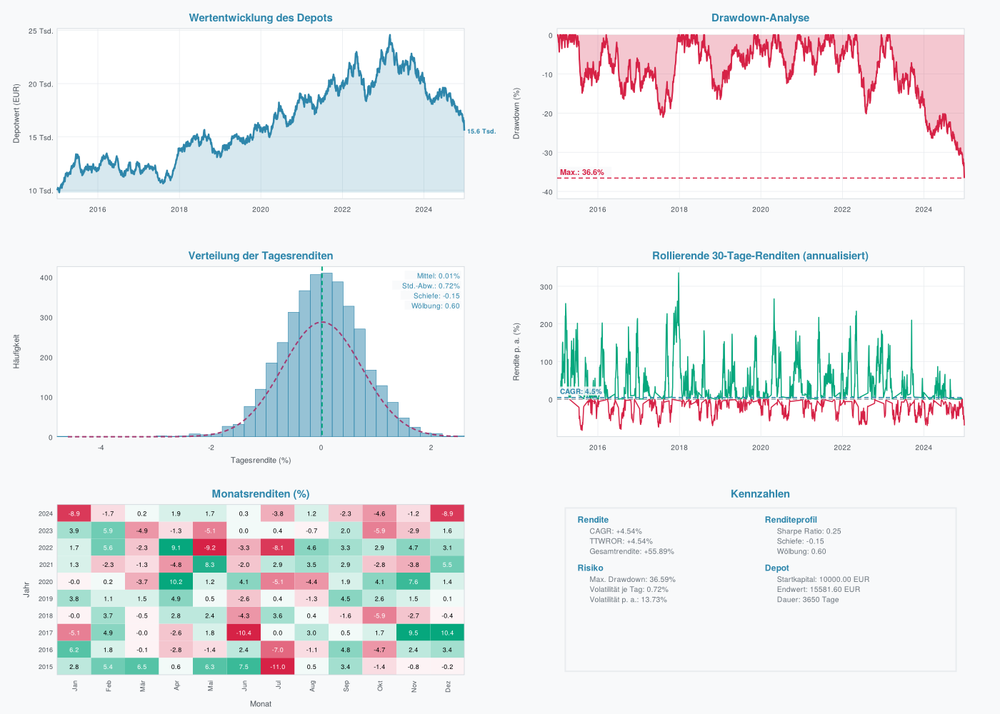

# SimLev-Tutorial (Julia)

SimLev rechnet Anlagestrategien auf täglichen Preisreihen durch, von der
einfachen Mischung aus Aktien- und Anleihe-ETF über Sparpläne und
Rebalancing bis zu Signalstrategien mit gehebelten Produkten. Die Engine
`simulation()` bildet die Besteuerung eines deutschen Privatanlegers Tag für
Tag ab: Teilfreistellung, Vorabpauschale, Sparer-Pauschbetrag, getrennte
Verlusttöpfe nach § 20 und § 23 EStG und Günstigerprüfung.

Dieses Tutorial hat dieselben neun Kapitel wie die R-Vignette
([`r/vignettes/getting-started.Rmd`](../../r/vignettes/getting-started.Rmd))
und das Python-Tutorial ([`python/examples/tutorial.md`](../../python/examples/tutorial.md)).
Funktionsnamen, Argumente und Voreinstellungen sind in allen drei Sprachen
gleich; Pflichtargumente stehen vor dem Semikolon, die übrigen sind
Schlüsselwörter. Die Schreibweisen stehen in der
[Julia-README](../README.md#von-r-zu-julia). Alle Argumente beschreiben die
Docstrings (`?simulation` in der REPL).

Alle Codeblöcke laufen nacheinander in einer Sitzung; die Ausgaben sind
echte Ausgaben (geprüft mit `tests/werkzeuge/doku/beispiele.py`). Die Kurse
erzeugt hier Julias `MersenneTwister`, die Zahlen unterscheiden sich daher
von denen der R- und Python-Fassung. Mit denselben Kursdaten rechnen alle drei Sprachen bitgleich.

## 1 Daten

`simulation()` erwartet eine Tabelle (`RFrame`, NamedTuple von Vektoren,
`Dict`, `DataFrame` oder jede Tabelle mit `propertynames`/`getproperty`) mit
einer Spalte `date` (`Date`, `DateTime`, Text `"JJJJ-MM-TT"` oder Tage seit
1970-01-01) und je Asset einer Spalte mit dem **Kursniveau** (keine
Renditen). Hebel, Dividenden und Finanzierungskosten werden nicht intern
berechnet, sie müssen in der Kursreihe enthalten sein. Weitere Spalten
können Signale, einen Basiszins oder einen risikolosen Zins enthalten.

Hier erzeugen wir zehn Jahre synthetische Kurse für einen Aktien-ETF
(`WORLD`), einen Anleihe-ETF (`BONDS`) und physisch hinterlegtes Gold
(`GOLD`). Julias Zufallszahlen steuern nur diese Beispieldaten; den Zufall
von SimLev selbst setzen `simlev_seed()` bzw. das Argument `seed`. Die
Erweiterungen (Bootstrap, Optimierung u. a.) erwarten Tabellen als `RFrame`;
deshalb wandelt `RFrame(pairs(nt)...)` das NamedTuple in ein `RFrame` um,
das alle Funktionen nehmen.

```julia
using SimLev, Dates, Random

rng = MersenneTwister(42)
n = 365 * 10
nt = (date  = collect(Date(2015, 1, 1):Day(1):Date(2015, 1, 1) + Day(n - 1)),
      WORLD = 100 .* cumprod(1 .+ 4e-4 .+ 0.010 .* randn(rng, n)),
      BONDS =  50 .* cumprod(1 .+ 1e-4 .+ 0.003 .* randn(rng, n)),
      GOLD  =  80 .* cumprod(1 .+ 2e-4 .+ 0.009 .* randn(rng, n)))
data = RFrame(pairs(nt)...)                 # Tabelle mit benannten Spalten
kopf(df, k) = RFrame((c => df[c][1:k] for c in names(df))...)
display(kopf(data, 3))
```

```text
        date    WORLD    BONDS     GOLD
1 2015-01-01 101.2503 50.06342 78.98015
2 2015-01-02 101.2108 50.41896 79.42861
3 2015-01-03 101.6597 50.59714 79.96042
```

Fehlende Kalendertage wie Wochenenden füllt SimLev mit dem letzten
bekannten Kurs auf und nimmt sie aus den renditebasierten Kennzahlen heraus.
Doppelte Datumswerte und Kurse ≤ 0 sind ein Fehler. Fehlende Werte sind
`missing` oder `SimLev.NA`. `series_check()` prüft eigene Daten vorab auf
Lücken, Sprünge und mögliche Splits.

**Prozent-Konvention.** Raten, Spreads, Gebühren, Steuersätze und
Toleranzbänder werden in Prozent angegeben (`26.375` heißt 26,375 %),
Gewichte (`share`) dagegen als Anteile, die sich zu 1 summieren.

## 2 Strategie

Jedes Asset beschreibt `asset_config()`, `create_strategy()` fasst die
Assets zusammen und prüft die Eingaben sofort. Die Assetklasse bestimmt das
Steuerregime: `"etf"` als Investmentfonds (Teilfreistellung,
Vorabpauschale), `"etn"`/`"etc"` und `"certificate"` nach § 20 EStG, mit
`deliverable = true` als privates Veräußerungsgeschäft nach § 23 EStG
(steuerfrei nach einem Jahr). `spread` ist der volle Bid-Ask-Spread in
Prozent (Standard 0).

```julia
strategy = create_strategy(
    WORLD = asset_config("etf", "bnh"; share = 0.6, spread = 0.1, partial_exemption = 30),
    BONDS = asset_config("etf", "bnh"; share = 0.3, spread = 0.1, partial_exemption = 0),
    GOLD  = asset_config("etc", "bnh"; share = 0.1, spread = 0.2, deliverable = true),
)
display(strategy)
println(strategy_validate(strategy, data))
```

```text
Anlagestrategie (3 Assets)
================================

WORLD:
  Klasse: etf | Anteil: 60% | Steuer: investment_fund
BONDS:
  Klasse: etf | Anteil: 30% | Steuer: investment_fund
GOLD:
  Klasse: etc | Anteil: 10% | Steuer: private_sale
true
```

`strategy_add_asset()`, `strategy_update_asset()` und
`strategy_remove_asset()` geben eine geänderte Strategie zurück;
`strategy_from_weights()` und `portfolio_template()` bauen Strategien aus
Gewichten bzw. bekannten Allokationen.

Mit `trading = "signal"` steigt ein Asset nach eigenen logischen
Signalspalten ein und aus; die Signal-Bausteine `signal_sma()`,
`signal_momentum()` u. a. erzeugen solche Spalten:

```julia
sig = signal_sma(data["WORLD"]; n = 200)
data["buy"] = sig.buy
data["sell"] = sig.sell
strategy_sig = create_strategy(
    WORLD = asset_config("etf", "signal"; share = 1, spread = 0.1, partial_exemption = 30,
                         signal_buy = "buy", signal_sell = "sell"))
res_sig = simulation(data, strategy_sig; start_value = 10000, tax = tax_profile())
println(round(res_sig.worth[end]; digits = 2), " ", round(res_sig.sells["WORLD"]; digits = 2))
```

```text
9057.74 6.41
```

## 3 `simulation()` mit Bausteinen

`simulation(data, strategy; ...)` nimmt neben Startwert und Zeitraum
Bausteine für Kosten, Sparplan, Rebalancing, Splits und Steuer. Jeder
Baustein ist ein eigenes Objekt; ohne Angabe ist er aus.

```julia
steuer = tax_profile(26.375; income = income_rate(42))
result = simulation(data, strategy;
    start_value = 10000,
    rebalance = rebalance_plan(1; unit = "year"),
    tax = steuer,
    liquidate = true,
    risk_free = 2)
display(result)
```

```text
══════════════════════════════════════════════════════════════
                 SimLev Simulationsergebnisse
══════════════════════════════════════════════════════════════

  Wertentwicklung
  ─────────────────────
  CAGR:             +3.94%
  TTWROR:           +3.94%
  Endwert:          14706.32 EUR

  Risiko
  ─────────────────────
  Max. Drawdown:    30.46%
  Mittl. Drawdown:  8.11%
  Ulcer Index:      0.0986
  Längster DD:      916 Tage
  Mittl. Erholung:  38 Tage

  Kennzahlen
  ─────────────────────
  Sharpe:           +0.218
  Sortino:          +0.308
  Calmar:           +0.129
  Omega:            +1.052
  Gain/Pain:        +0.052
  Serenity:         +1.312
  Martin Ratio:     +0.400

  Verteilung
  ─────────────────────
  Mittel je Tag:    +0.0125%
  Std.-Abw. je Tag: 0.6247%
  Schiefe:          -0.111
  Wölbung:          0.421

  Steuern
  ─────────────────────
  Gezahlte Steuern: 544.32 EUR
  Verlustvortrag:   0.00 EUR (§ 20) / 0.00 EUR (§ 23)
  SPB genutzt:      2225.36 EUR (Ersparnis: 586.94 EUR)

══════════════════════════════════════════════════════════════
```

*Endwert* ist der Depotwert nach Spreads und Steuern in EUR, *CAGR* die
jährliche Wachstumsrate. Mit `liquidate = true` wird am letzten Tag alles
verkauft und versteuert. Weil `GOLD` nach § 23 EStG besteuert wird, nennt
`income_rate(42)` den persönlichen Grenzsteuersatz für Gewinne innerhalb der
Haltefrist (ohne ihn warnt `simulation()`).

### Kosten

Spreads stehen je Asset in `asset_config()`. Ordergebühren setzt
`sim_costs()`: ein fester Betrag in EUR je Order oder ein NamedTuple mit
`fixed`, `percent`, `min` und `max`; `dca_fee` gilt für Sparplankäufe.

```julia
res_kosten = simulation(data, strategy; start_value = 10000,
    costs = sim_costs(; order_fee = (fixed = 4.9, percent = 0.25, min = 9.9, max = 59), dca_fee = 0),
    rebalance = rebalance_plan(1; unit = "year"),
    tax = steuer, liquidate = true)
println(round(res_kosten.fees_paid; digits = 2), " ", round(res_kosten.worth[end]; digits = 2))
```

```text
352.03 14376.46
```

### Sparplan

`dca_plan(value, span; unit = …)` zahlt regelmäßig ein, hier 250 EUR im
Monat. Mit `fill_deficits = true` fließt jede Rate zuerst in untergewichtete
Assets und ersetzt so einen Teil der Umschichtungen.

```julia
res_dca = simulation(data, strategy; start_value = 10000,
    dca = dca_plan(250, 1; unit = "month", fill_deficits = true),
    rebalance = rebalance_plan(1; unit = "year"),
    tax = steuer, liquidate = true)
println("CAGR (geldgewichtet) ", round(100 * res_dca.cagr; digits = 2), " %, TTWROR ",
        round(100 * res_dca.ttwror; digits = 2), " %")
println("eingezahlt ", round(res_dca.invested[end]; digits = 2), " EUR, Endwert ",
        round(res_dca.worth[end]; digits = 2), " EUR")
```

```text
CAGR (geldgewichtet) 2.35 %, TTWROR 4.21 %
eingezahlt 40000.0 EUR, Endwert 46398.92 EUR
```

Mit Einzahlungen ist die CAGR die geldgewichtete Rendite (interner Zinsfuß,
XIRR). Für den Vergleich mit anderen Strategien oder einem Index eignet sich
die zeitgewichtete Rendite TTWROR; Drawdowns misst SimLev dann auf dem
zeitgewichteten Wertindex `twr_index`.

### Rebalancing

`rebalance_plan()` schichtet kalenderbasiert um, mit `thresh` nur bei einer
Abweichung über dem Band (in Prozentpunkten, mit
`thresh_type = "relative"` relativ zum Zielgewicht) und mit `event_col` an
Tagen, an denen eine logische Datenspalte wahr ist (z. B. aus
`rebalance_trigger()`).

```julia
res_band = simulation(data, strategy; start_value = 10000,
    rebalance = rebalance_plan(1; unit = "quarter", thresh = 5),
    tax = steuer, liquidate = true)
println([k => round(res_band.sells[k]; digits = 2) for k in ("WORLD", "BONDS", "GOLD")])
```

```text
["WORLD" => 0.5, "BONDS" => 0.3, "GOLD" => 0.3]
```

`buys` und `sells` nennen die mittlere Zahl der Käufe und Verkäufe je Jahr
und Asset.

### Splits

Manche Hebelprodukte splitten, wenn ihr Kurs eine Grenze über- oder
unterschreitet. `split_rule([unten, oben])` bildet das nach: über der
oberen Grenze wird gesplittet, unter der unteren zusammengelegt; die
Anschaffungskosten der Lots werden angepasst, Kaufdaten bleiben erhalten.
`series_leverage()` erzeugt hier eine täglich zurückgesetzte 2-fach
gehebelte Reihe aus `WORLD` (Hebel, Zins und Kosten in Prozent).

```julia
data["LEV"] = series_leverage(data, "WORLD"; leverage = 2, rate = 2, expense = 0.6)
strategy_lev = create_strategy(
    LEV   = asset_config("certificate", "bnh"; share = 0.5, spread = 0.2),
    BONDS = asset_config("etf", "bnh"; share = 0.5, spread = 0.1))
res_split = simulation(data, strategy_lev; start_value = 10000,
    rebalance = rebalance_plan(1; unit = "year"),
    splits = split_rule([20, 150]), tax = tax_profile(), liquidate = true)
println(round.(extrema(data["LEV"]); digits = 2))
println(round(res_split.worth[end]; digits = 2))
```

```text
(88.44, 575.49)
16182.86
```

### Steuer

`tax_profile()` schaltet die Besteuerung ein (`tax = nothing` rechnet ohne
Steuern). Wichtige Argumente: `rate` (Abgeltungsteuer mit Soli, Standard
26,375 %), `church_tax`, `sparer_pauschbetrag` (Standard 1.000 EUR),
`base_rate` (Basiszins der Vorabpauschale, Zahl oder Spaltenname),
`guenstigerpruefung` und `income` für den persönlichen Steuersatz:
`income_rate(42)` als fester Grenzsteuersatz oder
`income_tariff(taxable_income)` mit dem Einkommensteuertarif aus
`tax_tariff()` (mitgeliefert: `julia/data/steuertarif.csv`).

```julia
res_steuer = simulation(data, strategy; start_value = 100000,
    rebalance = rebalance_plan(1; unit = "month", thresh = 3),
    tax = tax_profile(; base_rate = 2.55, church_tax = 9, guenstigerpruefung = true,
                      income = income_tariff(14000)),
    liquidate = true)
ty = res_steuer.tax_report.tariff_years
for i in findall(>=(2023), ty["year"])
    println(ty["year"][i], ": Kapitalerträge ", round(ty["capital_income"][i]; digits = 2),
            ", Abgeltungsteuer ", round(ty["abgeltung_burden"][i]; digits = 2),
            ", Abrechnung ", round(ty["settlement"][i]; digits = 2))
end
println(round(res_steuer.tax_report.total_taxes_paid; digits = 2))
```

```text
2023: Kapitalerträge 1343.46, Abgeltungsteuer 376.1, Abrechnung -112.32
2024: Kapitalerträge 10986.43, Abgeltungsteuer 3075.66, Abrechnung -319.05
8305.8
```

`tariff_years` zeigt die Veranlagung je Jahr. SimLev projiziert die heutige
Rechtslage in die Vergangenheit: Ein Backtest beantwortet, wie eine
Strategie zu heutigen Konditionen abgeschnitten hätte. Die Einzelheiten
(Vorabpauschale, Verlusttöpfe, § 23, Kirchensteuer als Sonderausgabe,
Vereinfachungen) stehen in der Hilfe zu `simulation` und `tax_tariff`.

### Wrapper

Ein Fonds-Wrapper ist **ein** Asset der Strategie, dessen Kurs der
Anteilswert einer inneren Strategie ist, mit Verwaltungsgebühr und
Performancegebühr gegen die High-Water-Mark (`funds_costs()`, in Prozent).
Außen wird er wie ein Einzelpapier gehandelt und besteuert.

```julia
inner = wrapper_config(
    create_strategy(WORLD = asset_config("etf"; share = 0.7), GOLD = asset_config("etc"; share = 0.3));
    rebalance = rebalance_plan(; unit = "quarter"),
    costs = funds_costs(0.95, 5))
nav = wrapper_nav(data, inner)
println(round(nav["nav"][end]; digits = 4), " ", round(nav["hwm"][end]; digits = 4))
strategy_wrap = create_strategy(
    Zertifikat = asset_config("certificate"; share = 0.8, spread = 0.5, wrapper = inner),
    BONDS      = asset_config("etf"; share = 0.2, spread = 0.1))
res_wrap = simulation(data, strategy_wrap; start_value = 10000, tax = tax_profile(), liquidate = true)
println(round(res_wrap.worth[end]; digits = 2))
```

```text
123.3515 163.6283
12205.84
```

Der Name `Zertifikat` ist keine Kursspalte; `simulation()` rechnet den
Anteilswert vorab aus `WORLD` und `GOLD`.

## 4 Ergebnis und Auswertung

`simulation()` liefert ein `SimLevResult`. Wichtige Bestandteile sind
`dates`, `worth` (Depotwert je Tag), `twr_index`, `drawdowns`, `cagr`,
`ttwror`, `statistics` (alle Kennzahlen), `report` (Werte je Asset),
`tax_report`, `buys`, `sells` und, mit Steuer, `open_lots`. Nur in Python
und Julia gibt es zusätzlich `trades` mit allen Buchungen je Asset.

```julia
st = result.statistics
println([round(st[k]; digits = 4) for k in ("sharpe", "sortino", "calmar", "omega")])
println(keys(result.report))
println(summary(result).total_return_twr)
```

```text
[0.2177, 0.3078, 0.1294, 1.0519]
["WORLD", "BONDS", "GOLD"]
0.471441018548731
```

`result_analysis()` wertet gespeicherte Ergebnisse oder Kursreihen
nachträglich aus, auch gegen eine Benchmark (Alpha, Beta, Capture, Tracking
Error, VaR/CVaR, Jahres- und Monatstabellen, rollierende Kennzahlen):

```julia
da = result_analysis(RList("Mischung" => result, "Mit_Sparplan" => res_dca);
                     benchmark = "Mischung", risk_free = 2)
display(da)
```

```text
══════════════════════════════════════════════════════════════
                    SimLev Detailanalyse
══════════════════════════════════════════════════════════════
  Zeitraum: 2015-01-01 bis 2024-12-28 (10.0 Jahre)

                                 Mischung Mit_Sparplan
  Gesamtrendite                   47.14 %      51.03 %
  CAGR (TWR)                       3.94 %       4.21 %
  MWRR (geldgewichtet)             3.94 %       2.35 %
  Volatilität p. a.               11.94 %      11.76 %
  Sharpe                            0.218        0.241
  Sortino                           0.308        0.342
  Calmar                            0.129        0.142
  Max. Drawdown                   30.46 %      29.59 %
  Mittlerer Drawdown               2.76 %       2.82 %
  Ulcer Index                      9.86 %       9.57 %
  Ulcer Performance Index           0.197        0.231
  Längster Drawdown                917 T.       666 T.
  Bestes Jahr                     17.67 %      18.31 %
  Schlechtestes Jahr             -20.46 %     -19.42 %
  Schlechtester Monat             -9.49 %      -8.56 %
  Positive Monate                 60.00 %      59.17 %
  VaR 5 % (Tag)                    1.01 %       1.00 %
  CVaR 5 % (Tag)                   1.30 %       1.28 %
  VaR 5 % (Monat)                  6.33 %       6.21 %
  CVaR 5 % (Monat)                 8.00 %       7.57 %
  Steuern                             544          973

  Gegen Benchmark 'Mischung'
                             Mit_Sparplan
  Alpha p. a.                      0.28 %
  Beta                              0.984
  Korrelation                       0.999
  R²                                0.997
  Up-Capture                        0.996
  Down-Capture                      0.978
  Capture Spread                    0.017
  Aktive Rendite p. a.             0.27 %
  Tracking Error                   0.63 %
  Information Ratio                 0.382
  M² (Modigliani)                  4.88 %
══════════════════════════════════════════════════════════════
```

Für Parameterstudien rufen `sensitivity_grid()`, `sensitivity_rebalancing()`,
`planning_lumpsum_vs_dca()` und `sensitivity_leverage()` die Engine
wiederholt auf.

## 5 Bootstrap

`bootstrap_config()` beschreibt die Reihen, `bootstrap_study()` erzeugt
Pfade, simuliert alle Strategien auf denselben Pfaden und behält die
Kennzahlen; `keep_returns = "year"` behält zusätzlich die Jahresrenditen für
die Entnahmephase. Jeder Pfad hat einen eigenen Zufallsstrom; das Ergebnis
hängt nicht von `cores` ab und ist in R, Python und Julia gleich.
Bedingungen stehen als Text in R-Syntax.

```julia
cfg = bootstrap_config((WORLD = "WORLD", BONDS = "BONDS", GOLD = "GOLD"); input = "prices")
study = bootstrap_study(data, cfg, "stationary"; n = 100, params = (L = 250,),
                        strategies = (mix = strategy,), seed = 42,
                        keep_returns = "year", progress = false)
display(r_summary(study))
display(bootstrap_probability(study, "cagr > 0.05 & max_drawdown <= 0.3"))
```

```text
══════════════════════════════════════════════════════════════
                 SimLev Bootstrap-Studie
══════════════════════════════════════════════════════════════
  Verfahren: stationary | Pfade: 100 | Pfadlänge: 3649 Tage

  cagr (mit Sparplan geldgewichtet, XIRR)
  Strategie          Mittel        q05       q25       q50       q75       q95
  mix                 4.48%     -0.57%     2.09%     3.97%     6.36%    10.13%

  ttwror
  Strategie          Mittel        q05       q25       q50       q75       q95
  mix                 4.48%     -0.57%     2.09%     3.97%     6.36%    10.13%

  max_drawdown
  Strategie          Mittel        q05       q25       q50       q75       q95
  mix                28.77%     20.40%    23.72%    28.08%    33.19%    38.73%

  sharpe
  Strategie          Mittel        q05       q25       q50       q75       q95
  mix                 0.390      0.001     0.243     0.375     0.524     0.783

  ulcer_index
  Strategie          Mittel        q05       q25       q50       q75       q95
  mix                 0.132      0.079     0.102     0.120     0.147     0.218

  final_value
  Strategie          Mittel        q05       q25       q50       q75       q95
  mix                 16532       9437     12291     14739     18501     26218
══════════════════════════════════════════════════════════════
  strategy                         condition probability         se   n
1      mix cagr > 0.05 & max_drawdown <= 0.3        0.27 0.04439595 100
```

Verfahren sind u. a. `block`, `stationary`, `regime`, `evt`, `garch`,
`gjr_garch` und `ms_garch` (Liste in `?bootstrap`).
`bootstrap_block_length()` schätzt eine Blocklänge.

## 6 Entnahme

Die Entnahmephase rechnet auf Periodenrenditen: aus historischen Kohorten,
Bootstrap-Pfaden oder einem gespeicherten Ergebnis von `simulation()`.
`withdrawal_rule()` wählt eine von 14 Regeln, z. B. `"constant"`
(4-%-Regel), `"vanguard"` oder `"guyton_klinger"`.

```julia
wd = withdrawal_simulation(study, withdrawal_rule("guyton_klinger"; rate = 5);
                           strategy = "mix", years = 8, inflation = 2, start_value = 500000)
display(wd)
```

```text
══════════════════════════════════════════════════════════════
                 SimLev Entnahme-Simulation
══════════════════════════════════════════════════════════════

  Regel:            Guyton-Klinger-Entscheidungsregeln
  Pfade:            100 Pfade über 8 Jahre, Startvermögen 500000
  Steuern:          keine

  Erfolgsquote:     100.0 % (Depot reicht für alle geplanten Entnahmen)
  Kapitalerhalt:    24.0 % (reales Endvermögen >= Start)
  SWR (5-%-Quantil PWR): 10.03 % der Startsumme

  real, in Startkaufkraft            q05       q25       q50       q75       q95
  Endvermögen                     205661    294767    369425    492016    722638
  Entnahme Jahr 1                  25000     25000     25000     25000     25000
  Konsum Jahr 1                    25000     25000     25000     25000     25000
  Konsum Jahr 10                       –         –         –         –         –
  Konsum Jahr 20                       –         –         –         –         –
  Konsum Jahr 30                       –         –         –         –         –
  Konsum Durchschnitt              23745     24157     24453     24755     27864
  Konsum Minimum                   22642     23556     24029     24510     25000
  Sicherheitsäquiv. (g=2)          23715     24143     24446     24753     27515
  Max. Konsumrückgang              0.00%     1.96%     3.89%     5.77%     9.43%
  PWR                             10.03%    12.02%    13.57%    14.95%    17.45%

══════════════════════════════════════════════════════════════
```

Ist `start_value` ein Ergebnis von `simulation()` mit Steuer, übernimmt die
Entnahmephase dessen Endwert und die offenen Lots und verkauft per FIFO.
`withdrawal_max_rate()` sucht die höchste Anfangsrate für eine
Ziel-Erfolgsquote.

## 7 Optimierung und Forschung

`portfolio_optimize()` schätzt Gewichte (Minimum-Varianz, maximale Sharpe
Ratio, Risikoparität, HRP, minimaler CVaR u. a.) aus Wochenrenditen:

```julia
opt = portfolio_optimize(data; assets = ["WORLD", "BONDS", "GOLD"], method = "risk_parity")
display(opt)
```

```text
SimLev-Optimierung: risk_parity (521 Perioden, week, Kovarianz sample)

 Anlage Gewicht Risikoanteil
  WORLD  18.5 %       33.3 %
  BONDS  61.0 %       33.3 %
   GOLD  20.5 %       33.3 %

Erwartete Rendite 2.87 % p. a. (historisch), Volatilität 5.79 %, Sharpe 0.495
CVaR(0.05) 1.60 % je Periode, CDaR(0.05) 9.18 % (kumuliert)
Diversifikationsverhältnis 1.81, effektive Anzahl: Gewichte 2.2, Risiko 3.0
```

`param_search()` prüft eine Strategie über einen Parameterraum; die
Ergebnisse lassen sich auf Überanpassung prüfen (`overfit_pbo()`,
`sharpe_deflated()`, `overfit_walk_forward()`):

```julia
ps = param_search(data;
    builder = p -> (strategy = strategy_sig, signal = df -> signal_sma(df["WORLD"]; n = p["n"])),
    space = param_space(n = [50, 100, 150, 200, 250]),
    objective = "sharpe")
display(ps)
display(sharpe_deflated(ps))
```

```text
...
Zielgröße: sharpe

 id   n    cagr max_drawdown sharpe ulcer_index trades plateau
  1  50 10.29 %      15.04 %  0.776       0.079 19.919   0.632
  2 100  5.97 %      32.46 %  0.488       0.126 14.614   0.486
  3 150  1.74 %      26.13 %  0.195       0.138 14.714   0.226
  5 250 -0.63 %      28.21 %  0.024       0.156 13.113   0.010
  4 200 -0.99 %      30.49 % -0.004       0.169 12.812   0.071
cagr: mit Sparplan geldgewichtet (XIRR), sonst CAGR des Depotwerts

Bester Punkt:   #1 (n = 50), sharpe = 0.776
Bestes Plateau: #1 (n = 50), sharpe = 0.776, Nachbarschaft = 0.632
Deflated Sharpe Ratio
  Punkt #1, 522 Beobachtungen (week)
  Sharpe Ratio (p. a.):                 0.777
  Versuche: 5 nominal, 1.8 effektiv (mittlere Korrelation 0.80), verwendet 1.8
  Erwartetes Maximum ohne Können (p. a.):  0.138
  PSR (SR > 0):                         99.4 %
  DSR (SR > erwartetes Maximum):        98.0 %
  Lesart: DSR über 95 % = Ergebnis hält der Mehrfachtest-Korrektur stand.
```

Weitere Forschungsfunktionen: Abhängigkeiten und Tail-Risiko
(`dependence_analysis()`, `copula_fit()`, `tail_covar()`), taktische
Allokation (`tactical_simulation()`), Szenarien
(`scenario_entropy_pooling()`, `scenario_crisis()`), Planung
(`planning_goal()`) und statistische Prüfungen (`sharpe_test()`,
`overfit_reality_check()`, `regime_hmm()`).

## 8 Weitere Werkzeuge

Die übrigen Werkzeuge arbeiten auf denselben Daten; je Funktion beschreibt
der Docstring Argumente und Ergebnis und zeigt ein Beispiel (z. B.
`?backcast_fit`). Eine Auswahl:

**Daten prüfen und Vorlagen.** `series_check()` meldet Lücken, Sprünge,
mögliche Splits und stehende Kurse, ohne die Daten zu ändern;
`portfolio_template()` baut bekannte Allokationen auf die eigenen Spalten.
`series_align()`, `series_align_macro()` und `series_splice()` führen
Quellen zusammen, legen Makroreihen mit Veröffentlichungsverzug auf den
Tageskalender und verketten Reihen.

```julia
chk = series_check(data)
display(chk["summary"])
display(portfolio_template("60_40"; map = (stocks = "WORLD", bonds = "BONDS")))
```

```text
  column      start        end    n missing jumps spikes splits stale_max
1  WORLD 2015-01-01 2024-12-28 3650       0     0      0      0         1
2  BONDS 2015-01-01 2024-12-28 3650       0     0      0      0         1
3   GOLD 2015-01-01 2024-12-28 3650       0     0      0      0         1
4    LEV 2015-01-01 2024-12-28 3650       0     0      0      0         1
  nonpositive
1           0
2           0
3           0
4           0
Anlagestrategie (2 Assets)
================================

WORLD:
  Klasse: etf | Anteil: 60% | Steuer: investment_fund
BONDS:
  Klasse: etf | Anteil: 40% | Steuer: investment_fund
```

**Backcast.** Ein gehebeltes Produkt, das es erst seit 2020 gibt, wird aus
dem Index zurückgerechnet. `backcast_fit()` schätzt auf dem
Überlappungszeitraum die laufenden Kosten, die über TER und Finanzierung
hinausgehen (hier 0,2 % p. a.), `backcast()` verlängert die Reihe:

```julia
d8 = RFrame("date" => data["date"], "WORLD" => data["WORLD"])
lev = series_leverage(d8, "WORLD"; leverage = 2, rate = 2, expense = 0.8)
lev[data["date"] .< Date(2020, 1, 1)] .= NaN
d8["LEV"] = lev
fit = backcast_fit(d8, "LEV", "WORLD"; leverage = 2, rate = 2, ter = 0.6)
println(fit["params"]["drag"])
bc = backcast(fit)
println(count(isequal("backcast"), bc["source"]), " ", count(isequal("product"), bc["source"]))
```

```text
0.19999999788902417
1826 1824
```

**Historische Entnahme-Kohorten.** `withdrawal_cohorts()` bildet aus einer
Kursreihe überlappende Entnahmezeiträume, `withdrawal_max_rate()` sucht die
höchste Anfangsrate für eine Ziel-Erfolgsquote:

```julia
coh = withdrawal_cohorts(data; price = "WORLD", inflation = 2, years = 5, step = "year")
println(size(coh["returns"]))
display(withdrawal_max_rate(coh, withdrawal_rule("constant"); success = 0.9))
```

```text
(5, 5)
1-element RVector{Float64}:
 20.0
```

**Taktische Allokation.** `tactical_rules()` legt Zielgewichte nach Regeln
fest (hier: Aktien über dem 200-Tage-Durchschnitt, sonst Anleihen),
`tactical_simulation()` rechnet sie mit `simulation()`:

```julia
w = tactical_rules(data, [(when = signal_sma(data["WORLD"], 200), weights = (WORLD = 1,))], (BONDS = 1,))
res_takt = tactical_simulation(data, w; rebalance = "switch")
println(res_takt["tactical"]["switches"])
println(round(res_takt["cagr"]; digits = 4))
```

```text
128
0.037
```

**Abhängigkeiten und Szenarien.** `tail_dependence()` misst die gemeinsamen
Ausschläge in den Rändern, `scenario_crisis()` führt ein Portfolio durch
Krisenfenster (eigene Fenster oder die eingebaute Liste):

```julia
td = tail_dependence(diff(log.(data["WORLD"])), diff(log.(data["GOLD"])), [0.05, 0.10])
display(td)
kr = RFrame("crisis" => ["Beispiel"], "start" => [Date(2020, 2, 15)], "end" => [Date(2020, 4, 30)])
display(scenario_crisis(data, (WORLD = 0.6, BONDS = 0.4); crises = kr))
```

```text
     q      lower      upper exceed_lower exceed_upper n_lower n_upper
1 0.05 0.03836668 0.06029049           NA  -0.16657736       7      11
2 0.10 0.09317621 0.11784050 -0.004458887   0.07216348      34      43
    crisis      start        end portfolio max_drawdown days_to_recover
1 Beispiel 2020-02-15 2020-04-30  5.764787    -6.240278               0
     WORLD   BONDS
1 6.857553 4.12564
```

Weitere Werkzeuge: Bootstrap-Verfahren und Studien mit Signalen
(`bootstrap_study()`), Steuern in der Entnahmephase (`tax_profile()` in
`withdrawal_simulation()`), Sensitivitäten (`sensitivity_grid()`,
`sensitivity_rebalancing()`), Abhängigkeitsanalyse mit Drittvariablen
(`dependence_analysis()`, `tail_regression()`, `tail_covar()`), Rotation und
Zielvolatilität (`tactical_rotation()`, `tactical_target_volatility()`),
Anleihen und Geldmarkt aus Zinsreihen (`index_bond()`,
`index_money_market()`), Szenarien mit eigenen Annahmen
(`scenario_entropy_pooling()`), Planung (`planning_goal()`) und
statistische Prüfungen (`sharpe_test()`, `overfit_reality_check()`,
`regime_hmm()`).

## 9 Grafik

`plot_dashboard(result)` (für alle Ergebnisobjekte `r_plot(x)`) zeichnet das
Dashboard als SVG ohne externe Pakete und liefert ein `SimLevPlot`: in
Jupyter, Pluto und VS Code direkt sichtbar, mit `file = "datei.svg"`
gespeichert. Es enthält neben `svg` die dargestellten Werte je Panel als
`RFrame` (`p.data`), das Eingabeobjekt (`p.source`) und dessen Klasse
(`p.kind`). `style = "compact"` zeigt vier Panels, `style = "custom"` die
Panels aus `panels`, `compare` ein zweites Ergebnis daneben.

```julia
p = plot_dashboard(result)
println(p.kind, " ", sort(keys(p.data)))
display(kopf(p.data["performance"], 3))
p2 = plot_dashboard(result; style = "custom", panels = ["performance", "drawdown"],
                    compare = res_dca, file = "vergleich.svg")
export_dashboard(result, "backtest.svg"; width = 16, height = 10)
```

```text
SimLevResult ["distribution", "drawdown", "monthly", "performance", "rolling", "stats"]
        date  strategy
1 2015-01-01  9994.503
2 2015-01-02 10019.132
3 2015-01-03 10063.117
```

Die Grafik zeigt dieselben Panels, deutschen Beschriftungen und Kennzahlen
wie in R; sie ist nicht bitgleich, die Werte in `p.data` schon. Eigene
Grafiken entstehen aus `p.data`, etwa mit Plots.jl oder Makie aus den
Spalten `date` und `strategy` von `p.data["performance"]`. Für PDF oder PNG
wandeln Sie die SVG-Datei z. B. mit `rsvg-convert` oder CairoSVG um. Auch die
übrigen Ergebnisobjekte zeichnet `r_plot()`, etwa `r_plot(study)`,
`r_plot(wd)` und `r_plot(da)`.

So sieht das Dashboard des Schnellstarts aus
([`schnellstart.jl`](schnellstart.jl)):

<p align="center">
  
</p>
