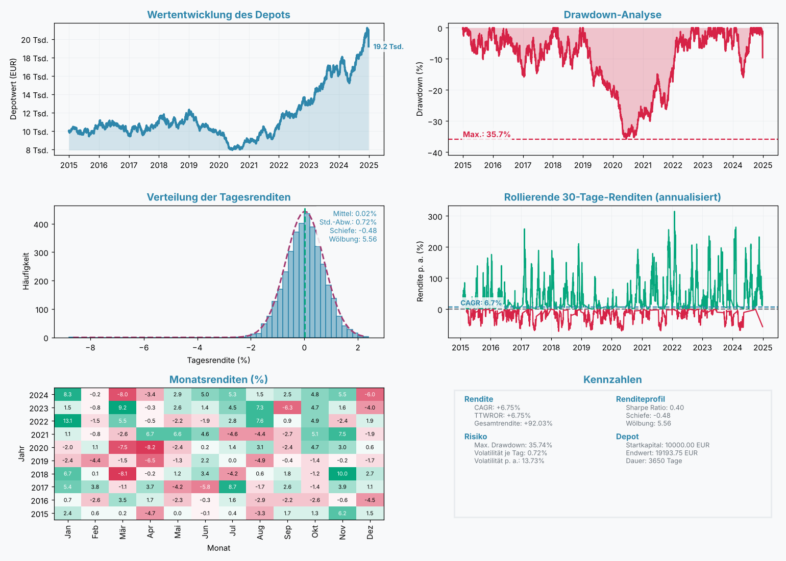

# SimLev-Tutorial (Python)

SimLev rechnet Anlagestrategien auf täglichen Preisreihen durch, von der
einfachen Mischung aus Aktien- und Anleihe-ETF über Sparpläne und
Rebalancing bis zu Signalstrategien mit gehebelten Produkten. Die Engine
`simulation()` bildet die Besteuerung eines deutschen Privatanlegers Tag für
Tag ab: Teilfreistellung, Vorabpauschale, Sparer-Pauschbetrag, getrennte
Verlusttöpfe nach § 20 und § 23 EStG und Günstigerprüfung.

Dieses Tutorial hat dieselben neun Kapitel wie die R-Vignette
([`r/vignettes/getting-started.Rmd`](../../r/vignettes/getting-started.Rmd))
und das Julia-Tutorial ([`julia/examples/tutorial.md`](../../julia/examples/tutorial.md)).
Funktionsnamen, Argumente und Voreinstellungen sind in allen drei Sprachen
gleich; die Schreibweisen stehen in der [Python-README](../README.md#von-r-zu-python).
Alle Argumente beschreiben die Docstrings (`help(simlev.simulation)`).

Alle Codeblöcke laufen nacheinander in einer Sitzung; die Ausgaben sind
echte Ausgaben (geprüft mit `tests/werkzeuge/doku/beispiele.sh`). Die Kurse
erzeugt hier numpy, die Zahlen unterscheiden sich daher von denen der R- und
Julia-Fassung. Mit denselben Kursdaten rechnen alle drei Sprachen bitgleich.

## 1 Daten

SimLev erwartet eine Tabelle (`pandas.DataFrame` oder `dict` aus Spalten)
mit einer Spalte `date` (`datetime64`, `datetime.date` oder Text
`"JJJJ-MM-TT"`) und je Asset einer Spalte mit dem **Kursniveau** (keine
Renditen). Hebel, Dividenden und Finanzierungskosten werden nicht intern
berechnet, sie müssen in der Kursreihe enthalten sein. Weitere Spalten
können Signale, einen Basiszins oder einen risikolosen Zins enthalten.

Hier erzeugen wir zehn Jahre synthetische Kurse für einen Aktien-ETF
(`WORLD`), einen Anleihe-ETF (`BONDS`) und physisch hinterlegtes Gold
(`GOLD`). numpy steuert nur diese Beispieldaten; den Zufall von SimLev selbst
setzen `simlev.simlev_seed()` bzw. das Argument `seed`.

```python
import numpy as np
import pandas as pd
import simlev

pd.set_option("display.width", 100)
rng = np.random.default_rng(42)
n = 365 * 10
data = pd.DataFrame({
    "date":  pd.date_range("2015-01-01", periods=n, freq="D"),
    "WORLD": 100 * np.cumprod(1 + rng.normal(4e-4, 0.010, n)),
    "BONDS":  50 * np.cumprod(1 + rng.normal(1e-4, 0.003, n)),
    "GOLD":   80 * np.cumprod(1 + rng.normal(2e-4, 0.009, n)),
})
print(data.head(3))
```

```text
        date       WORLD      BONDS       GOLD
0 2015-01-01  100.344717  50.219430  80.133994
1 2015-01-02   99.341286  50.263125  79.718144
2 2015-01-03  100.126530  50.396810  79.335772
```

Fehlende Kalendertage wie Wochenenden füllt SimLev mit dem letzten
bekannten Kurs auf und nimmt sie aus den renditebasierten Kennzahlen heraus.
Doppelte Datumswerte und Kurse ≤ 0 sind ein Fehler. Fehlende Werte sind
`NaN` oder `simlev.NA`. `simlev.series_check()` prüft eigene Daten vorab auf
Lücken, Sprünge und mögliche Splits.

**Prozent-Konvention.** Raten, Spreads, Gebühren, Steuersätze und
Toleranzbänder werden in Prozent angegeben (`26.375` heißt 26,375 %),
Gewichte (`share`) dagegen als Anteile, die sich zu 1 summieren.

## 2 Strategie

Jedes Asset beschreibt `asset_config()`, `create_strategy()` fasst die
Assets zusammen und prüft die Eingaben sofort. Die Assetklasse bestimmt das
Steuerregime: `"etf"` als Investmentfonds (Teilfreistellung,
Vorabpauschale), `"etn"`/`"etc"` und `"certificate"` nach § 20 EStG, mit
`deliverable=True` als privates Veräußerungsgeschäft nach § 23 EStG
(steuerfrei nach einem Jahr). `spread` ist der volle Bid-Ask-Spread in
Prozent (Standard 0).

```python
strategy = simlev.create_strategy(
    WORLD=simlev.asset_config(asset_class="etf", trading="bnh",
                              share=0.6, spread=0.1, partial_exemption=30),
    BONDS=simlev.asset_config(asset_class="etf", trading="bnh",
                              share=0.3, spread=0.1, partial_exemption=0),
    GOLD=simlev.asset_config(asset_class="etc", trading="bnh",
                             share=0.1, spread=0.2, deliverable=True),
)
print(strategy)
print(simlev.strategy_validate(strategy, data=data))
```

```text
Anlagestrategie (3 Assets)
================================

WORLD:
  Klasse: etf | Anteil: 60% | Steuer: investment_fund
BONDS:
  Klasse: etf | Anteil: 30% | Steuer: investment_fund
GOLD:
  Klasse: etc | Anteil: 10% | Steuer: private_sale
True
```

`strategy_add_asset()`, `strategy_update_asset()` und
`strategy_remove_asset()` geben eine geänderte Strategie zurück;
`strategy_from_weights()` und `portfolio_template()` bauen Strategien aus
Gewichten bzw. bekannten Allokationen.

Mit `trading="signal"` steigt ein Asset nach eigenen logischen
Signalspalten ein und aus; die Signal-Bausteine `signal_sma()`,
`signal_momentum()` u. a. erzeugen solche Spalten:

```python
sig = simlev.signal_sma(data["WORLD"], n=200)
data["buy"] = sig["buy"]
data["sell"] = sig["sell"]
strategy_sig = simlev.create_strategy(
    WORLD=simlev.asset_config(asset_class="etf", trading="signal", share=1, spread=0.1,
                              partial_exemption=30, signal_buy="buy", signal_sell="sell"),
)
res_sig = simlev.simulation(data, strategy_sig, start_value=10000, tax=simlev.tax_profile())
print(round(res_sig.worth[-1], 2), round(res_sig.sells["WORLD"], 2))
```

```text
18113.2 5.61
```

## 3 `simulation()` mit Bausteinen

`simlev.simulation(data, strategy, ...)` nimmt neben Startwert und Zeitraum
Bausteine für Kosten, Sparplan, Rebalancing, Splits und Steuer. Jeder
Baustein ist ein eigenes Objekt; ohne Angabe ist er aus.

```python
steuer = simlev.tax_profile(rate=26.375, income=simlev.income_rate(42))
result = simlev.simulation(
    data, strategy,
    start_value=10000,
    rebalance=simlev.rebalance_plan(span=1, unit="year"),
    tax=steuer,
    liquidate=True,
    risk_free=2,
)
print(result)
```

```text
══════════════════════════════════════════════════════════════
                 SimLev Simulationsergebnisse
══════════════════════════════════════════════════════════════

  Wertentwicklung
  ─────────────────────
  CAGR:             +5.70%
  TTWROR:           +5.70%
  Endwert:          17397.31 EUR

  Risiko
  ─────────────────────
  Max. Drawdown:    32.09%
  Mittl. Drawdown:  9.55%
  Ulcer Index:      0.1244
  Längster DD:      1329 Tage
  Mittl. Erholung:  50 Tage

  Kennzahlen
  ─────────────────────
  Sharpe:           +0.359
  Sortino:          +0.504
  Calmar:           +0.178
  Omega:            +1.073
  Gain/Pain:        +0.073
  Serenity:         +1.429
  Martin Ratio:     +0.458

  Verteilung
  ─────────────────────
  Mittel je Tag:    +0.0171%
  Std.-Abw. je Tag: 0.6250%
  Schiefe:          -0.533
  Wölbung:          6.494

  Steuern
  ─────────────────────
  Gezahlte Steuern: 1479.55 EUR
  Verlustvortrag:   0.00 EUR (§ 20) / 0.00 EUR (§ 23)
  SPB genutzt:      1311.80 EUR (Ersparnis: 345.99 EUR)

══════════════════════════════════════════════════════════════
```

*Endwert* ist der Depotwert nach Spreads und Steuern in EUR, *CAGR* die
jährliche Wachstumsrate. Mit `liquidate=True` wird am letzten Tag alles
verkauft und versteuert. Weil `GOLD` nach § 23 EStG besteuert wird, nennt
`income_rate(42)` den persönlichen Grenzsteuersatz für Gewinne innerhalb der
Haltefrist (ohne ihn warnt `simulation()`).

### Kosten

Spreads stehen je Asset in `asset_config()`. Ordergebühren setzt
`sim_costs()`: ein fester Betrag in EUR je Order oder ein `dict` mit
`fixed`, `percent`, `min` und `max`; `dca_fee` gilt für Sparplankäufe.

```python
res_kosten = simlev.simulation(
    data, strategy, start_value=10000,
    costs=simlev.sim_costs(order_fee={"fixed": 4.9, "percent": 0.25, "min": 9.9, "max": 59},
                           dca_fee=0),
    rebalance=simlev.rebalance_plan(span=1, unit="year"),
    tax=steuer, liquidate=True)
print(round(res_kosten.fees_paid, 2), round(res_kosten.worth[-1], 2))
```

```text
361.41 16898.89
```

### Sparplan

`dca_plan(value, span, unit=...)` zahlt regelmäßig ein, hier 250 EUR im
Monat. Mit `fill_deficits=True` fließt jede Rate zuerst in untergewichtete
Assets und ersetzt so einen Teil der Umschichtungen.

```python
res_dca = simlev.simulation(
    data, strategy, start_value=10000,
    dca=simlev.dca_plan(250, 1, unit="month", fill_deficits=True),
    rebalance=simlev.rebalance_plan(span=1, unit="year"),
    tax=steuer, liquidate=True)
print(f"CAGR (geldgewichtet) {100 * res_dca.cagr:.2f} %, TTWROR {100 * res_dca.ttwror:.2f} %")
print(f"eingezahlt {res_dca.invested[-1]:.2f} EUR, Endwert {res_dca.worth[-1]:.2f} EUR")
```

```text
CAGR (geldgewichtet) 7.54 %, TTWROR 5.50 %
eingezahlt 40000.00 EUR, Endwert 64897.17 EUR
```

Mit Einzahlungen ist die CAGR die geldgewichtete Rendite (interner Zinsfuß,
XIRR). Für den Vergleich mit anderen Strategien oder einem Index eignet sich
die zeitgewichtete Rendite TTWROR; Drawdowns misst SimLev dann auf dem
zeitgewichteten Wertindex `twr_index`.

### Rebalancing

`rebalance_plan()` schichtet kalenderbasiert um, mit `thresh` nur bei einer
Abweichung über dem Band (in Prozentpunkten, mit
`thresh_type="relative"` relativ zum Zielgewicht) und mit `event_col` an
Tagen, an denen eine logische Datenspalte wahr ist (z. B. aus
`rebalance_trigger()`).

```python
res_band = simlev.simulation(
    data, strategy, start_value=10000,
    rebalance=simlev.rebalance_plan(span=1, unit="quarter", thresh=5),
    tax=steuer, liquidate=True)
print(res_band.sells.round(2).to_dict())
```

```text
{'WORLD': 0.6, 'BONDS': 0.5, 'GOLD': 0.6}
```

`buys` und `sells` nennen die mittlere Zahl der Käufe und Verkäufe je Jahr
und Asset.

### Splits

Manche Hebelprodukte splitten, wenn ihr Kurs eine Grenze über- oder
unterschreitet. `split_rule((unten, oben))` bildet das nach: über der
oberen Grenze wird gesplittet, unter der unteren zusammengelegt; die
Anschaffungskosten der Lots werden angepasst, Kaufdaten bleiben erhalten.
`series_leverage()` erzeugt hier eine täglich zurückgesetzte 2-fach
gehebelte Reihe aus `WORLD` (Hebel, Zins und Kosten in Prozent).

```python
data["LEV"] = simlev.series_leverage(data, "WORLD", leverage=2, rate=2, expense=0.6)
strategy_lev = simlev.create_strategy(
    LEV=simlev.asset_config(asset_class="certificate", trading="bnh", share=0.5, spread=0.2),
    BONDS=simlev.asset_config(asset_class="etf", trading="bnh", share=0.5, spread=0.1),
)
res_split = simlev.simulation(
    data, strategy_lev, start_value=10000,
    rebalance=simlev.rebalance_plan(span=1, unit="year"),
    splits=simlev.split_rule((20, 150)), tax=simlev.tax_profile(), liquidate=True)
print(round(data["LEV"].min(), 2), round(data["LEV"].max(), 2))
print(round(res_split.worth[-1], 2))
```

```text
28.52 258.25
22484.84
```

### Steuer

`tax_profile()` schaltet die Besteuerung ein (`tax=None` rechnet ohne
Steuern). Wichtige Argumente: `rate` (Abgeltungsteuer mit Soli, Standard
26,375 %), `church_tax`, `sparer_pauschbetrag` (Standard 1.000 EUR),
`base_rate` (Basiszins der Vorabpauschale, Zahl oder Spaltenname),
`guenstigerpruefung` und `income` für den persönlichen Steuersatz:
`income_rate(42)` als fester Grenzsteuersatz oder
`income_tariff(taxable_income)` mit dem Einkommensteuertarif aus
`tax_tariff()` (mitgeliefert: `simlev/data/steuertarif.csv`).

```python
res_steuer = simlev.simulation(
    data, strategy, start_value=100000,
    rebalance=simlev.rebalance_plan(span=1, unit="month", thresh=3),
    tax=simlev.tax_profile(base_rate=2.55, church_tax=9, guenstigerpruefung=True,
                           income=simlev.income_tariff(14000)),
    liquidate=True)
ty = res_steuer.tax_report["tariff_years"]
print(ty.loc[ty["year"] >= 2023, ["year", "capital_income", "abgeltung_burden",
                                   "gain_p23", "tax_p23", "settlement"]].round(2))
print(round(res_steuer.tax_report["total_taxes_paid"], 2))
```

```text
   year  capital_income  abgeltung_burden  gain_p23  tax_p23  settlement
8  2023         3154.01            882.97       0.0      0.0     -215.89
9  2024        57302.81          16041.98       0.0      0.0        2.18
16894.36
```

`tariff_years` zeigt die Veranlagung je Jahr. SimLev projiziert die heutige
Rechtslage in die Vergangenheit: Ein Backtest beantwortet, wie eine
Strategie zu heutigen Konditionen abgeschnitten hätte. Die Einzelheiten
(Vorabpauschale, Verlusttöpfe, § 23, Kirchensteuer als Sonderausgabe,
Vereinfachungen) stehen in der Hilfe zu `simulation` und `tax_tariff`.

### Wrapper

Ein Fonds-Wrapper ist **ein** Asset der Strategie, dessen Kurs der
Anteilswert einer inneren Strategie ist, mit Verwaltungsgebühr und
Performancegebühr gegen die High-Water-Mark (`funds_costs()`, in Prozent).
Außen wird er wie ein Einzelpapier gehandelt und besteuert.

```python
inner = simlev.wrapper_config(
    simlev.create_strategy(WORLD=simlev.asset_config(asset_class="etf", share=0.7),
                           GOLD=simlev.asset_config(asset_class="etc", share=0.3)),
    rebalance=simlev.rebalance_plan(unit="quarter"),
    costs=simlev.funds_costs(fee=0.95, performance_fee=5))
nav = simlev.wrapper_nav(data, inner)
print(nav.tail(2))
strategy_wrap = simlev.create_strategy(
    Zertifikat=simlev.asset_config(asset_class="certificate", share=0.8, spread=0.5, wrapper=inner),
    BONDS=simlev.asset_config(asset_class="etf", share=0.2, spread=0.1),
)
res_wrap = simlev.simulation(data, strategy_wrap, start_value=10000,
                             tax=simlev.tax_profile(), liquidate=True)
print(round(res_wrap.worth[-1], 2))
```

```text
           date         nav       gross  ...  perf_fee  perf_paid         hwm
3648 2024-12-27  145.090422  162.405244  ...  1.445106        0.0  117.633417
3649 2024-12-28  145.212490  162.551872  ...  1.451530        0.0  117.633417

[2 rows x 7 columns]
13707.95
```

Der Name `Zertifikat` ist keine Kursspalte; `simulation()` rechnet den
Anteilswert vorab aus `WORLD` und `GOLD`.

## 4 Ergebnis und Auswertung

`simulation()` liefert ein `SimLevResult`. Wichtige Bestandteile sind
`dates`, `worth` (Depotwert je Tag), `twr_index`, `drawdowns`, `cagr`,
`ttwror`, `statistics` (alle Kennzahlen), `report` (Werte je Asset),
`tax_report`, `buys`, `sells` und, mit Steuer, `open_lots`. Nur in Python
und Julia gibt es zusätzlich `trades` mit allen Buchungen je Asset.

```python
print({k: round(result.statistics[k], 4) for k in ["sharpe", "sortino", "calmar", "omega"]})
print(list(result.report.keys()))
print(simlev.summary(result)["total_return_twr"])
```

```text
{'sharpe': 0.3586, 'sortino': 0.5043, 'calmar': 0.1778, 'omega': 1.0726}
['WORLD', 'BONDS', 'GOLD']
0.7406879338114263
```

`result_analysis()` wertet gespeicherte Ergebnisse oder Kursreihen
nachträglich aus, auch gegen eine Benchmark (Alpha, Beta, Capture, Tracking
Error, VaR/CVaR, Jahres- und Monatstabellen, rollierende Kennzahlen):

```python
da = simlev.result_analysis({"Mischung": result, "Mit_Sparplan": res_dca},
                            benchmark="Mischung", risk_free=2)
print(da)
```

```text
══════════════════════════════════════════════════════════════
                    SimLev Detailanalyse
══════════════════════════════════════════════════════════════
  Zeitraum: 2015-01-01 bis 2024-12-28 (10.0 Jahre)

                                 Mischung Mit_Sparplan
  Gesamtrendite                   74.07 %      70.75 %
  CAGR (TWR)                       5.70 %       5.50 %
  MWRR (geldgewichtet)             5.70 %       7.54 %
  Volatilität p. a.               11.95 %      11.92 %
  Sharpe                            0.359        0.343
  Sortino                           0.504        0.481
  Calmar                            0.178        0.168
  Max. Drawdown                   32.09 %      32.84 %
  Mittlerer Drawdown               2.65 %       2.60 %
  Ulcer Index                     12.44 %      12.72 %
  Ulcer Performance Index           0.298        0.275
  Längster Drawdown               1330 T.      1331 T.
  Bestes Jahr                     25.96 %      25.46 %
  Schlechtestes Jahr             -17.58 %     -18.41 %
  Schlechtester Monat             -7.29 %      -7.37 %
  Positive Monate                 55.00 %      55.00 %
  VaR 5 % (Tag)                    1.00 %       0.99 %
  CVaR 5 % (Tag)                   1.28 %       1.28 %
  VaR 5 % (Monat)                  5.14 %       5.36 %
  CVaR 5 % (Monat)                 6.56 %       6.65 %
  Steuern                           1 480        5 867

  Gegen Benchmark 'Mischung'
                             Mit_Sparplan
  Alpha p. a.                     -0.18 %
  Beta                              0.997
  Korrelation                       0.999
  R²                                0.999
  Up-Capture                        0.991
  Down-Capture                      1.002
  Capture Spread                   -0.011
  Aktive Rendite p. a.            -0.20 %
  Tracking Error                   0.39 %
  Information Ratio                -0.497
  M² (Modigliani)                  6.10 %
══════════════════════════════════════════════════════════════
```

Für Parameterstudien rufen `sensitivity_grid()`, `sensitivity_rebalancing()`,
`planning_lumpsum_vs_dca()` und `sensitivity_leverage()` die Engine
wiederholt auf.

## 5 Bootstrap

`bootstrap_config()` beschreibt die Reihen, `bootstrap_study()` erzeugt
Pfade, simuliert alle Strategien auf denselben Pfaden und behält die
Kennzahlen; `keep_returns="year"` behält zusätzlich die Jahresrenditen für
die Entnahmephase. Jeder Pfad hat einen eigenen Zufallsstrom; das Ergebnis
hängt nicht von `cores` ab und ist in R, Python und Julia gleich.
Bedingungen stehen als Text in R-Syntax.

```python
cfg = simlev.bootstrap_config({"WORLD": "WORLD", "BONDS": "BONDS", "GOLD": "GOLD"},
                              input="prices")
study = simlev.bootstrap_study(data, cfg, "stationary", n=100, params={"L": 250},
                               strategies={"mix": strategy}, seed=42,
                               keep_returns="year", progress=False)
print(simlev.summary(study))
print(simlev.bootstrap_probability(study, "cagr > 0.05 & max_drawdown <= 0.3"))
```

```text
══════════════════════════════════════════════════════════════
                 SimLev Bootstrap-Studie
══════════════════════════════════════════════════════════════
  Verfahren: stationary | Pfade: 100 | Pfadlänge: 3649 Tage

  cagr (mit Sparplan geldgewichtet, XIRR)
  Strategie          Mittel        q05       q25       q50       q75       q95
  mix                 6.86%     -0.93%     3.45%     6.24%     9.36%    17.14%

  ttwror
  Strategie          Mittel        q05       q25       q50       q75       q95
  mix                 6.86%     -0.93%     3.45%     6.24%     9.36%    17.14%

  max_drawdown
  Strategie          Mittel        q05       q25       q50       q75       q95
  mix                28.83%     18.19%    22.45%    28.23%    33.27%    42.35%

  sharpe
  Strategie          Mittel        q05       q25       q50       q75       q95
  mix                 0.550     -0.039     0.355     0.584     0.741     1.143

  ulcer_index
  Strategie          Mittel        q05       q25       q50       q75       q95
  mix                 0.128      0.068     0.085     0.112     0.146     0.248

  final_value
  Strategie          Mittel        q05       q25       q50       q75       q95
  mix                 21627       9110     14027     18292     24442     48541
══════════════════════════════════════════════════════════════
  strategy                          condition  probability       se    n
0      mix  cagr > 0.05 & max_drawdown <= 0.3         0.46  0.04984  100
```

Verfahren sind u. a. `block`, `stationary`, `regime`, `evt`, `garch`,
`gjr_garch` und `ms_garch` (Liste in `help(simlev.bootstrap)`).
`bootstrap_block_length()` schätzt eine Blocklänge.

## 6 Entnahme

Die Entnahmephase rechnet auf Periodenrenditen: aus historischen Kohorten,
Bootstrap-Pfaden oder einem gespeicherten Ergebnis von `simulation()`.
`withdrawal_rule()` wählt eine von 14 Regeln, z. B. `"constant"`
(4-%-Regel), `"vanguard"` oder `"guyton_klinger"`.

```python
wd = simlev.withdrawal_simulation(study, rule=simlev.withdrawal_rule(type="guyton_klinger", rate=5),
                                  strategy="mix", years=8, inflation=2, start_value=500000)
print(wd)
```

```text
══════════════════════════════════════════════════════════════
                 SimLev Entnahme-Simulation
══════════════════════════════════════════════════════════════

  Regel:            Guyton-Klinger-Entscheidungsregeln
  Pfade:            100 Pfade über 8 Jahre, Startvermögen 500000
  Steuern:          keine

  Erfolgsquote:     100.0 % (Depot reicht für alle geplanten Entnahmen)
  Kapitalerhalt:    43.0 % (reales Endvermögen >= Start)
  SWR (5-%-Quantil PWR): 10.62 % der Startsumme

  real, in Startkaufkraft            q05       q25       q50       q75       q95
  Endvermögen                     222000    353561    471995    686609    991504
  Entnahme Jahr 1                  25000     25000     25000     25000     25000
  Konsum Jahr 1                    25000     25000     25000     25000     25000
  Konsum Jahr 10                       –         –         –         –         –
  Konsum Jahr 20                       –         –         –         –         –
  Konsum Jahr 30                       –         –         –         –         –
  Konsum Durchschnitt              23921     24276     24694     26875     31834
  Konsum Minimum                   23096     23559     24509     25000     25000
  Sicherheitsäquiv. (g=2)          23902     24265     24689     26829     30909
  Max. Konsumrückgang              0.00%     1.96%     3.88%     5.76%     7.62%
  PWR                             10.62%    12.57%    14.33%    17.00%    20.83%

══════════════════════════════════════════════════════════════
```

Ist `start_value` ein Ergebnis von `simulation()` mit Steuer, übernimmt die
Entnahmephase dessen Endwert und die offenen Lots und verkauft per FIFO.
`withdrawal_max_rate()` sucht die höchste Anfangsrate für eine
Ziel-Erfolgsquote.

## 7 Optimierung und Forschung

`portfolio_optimize()` schätzt Gewichte (Minimum-Varianz, maximale Sharpe
Ratio, Risikoparität, HRP, minimaler CVaR u. a.) aus Wochenrenditen:

```python
opt = simlev.portfolio_optimize(data, assets=["WORLD", "BONDS", "GOLD"], method="risk_parity")
print(opt)
```

```text
SimLev-Optimierung: risk_parity (521 Perioden, week, Kovarianz sample)

 Anlage Gewicht Risikoanteil
  WORLD  17.4 %       33.3 %
  BONDS  61.1 %       33.3 %
   GOLD  21.6 %       33.3 %

Erwartete Rendite 3.81 % p. a. (historisch), Volatilität 5.81 %, Sharpe 0.656
CVaR(0.05) 1.52 % je Periode, CDaR(0.05) 10.92 % (kumuliert)
Diversifikationsverhältnis 1.78, effektive Anzahl: Gewichte 2.2, Risiko 3.0
```

`param_search()` prüft eine Strategie über einen Parameterraum; die
Ergebnisse lassen sich auf Überanpassung prüfen (`overfit_pbo()`,
`sharpe_deflated()`, `overfit_walk_forward()`):

```python
ps = simlev.param_search(
    data,
    builder=lambda p: {"strategy": strategy_sig,
                       "signal": lambda df: simlev.signal_sma(df["WORLD"], n=p["n"])},
    space=simlev.param_space(n=[50, 100, 150, 200, 250]),
    objective="sharpe")
print(ps)
print(simlev.sharpe_deflated(ps))
```

```text
...
Zielgröße: sharpe

 id   n   cagr max_drawdown sharpe ulcer_index trades plateau
  5 250 6.95 %      32.33 %  0.528       0.188 11.411   0.519
  4 200 6.59 %      25.52 %  0.509       0.150 11.411   0.510
  2 100 6.37 %      30.13 %  0.508       0.163 17.317   0.495
  3 150 6.20 %      30.86 %  0.494       0.173 14.514   0.504
  1  50 5.99 %      35.48 %  0.482       0.160 28.027   0.495
cagr: mit Sparplan geldgewichtet (XIRR), sonst CAGR des Depotwerts

Bester Punkt:   #5 (n = 250), sharpe = 0.528
Bestes Plateau: #5 (n = 250), sharpe = 0.528, Nachbarschaft = 0.519
Deflated Sharpe Ratio
  Punkt #5, 522 Beobachtungen (week)
  Sharpe Ratio (p. a.):                 0.510
  Versuche: 5 nominal, 1.5 effektiv (mittlere Korrelation 0.87), verwendet 1.5
  Erwartetes Maximum ohne Können (p. a.):  0.003
  PSR (SR > 0):                         94.8 %
  DSR (SR > erwartetes Maximum):        94.7 %
  Lesart: DSR über 95 % = Ergebnis hält der Mehrfachtest-Korrektur stand.
```

Weitere Forschungsfunktionen: Abhängigkeiten und Tail-Risiko
(`dependence_analysis()`, `copula_fit()`, `tail_covar()`), taktische
Allokation (`tactical_simulation()`), Szenarien
(`scenario_entropy_pooling()`, `scenario_crisis()`), Planung
(`planning_goal()`) und statistische Prüfungen (`sharpe_test()`,
`overfit_reality_check()`, `regime_hmm()`).

## 8 Weitere Werkzeuge

Die übrigen Werkzeuge arbeiten auf denselben Daten; je Funktion beschreibt
der Docstring Argumente und Ergebnis und zeigt ein Beispiel (z. B.
`help(simlev.backcast_fit)`). Eine Auswahl:

**Daten prüfen und Vorlagen.** `series_check()` meldet Lücken, Sprünge,
mögliche Splits und stehende Kurse, ohne die Daten zu ändern;
`portfolio_template()` baut bekannte Allokationen auf die eigenen Spalten.
`series_align()`, `series_align_macro()` und `series_splice()` führen
Quellen zusammen, legen Makroreihen mit Veröffentlichungsverzug auf den
Tageskalender und verketten Reihen.

```python
chk = simlev.series_check(data)
print(chk["summary"][["column", "n", "missing", "jumps", "splits"]])
print(simlev.portfolio_template(name="60_40", map={"stocks": "WORLD", "bonds": "BONDS"}))
```

```text
  column     n  missing  jumps  splits
0  WORLD  3650        0      0       0
1  BONDS  3650        0      0       0
2   GOLD  3650        0      0       0
3    LEV  3650        0      0       0
Anlagestrategie (2 Assets)
================================

WORLD:
  Klasse: etf | Anteil: 60% | Steuer: investment_fund
BONDS:
  Klasse: etf | Anteil: 40% | Steuer: investment_fund
```

**Backcast.** Ein gehebeltes Produkt, das es erst seit 2020 gibt, wird aus
dem Index zurückgerechnet. `backcast_fit()` schätzt auf dem
Überlappungszeitraum die laufenden Kosten, die über TER und Finanzierung
hinausgehen (hier 0,2 % p. a.), `backcast()` verlängert die Reihe:

```python
d8 = data[["date", "WORLD"]].copy()
d8["LEV"] = simlev.series_leverage(d8, "WORLD", leverage=2, rate=2, expense=0.8)
d8.loc[d8["date"] < "2020-01-01", "LEV"] = np.nan
fit = simlev.backcast_fit(d8, "LEV", "WORLD", leverage=2, rate=2, ter=0.6)
print(fit["params"]["drag"])
bc = simlev.backcast(fit=fit)
print(bc["source"].value_counts())
```

```text
0.1999999975004011
source
backcast    1826
product     1824
Name: count, dtype: int64
```

**Historische Entnahme-Kohorten.** `withdrawal_cohorts()` bildet aus einer
Kursreihe überlappende Entnahmezeiträume, `withdrawal_max_rate()` sucht die
höchste Anfangsrate für eine Ziel-Erfolgsquote:

```python
coh = simlev.withdrawal_cohorts(data, price="WORLD", inflation=2, years=5, step="year")
print(coh["returns"].shape)
print(simlev.withdrawal_max_rate(coh, rule=simlev.withdrawal_rule(type="constant"), success=0.9))
```

```text
(5, 5)
14.658447265625
```

**Taktische Allokation.** `tactical_rules()` legt Zielgewichte nach Regeln
fest (hier: Aktien über dem 200-Tage-Durchschnitt, sonst Anleihen),
`tactical_simulation()` rechnet sie mit `simulation()`:

```python
w = simlev.tactical_rules(data, [{"when": simlev.signal_sma(data["WORLD"], n=200), "weights": {"WORLD": 1}}],
                          {"BONDS": 1})
res_takt = simlev.tactical_simulation(data, w, rebalance="switch")
print(res_takt["tactical"]["switches"])
print(round(res_takt["cagr"], 4))
```

```text
113
0.0774
```

**Abhängigkeiten und Szenarien.** `tail_dependence()` misst die gemeinsamen
Ausschläge in den Rändern, `scenario_crisis()` führt ein Portfolio durch
Krisenfenster (eigene Fenster oder die eingebaute Liste):

```python
td = simlev.tail_dependence(np.diff(np.log(data["WORLD"])), np.diff(np.log(data["GOLD"])), q=[0.05, 0.10])
print(td[["q", "lower", "upper"]])
kr = pd.DataFrame({"crisis": ["Beispiel"], "start": pd.to_datetime(["2020-02-15"]), "end": pd.to_datetime(["2020-04-30"])})
print(simlev.scenario_crisis(data, {"WORLD": 0.6, "BONDS": 0.4}, crises=kr)[["crisis", "portfolio", "max_drawdown"]])
```

```text
      q     lower     upper
0  0.05  0.032886  0.049329
1  0.10  0.095917  0.095917
     crisis  portfolio  max_drawdown
0  Beispiel -13.624182    -13.624182
```

Weitere Werkzeuge: Bootstrap-Verfahren und Studien mit Signalen
(`bootstrap_study()`), Steuern in der Entnahmephase (`tax_profile()` in
`withdrawal_simulation()`), Sensitivitäten (`sensitivity_grid()`,
`sensitivity_rebalancing()`), Abhängigkeitsanalyse mit Drittvariablen
(`dependence_analysis()`, `tail_regression()`, `tail_covar()`), Rotation und
Zielvolatilität (`tactical_rotation()`, `tactical_target_volatility()`),
Anleihen und Geldmarkt aus Zinsreihen (`index_bond()`,
`index_money_market()`), Szenarien mit eigenen Annahmen
(`scenario_entropy_pooling()`), Planung (`planning_goal()`) und
statistische Prüfungen (`sharpe_test()`, `overfit_reality_check()`,
`regime_hmm()`).

## 9 Grafik

`result.plot()` (oder `simlev.plot(result)`) zeichnet das Dashboard als SVG
ohne Zusatzpaket und liefert ein `simlev.SimLevPlot`: in Jupyter direkt
sichtbar, mit `p.save("datei.svg")` gespeichert. Es enthält neben `svg` die
dargestellten Werte je Panel als pandas-Tabellen (`p.data`), das
Eingabeobjekt (`p.source`) und dessen Klasse (`p.kind`). `style="compact"`
zeigt vier Panels, `style="custom"` die Panels aus `panels`, `compare` ein
zweites Ergebnis daneben.

```python
p = result.plot()
print(p.kind, sorted(p.data.keys()))
print(p.data["performance"].head(3))
p2 = result.plot(style="custom", panels=["performance", "drawdown"], compare=res_dca)
p2.save("vergleich.svg")
simlev.export_dashboard(result, filename="backtest.svg", width=16, height=10)
```

```text
SimLevResult ['distribution', 'drawdown', 'monthly', 'performance', 'rolling', 'stats']
        date     strategy
0 2015-01-01  9994.503248
1 2015-01-02  9931.958879
2 2015-01-03  9982.103381
```

Die Grafik zeigt dieselben Panels, deutschen Beschriftungen und Kennzahlen
wie in R; sie ist nicht bitgleich, die Werte in `p.data` schon. Eigene
Grafiken entstehen aus `p.data`, z. B. mit matplotlib:
`p.data["performance"].plot(x="date", y="strategy")`. Für PDF oder PNG
wandeln Sie die SVG-Datei z. B. mit `rsvg-convert` oder CairoSVG um. Auch die
übrigen Ergebnisobjekte haben eine `plot()`-Methode, etwa `study.plot()`,
`wd.plot()` und `da.plot()`.

So sieht das Dashboard des Schnellstarts aus
([`schnellstart.py`](schnellstart.py)):

<p align="center">
  
</p>
