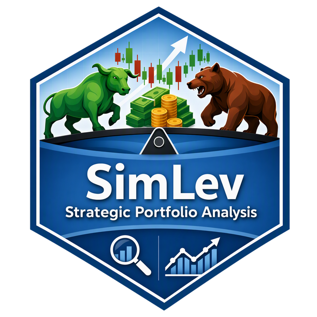

<p align="center">
  
</p>

<h1 align="center">SimLev für R</h1>

<p align="center">
  <strong>Simulation und Backtesting für Basis-, Hebel- und Multi-Asset-Strategien für Exchange Traded Products</strong>
</p>

---

Dies ist das R-Paket **SimLev**, eine von drei gleichwertigen Fassungen. Die
Rechenkerne liegen als gemeinsamer C/C++-Code in [`core/`](../core/); R,
Python und Julia bilden die Schnittstelle darum (Eingabeprüfung,
Datenaufbereitung, Ablauf, Ergebnisobjekte, Druck, Grafik), haben dieselben
Funktionen und rechnen bitgleich (siehe
[Haupt-README](../README.md#bitgleichheit)). Das Paket braucht außer Basis-R
keine weiteren Pakete und enthält keinen Code aus fremden Paketen; die
Quellen der Verfahren stehen in [`LITERATUR.md`](../LITERATUR.md).

**Einstieg:** das Tutorial als Vignette
([`vignettes/getting-started.Rmd`](vignettes/getting-started.Rmd), im
installierten Paket `vignette("getting-started", package = "SimLev")`) mit
Daten, Strategie, `simulation()` mit allen Bausteinen, Auswertung,
Bootstrap, Entnahme, Optimierung und Grafik.

## Installation

SimLev enthält C- und C++-Code und wird aus dem Quellcode übersetzt. Neben
**R ≥ 4.0** brauchen Sie einen Compiler:

| Betriebssystem | Was Sie benötigen |
|---|---|
| Windows | [Rtools](https://cran.r-project.org/bin/windows/Rtools/) in der zu Ihrer R-Version passenden Ausgabe |
| macOS | Xcode Command Line Tools (`xcode-select --install` im Terminal) |
| Linux | `build-essential` bzw. `gcc`/`g++` und die R-Entwicklungspakete (z. B. `r-base-dev`) |

<!-- beispiele: nicht ausführen -->
``` r
# install.packages("remotes")
remotes::install_github("chemicalstats/SimLev-Repos", subdir = "r")

# oder aus einem lokalen Quellarchiv (R CMD build r)
install.packages("SimLev_<Version>.tar.gz", repos = NULL, type = "source")
```

Optional: `knitr` und `rmarkdown` zum Bauen der Vignette. Technische
Indikatoren für eigene Signale berechnet z. B. das Paket `TTR`; es ist keine
Abhängigkeit von SimLev.

## Kurzbeispiel

``` r
library(SimLev)

set.seed(42)
n <- 365 * 10
data <- data.frame(
  date  = seq.Date(as.Date("2015-01-01"), by = "day", length.out = n),
  WORLD = 100 * cumprod(1 + rnorm(n, 4e-4, 0.010)),
  BONDS =  50 * cumprod(1 + rnorm(n, 1e-4, 0.003))
)
strategy <- create_strategy(
  WORLD = asset_config("etf", trading = "bnh", share = 0.7, spread = 0.1, partial_exemption = 30),
  BONDS = asset_config("etf", trading = "bnh", share = 0.3, spread = 0.1, partial_exemption = 0)
)
result <- simulation(data, strategy, start_value = 10000,
                     rebalance = rebalance_plan(span = 1, unit = "year"),
                     tax = tax_profile(rate = 26.375), liquidate = TRUE, risk_free = 2)
tail(result$worth, 1)
```

``` text
[1] 17765.2
```

`print(result)` zeigt alle Kennzahlen, `plot(result)` das Dashboard.

## Hilfe

- `?SimLev`: Arbeitsweise und Glossar der Einheiten und Argumentnamen.
- `?simulation` und `?sim_blocks`: die Engine und ihre Bausteine
  (`sim_costs()`, `dca_plan()`, `rebalance_plan()`, `split_rule()`,
  `tax_profile()`); `?tax_tariff`, `?wrapper_config`, `?rebalance_trigger`.
- `?plot.SimLevResult`: Dashboard und Export.
- Erweiterungen: `?backcast_fit`, `?bootstrap_study`,
  `?withdrawal_simulation`, `?result_analysis`, `?param_search`,
  `?series_align`, `?dependence_analysis`, `?tactical_simulation`,
  `?portfolio_optimize`, `?scenario_entropy_pooling`, `?planning_goal`,
  `?sharpe_test`, `?regime_hmm`.
- [`inst/examples/`](inst/examples/) (im Paket
  `system.file("examples", package = "SimLev")`): Beispielsammlungen zu
  Strategie-Objekten, Dashboards, Backcast, Bootstrap und Entnahme sowie
  Vorlagen für eigene Rebalancing-Trigger.
- [`NEWS.md`](NEWS.md) bzw. `news(package = "SimLev")`: Änderungen je Version.
- Zuordnung der Funktionen zu Python und Julia:
  [`STRUKTUR.md`](../STRUKTUR.md).

## Entwicklung und Tests

Bauen, Prüfen und den Abgleich der C-Quellen beschreibt
[`DEVELOPING.md`](DEVELOPING.md). Die Tests gehören nicht zum Paket; sie
liegen im Ordner `tests/` des Repositorys.

## Lizenz

GPL-3. Siehe [LICENSE.md](../LICENSE.md) im Hauptverzeichnis.
